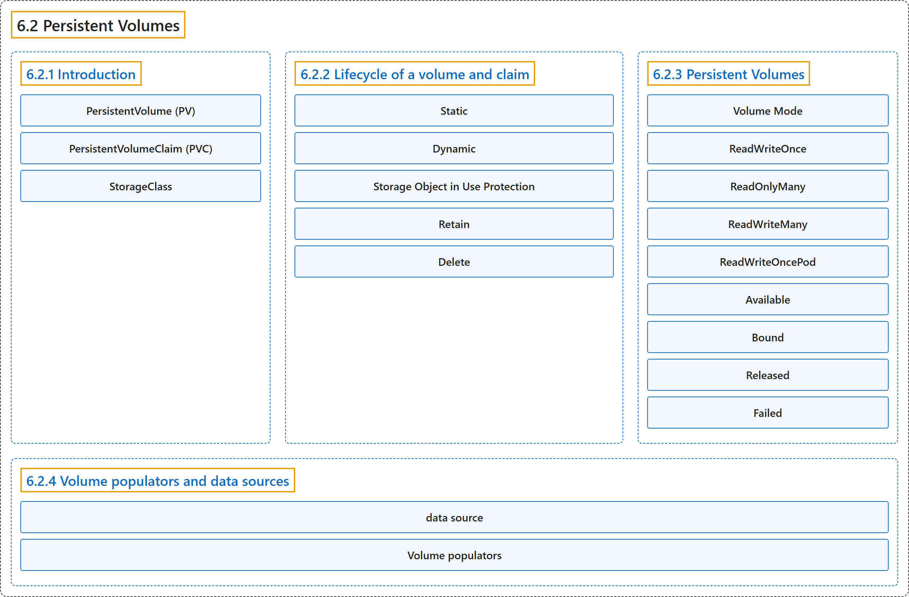

# 6.2 Persistent Volumes

## Classification

## Glossary

| Term | Definition | 中文翻译 | Source |
|---|---|---|---|
| **6.2 Persistent Volumes** 持久卷 | (context) "Managing storage is **a distinct problem from managing compute instances**." | （语境）管理存储是**一个与管理计算实例截然不同的问题**。 | [The Kubernetes Authors, n.d., "Introduction", para. 1](https://kubernetes.io/docs/concepts/storage/persistent-volumes/#:~:text=Managing%20storage%20is%20a%20distinct%20problem%20from) |
| **6.2.1 Introduction** 介绍 | (No definition) | （无定义） | [The Kubernetes Authors, n.d., "Introduction"](https://kubernetes.io/docs/concepts/storage/persistent-volumes/#introduction) |
| **PersistentVolume (PV)** PersistentVolume（PV） | "A *PersistentVolume* (PV) is **a piece of storage in the cluster that has been provisioned by an administrator or dynamically provisioned using [Storage Classes](https://kubernetes.io/docs/concepts/storage/storage-classes/)**." | *PersistentVolume*（PV）是**集群中由管理员供应、或使用[存储类](https://kubernetes.io/docs/concepts/storage/storage-classes/)动态供应的一块存储**。 | [The Kubernetes Authors, n.d., "Introduction", para. 2](https://kubernetes.io/docs/concepts/storage/persistent-volumes/#:~:text=A%20%2APersistentVolume%2A%20%28PV%29%20is%20a%20piece%20of) |
| **PersistentVolumeClaim (PVC)** PersistentVolumeClaim（PVC） | "A *PersistentVolumeClaim* (PVC) is **a request for storage by a user**." | *PersistentVolumeClaim*（PVC）是**用户对存储的请求**。 | [The Kubernetes Authors, n.d., "Introduction", para. 3](https://kubernetes.io/docs/concepts/storage/persistent-volumes/#:~:text=A%20%2APersistentVolumeClaim%2A%20%28PVC%29%20is%20a%20request%20for) |
| **StorageClass** StorageClass | (context) "For these needs, there is the *StorageClass* resource." | （语境）针对这些需求，有 *StorageClass* 资源。 | [The Kubernetes Authors, n.d., "Introduction", para. 4](https://kubernetes.io/docs/concepts/storage/persistent-volumes/#:~:text=For%20these%20needs%2C%20there%20is%20the%20%2AStorageClass%2A) |
| **6.2.2 Lifecycle of a volume and claim** 卷与申领的生命周期 | "PVs are **resources in the cluster**." | PV 是**集群中的资源**。 | [The Kubernetes Authors, n.d., "Lifecycle of a volume and claim", para. 1](https://kubernetes.io/docs/concepts/storage/persistent-volumes/#:~:text=PVs%20are%20resources%20in%20the%20cluster.) |
| **Static** 静态 | (context) "A cluster administrator **creates a number of PVs**." | （语境）集群管理员**创建若干 PV**。 | [The Kubernetes Authors, n.d., "Static", para. 1](https://kubernetes.io/docs/concepts/storage/persistent-volumes/#:~:text=A%20cluster%20administrator%20creates%20a%20number%20of) |
| **Dynamic** 动态 | "When none of the static PVs the administrator created match a user's PersistentVolumeClaim, **the cluster may try to dynamically provision a volume specially for the PVC**." | 当管理员创建的静态 PV 都不匹配用户的 PersistentVolumeClaim 时，**集群可能尝试专门为该 PVC 动态供应一个卷**。 | [The Kubernetes Authors, n.d., "Dynamic", para. 1](https://kubernetes.io/docs/concepts/storage/persistent-volumes/#:~:text=When%20none%20of%20the%20static%20PVs%20the) |
| **Storage Object in Use Protection** 使用中存储对象保护 | "The purpose of the Storage Object in Use Protection feature is **to ensure that PersistentVolumeClaims (PVCs) in active use by a Pod and PersistentVolume (PVs) that are bound to PVCs are not removed from the system**" | 使用中存储对象保护功能的目的是**确保正被 Pod 使用的 PersistentVolumeClaim（PVC）以及绑定到 PVC 的 PersistentVolume（PV）不会被从系统中删除** | [The Kubernetes Authors, n.d., "Storage Object in Use Protection", para. 1](https://kubernetes.io/docs/concepts/storage/persistent-volumes/#:~:text=The%20purpose%20of%20the%20Storage%20Object%20in) |
| **Retain** Retain | "The `Retain` reclaim policy **allows for manual reclamation of the resource**." | `Retain` 回收策略**允许手动回收资源**。 | [The Kubernetes Authors, n.d., "Retain", para. 1](https://kubernetes.io/docs/concepts/storage/persistent-volumes/#:~:text=The%20%60Retain%60%20reclaim%20policy%20allows%20for%20manual) |
| **Delete** Delete | "For volume plugins that support the `Delete` reclaim policy, **deletion removes both the PersistentVolume object from Kubernetes, as well as the associated storage asset in the external infrastructure**." | 对于支持 `Delete` 回收策略的卷插件，**删除操作会同时移除 Kubernetes 中的 PersistentVolume 对象以及外部基础设施中关联的存储资产**。 | [The Kubernetes Authors, n.d., "Delete", para. 1](https://kubernetes.io/docs/concepts/storage/persistent-volumes/#:~:text=For%20volume%20plugins%20that%20support%20the%20%60Delete%60) |
| **6.2.3 Persistent Volumes** 持久卷 | "Each PV contains **a spec and status, which is the specification and status of the volume**." | 每个 PV 都包含**规约和状态，即卷的规格和状态**。 | [The Kubernetes Authors, n.d., "Persistent Volumes", para. 1](https://kubernetes.io/docs/concepts/storage/persistent-volumes/#:~:text=Each%20PV%20contains%20a%20spec%20and%20status%2C) |
| **Volume Mode** 卷模式 | "Kubernetes supports **two `volumeModes` of PersistentVolumes: `Filesystem` and `Block`**." | Kubernetes 支持 PersistentVolume 的**两种 `volumeModes`：`Filesystem` 和 `Block`**。 | [The Kubernetes Authors, n.d., "Volume Mode", para. 1](https://kubernetes.io/docs/concepts/storage/persistent-volumes/#:~:text=Kubernetes%20supports%20two%20%60volumeModes%60%20of%20PersistentVolumes%3A%20%60Filesystem%60) |
| **ReadWriteOnce** ReadWriteOnce | "**the volume can be mounted as read-write by a single node.**" | **卷可以被单个节点以读写方式挂载。** | [The Kubernetes Authors, n.d., "Access Modes", para. 4](https://kubernetes.io/docs/concepts/storage/persistent-volumes/#:~:text=the%20volume%20can%20be%20mounted%20as%20read-write) |
| **ReadOnlyMany** ReadOnlyMany | "**the volume can be mounted as read-only by many nodes.**" | **卷可以被多个节点以只读方式挂载。** | [The Kubernetes Authors, n.d., "Access Modes", para. 6](https://kubernetes.io/docs/concepts/storage/persistent-volumes/#:~:text=the%20volume%20can%20be%20mounted%20as%20read-only) |
| **ReadWriteMany** ReadWriteMany | "**the volume can be mounted as read-write by many nodes.**" | **卷可以被多个节点以读写方式挂载。** | [The Kubernetes Authors, n.d., "Access Modes", para. 8](https://kubernetes.io/docs/concepts/storage/persistent-volumes/#:~:text=the%20volume%20can%20be%20mounted%20as%20read-write) |
| **ReadWriteOncePod** ReadWriteOncePod | "**the volume can be mounted as read-write by a single Pod.**" | **卷可以被单个 Pod 以读写方式挂载。** | [The Kubernetes Authors, n.d., "Access Modes", para. 10](https://kubernetes.io/docs/concepts/storage/persistent-volumes/#:~:text=the%20volume%20can%20be%20mounted%20as%20read-write) |
| **Available** Available | "**a free resource that is not yet bound to a claim**" | **尚未绑定到申领的空闲资源** | [The Kubernetes Authors, n.d., "Phase", para. 3](https://kubernetes.io/docs/concepts/storage/persistent-volumes/#:~:text=a%20free%20resource%20that%20is%20not%20yet) |
| **Bound** Bound | "**the volume is bound to a claim**" | **卷已绑定到申领** | [The Kubernetes Authors, n.d., "Phase", para. 5](https://kubernetes.io/docs/concepts/storage/persistent-volumes/#:~:text=the%20volume%20is%20bound%20to%20a%20claim) |
| **Released** Released | "**the claim has been deleted, but the associated storage resource is not yet reclaimed by the cluster**" | **申领已被删除，但关联的存储资源尚未被集群回收** | [The Kubernetes Authors, n.d., "Phase", para. 7](https://kubernetes.io/docs/concepts/storage/persistent-volumes/#:~:text=the%20claim%20has%20been%20deleted%2C%20but%20the) |
| **Failed** Failed | "**the volume has failed its (automated) reclamation**" | **卷的（自动）回收失败** | [The Kubernetes Authors, n.d., "Phase", para. 9](https://kubernetes.io/docs/concepts/storage/persistent-volumes/#:~:text=the%20volume%20has%20failed%20its%20%28automated%29%20reclamation) |
| **6.2.4 Volume populators and data sources** 卷填充器与数据源 | (No definition) | （无定义） | [The Kubernetes Authors, n.d., "Volume populators and data sources"](https://kubernetes.io/docs/concepts/storage/persistent-volumes/#volume-populators-and-data-sources) |
| **data source** 数据源 | "[Volume cloning](#volume-cloning) and [snapshot restore](#volume-snapshot-and-restore-volume-from-snapshot-support) **pre-populate a new volume from a built-in *data source***." | [卷克隆](#volume-cloning)和[快照恢复](#volume-snapshot-and-restore-volume-from-snapshot-support)**从内置的*数据源*预先填充新卷**。 | [The Kubernetes Authors, n.d., "Volume populators and data sources", para. 1](https://kubernetes.io/docs/concepts/storage/persistent-volumes/#:~:text=%5BVolume%20cloning%5D%28%23volume-cloning%29%20and%20%5Bsnapshot%20restore%5D%28%23volume-snapshot-and-restore-volume-from-snapshot-support%29%20pre-populate%20a) |
| **Volume populators** 卷填充器 | "*Volume populators* **extend this mechanism so that a PersistentVolumeClaim can be pre-populated from other kinds of source (a custom resource)**" | *卷填充器***扩展了这一机制，使 PersistentVolumeClaim 可以从其他类型的源（自定义资源）预先填充** | [The Kubernetes Authors, n.d., "Volume populators and data sources", para. 1](https://kubernetes.io/docs/concepts/storage/persistent-volumes/#:~:text=%2AVolume%20populators%2A%20extend%20this%20mechanism%20so%20that) |

## References

The Kubernetes Authors. (n.d.). *Persistent Volumes*. Kubernetes Documentation. Retrieved October 31, 2026, from <https://kubernetes.io/docs/concepts/storage/persistent-volumes/>
