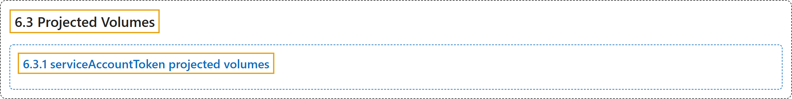

# 6.3 Projected Volumes

## Classification

## Glossary

| Term | Definition | 中文翻译 | Source |
|---|---|---|---|
| **6.3 Projected Volumes** 投射卷 | "**A `projected` volume** maps **several existing volume sources into the same directory**." | **`projected` 卷**会把**若干现有卷源映射到同一个目录**。 | [The Kubernetes Authors, n.d., "Introduction", para. 1](https://kubernetes.io/docs/concepts/storage/projected-volumes/#:~:text=A%20%60projected%60%20volume%20maps%20several%20existing%20volume) |
| **6.3.1 serviceAccountToken projected volumes** serviceAccountToken 投射卷 | "You can **inject the token for the current service account** into a Pod at **a specified path**." | 你可以**把当前服务账号的令牌注入** Pod 的**指定路径**。 | [The Kubernetes Authors, n.d., "serviceAccountToken projected volumes", para. 1](https://kubernetes.io/docs/concepts/storage/projected-volumes/#:~:text=You%20can%20inject%20the%20token%20for%20the) |

## References

The Kubernetes Authors. (n.d.). *Projected Volumes*. Kubernetes Documentation. Retrieved October 31, 2026, from <https://kubernetes.io/docs/concepts/storage/projected-volumes/>
