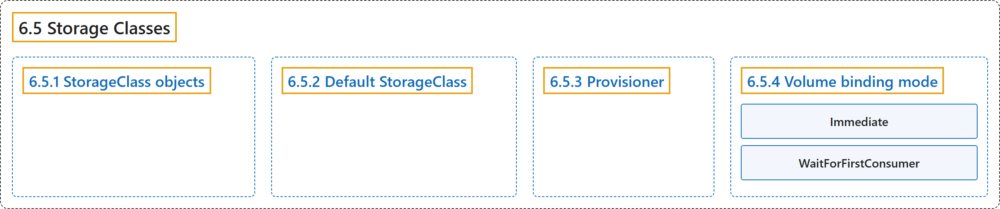

# 6.5 Storage Classes

## Classification

## Glossary

| Term | Definition | 中文翻译 | Source |
|---|---|---|---|
| **6.5 Storage Classes** 存储类 | "A StorageClass provides **a way for administrators to describe the *classes* of storage they offer**." | StorageClass 提供**一种方式，让管理员描述他们提供的存储*类别***。 | [The Kubernetes Authors, n.d., "Storage Classes", para. 2](https://kubernetes.io/docs/concepts/storage/storage-classes/#:~:text=A%20StorageClass%20provides%20a%20way%20for%20administrators) |
| **6.5.1 StorageClass objects** StorageClass 对象 | "Each StorageClass contains **the fields `provisioner`, `parameters`, and `reclaimPolicy`**, which are used when a PersistentVolume belonging to the class needs to be dynamically provisioned to satisfy a PersistentVolumeClaim (PVC)." | 每个 StorageClass 都包含 **`provisioner`、`parameters` 和 `reclaimPolicy` 字段**，在需要动态供应属于该类的 PersistentVolume 以满足 PersistentVolumeClaim（PVC）时使用。 | [The Kubernetes Authors, n.d., "StorageClass objects", para. 1](https://kubernetes.io/docs/concepts/storage/storage-classes/#:~:text=Each%20StorageClass%20contains%20the%20fields%20%60provisioner%60%2C%20%60parameters%60%2C) |
| **6.5.2 Default StorageClass** 默认 StorageClass | "You can **mark a StorageClass as the default for your cluster**." | 你可以**把一个 StorageClass 标记为集群的默认值**。 | [The Kubernetes Authors, n.d., "Default StorageClass", para. 1](https://kubernetes.io/docs/concepts/storage/storage-classes/#:~:text=You%20can%20mark%20a%20StorageClass%20as%20the) |
| **6.5.3 Provisioner** 供应者 | "Each StorageClass has a provisioner that **determines what volume plugin is used for provisioning PVs**." | 每个 StorageClass 都有一个供应者，**决定用哪个卷插件来供应 PV**。 | [The Kubernetes Authors, n.d., "Provisioner", para. 1](https://kubernetes.io/docs/concepts/storage/storage-classes/#:~:text=Each%20StorageClass%20has%20a%20provisioner%20that%20determines) |
| **6.5.4 Volume binding mode** 卷绑定模式 | "The `volumeBindingMode` field **controls when [volume binding and dynamic provisioning](https://kubernetes.io/docs/concepts/storage/persistent-volumes/#provisioning) should occur**." | `volumeBindingMode` 字段**控制[卷绑定和动态供应](https://kubernetes.io/docs/concepts/storage/persistent-volumes/#provisioning)何时发生**。 | [The Kubernetes Authors, n.d., "Volume binding mode", para. 1](https://kubernetes.io/docs/concepts/storage/storage-classes/#:~:text=The%20%60volumeBindingMode%60%20field%20controls%20when%20%5Bvolume%20binding) |
| **Immediate** Immediate | "The `Immediate` mode indicates that **volume binding and dynamic provisioning occurs once the PersistentVolumeClaim is created**." | `Immediate` 模式表示**一旦创建 PersistentVolumeClaim，就立即进行卷绑定和动态供应**。 | [The Kubernetes Authors, n.d., "Volume binding mode", para. 2](https://kubernetes.io/docs/concepts/storage/storage-classes/#:~:text=The%20%60Immediate%60%20mode%20indicates%20that%20volume%20binding) |
| **WaitForFirstConsumer** WaitForFirstConsumer | "`WaitForFirstConsumer` mode which will **delay the binding and provisioning of a PersistentVolume until a Pod using the PersistentVolumeClaim is created**." | `WaitForFirstConsumer` 模式会**推迟 PersistentVolume 的绑定和供应，直到使用该 PersistentVolumeClaim 的 Pod 被创建**。 | [The Kubernetes Authors, n.d., "Volume binding mode", para. 3](https://kubernetes.io/docs/concepts/storage/storage-classes/#:~:text=%60WaitForFirstConsumer%60%20mode%20which%20will%20delay%20the%20binding) |

## References

The Kubernetes Authors. (n.d.). *Storage Classes*. Kubernetes Documentation. Retrieved October 31, 2026, from <https://kubernetes.io/docs/concepts/storage/storage-classes/>
