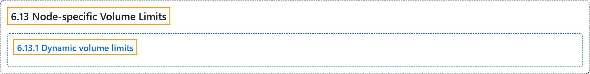

# 6.13 Node-specific Volume Limits

## Classification

## Glossary

| Term | Definition | 中文翻译 | Source |
|---|---|---|---|
| **6.13 Node-specific Volume Limits** 节点特定的卷数限制 | (context) "**Cloud providers like Google, Amazon, and Microsoft** typically have **a limit on how many volumes can be attached to a Node**." | （语境）**Google、Amazon 和 Microsoft 等云服务商**通常**对一个节点可挂接的卷数量有上限**。 | [The Kubernetes Authors, n.d., "Node-specific Volume Limits", para. 2](https://kubernetes.io/docs/concepts/storage/storage-limits/#:~:text=Cloud%20providers%20like%20Google%2C%20Amazon%2C%20and%20Microsoft) |
| **6.13.1 Dynamic volume limits** 动态卷数限制 | (context) "**Dynamic volume limits** are **supported for following volume types**." | （语境）**动态卷数限制**在**以下卷类型上受支持**。 | [The Kubernetes Authors, n.d., "Dynamic volume limits", para. 1](https://kubernetes.io/docs/concepts/storage/storage-limits/#:~:text=Dynamic%20volume%20limits%20are%20supported%20for%20following) |

## References

The Kubernetes Authors. (n.d.). *Node-specific Volume Limits*. Kubernetes Documentation. Retrieved October 31, 2026, from <https://kubernetes.io/docs/concepts/storage/storage-limits/>
