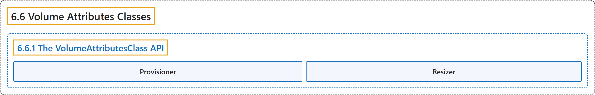

# 6.6 Volume Attributes Classes

## Classification

## Glossary

| Term | Definition | 中文翻译 | Source |
|---|---|---|---|
| **6.6 Volume Attributes Classes** 卷属性类 | "**A VolumeAttributesClass** provides a way for administrators to **describe the mutable "classes" of storage they offer**." | **VolumeAttributesClass** 提供一种方式，让管理员**描述他们提供的可变存储类别**。 | [The Kubernetes Authors, n.d., "Volume Attributes Classes", para. 3](https://kubernetes.io/docs/concepts/storage/volume-attributes-classes/#:~:text=A%20VolumeAttributesClass%20provides%20a%20way%20for%20administrators) |
| **6.6.1 The VolumeAttributesClass API** VolumeAttributesClass API | (No definition) | （无定义） | [The Kubernetes Authors, n.d., "The VolumeAttributesClass API"](https://kubernetes.io/docs/concepts/storage/volume-attributes-classes/#the-volumeattributesclass-api) |
| **Provisioner** 供应者 | "**Each VolumeAttributesClass has a provisioner** that **determines what volume plugin is used for provisioning PVs**." | **每个 VolumeAttributesClass 都有一个供应者**，它**决定用哪个卷插件来供应 PV**。 | [The Kubernetes Authors, n.d., "Provisioner", para. 1](https://kubernetes.io/docs/concepts/storage/volume-attributes-classes/#:~:text=Each%20VolumeAttributesClass%20has%20a%20provisioner%20that%20determines) |
| **Resizer** 调整器 | "**Each VolumeAttributesClass has a resizer** that **determines what volume plugin is used for modifying PVs**." | **每个 VolumeAttributesClass 都有一个调整器**，它**决定用哪个卷插件来修改 PV**。 | [The Kubernetes Authors, n.d., "Resizer", para. 1](https://kubernetes.io/docs/concepts/storage/volume-attributes-classes/#:~:text=Each%20VolumeAttributesClass%20has%20a%20resizer%20that%20determines) |

## References

The Kubernetes Authors. (n.d.). *Volume Attributes Classes*. Kubernetes Documentation. Retrieved October 31, 2026, from <https://kubernetes.io/docs/concepts/storage/volume-attributes-classes/>
