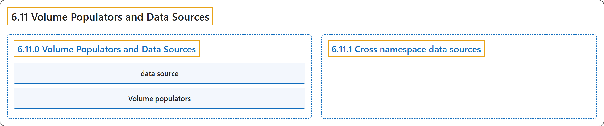

# 6.11 Volume Populators and Data Sources

## Classification

## Glossary

| Term | Definition | 中文翻译 | Source |
|---|---|---|---|
| **6.11 Volume Populators and Data Sources** 卷填充器与数据源 | (context) "When you create a [PersistentVolumeClaim](https://kubernetes.io/docs/concepts/storage/persistent-volumes/#persistentvolumeclaims), **the volume that Kubernetes provisions for it normally starts empty**." | （语境）当你创建 [PersistentVolumeClaim](https://kubernetes.io/docs/concepts/storage/persistent-volumes/#persistentvolumeclaims) 时，**Kubernetes 为它供应的卷通常一开始是空的**。 | [The Kubernetes Authors, n.d., "Volume Populators and Data Sources", para. 2](https://kubernetes.io/docs/concepts/storage/volume-populators-and-data-sources/#:~:text=When%20you%20create%20a%20%5BPersistentVolumeClaim%5D%28https%3A%2F%2Fkubernetes.io%2Fdocs%2Fconcepts%2Fstorage%2Fpersistent-volumes%2F%23persistentvolumeclaims%29%2C%20the%20volume) |
| **6.11.0 Volume Populators and Data Sources** 卷填充器与数据源 | (No definition) | （无定义） | [The Kubernetes Authors, n.d., "Volume Populators and Data Sources"](https://kubernetes.io/docs/concepts/storage/volume-populators-and-data-sources/#volume-populators-and-data-sources) |
| **data source** 数据源 | "A *data source* lets you instead **request that the new volume be pre-populated with existing data**." | *数据源*让你**请求新卷预先填充已有的数据**。 | [The Kubernetes Authors, n.d., "Volume Populators and Data Sources", para. 2](https://kubernetes.io/docs/concepts/storage/volume-populators-and-data-sources/#:~:text=A%20%2Adata%20source%2A%20lets%20you%20instead%20request) |
| **Volume populators** 卷填充器 | "*Volume populators* are **the controllers that carry out that population, based on the data source that the PersistentVolumeClaim references**." | *卷填充器*是**根据 PersistentVolumeClaim 引用的数据源执行填充的控制器**。 | [The Kubernetes Authors, n.d., "Volume Populators and Data Sources", para. 2](https://kubernetes.io/docs/concepts/storage/volume-populators-and-data-sources/#:~:text=%2AVolume%20populators%2A%20are%20the%20controllers%20that%20carry) |
| **6.11.1 Cross namespace data sources** 跨命名空间数据源 | "Kubernetes **supports cross namespace volume data sources**." | Kubernetes **支持跨命名空间的卷数据源**。 | [The Kubernetes Authors, n.d., "Cross namespace data sources", para. 1](https://kubernetes.io/docs/concepts/storage/volume-populators-and-data-sources/#:~:text=Kubernetes%20supports%20cross%20namespace%20volume%20data%20sources.) |

## References

The Kubernetes Authors. (n.d.). *Volume Populators and Data Sources*. Kubernetes Documentation. Retrieved October 31, 2026, from <https://kubernetes.io/docs/concepts/storage/volume-populators-and-data-sources/>
