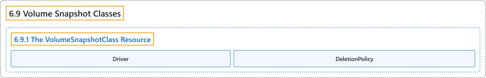

# 6.9 Volume Snapshot Classes

## Classification

## Glossary

| Term | Definition | 中文翻译 | Source |
|---|---|---|---|
| **6.9 Volume Snapshot Classes** 卷快照类 | "VolumeSnapshotClass **provides a way to describe the "classes" of storage when provisioning a volume snapshot**." | VolumeSnapshotClass **提供一种方式，在供应卷快照时描述存储的“类别”**。 | [The Kubernetes Authors, n.d., "Introduction", para. 1](https://kubernetes.io/docs/concepts/storage/volume-snapshot-classes/#:~:text=VolumeSnapshotClass%20provides%20a%20way%20to%20describe%20the) |
| **6.9.1 The VolumeSnapshotClass Resource** VolumeSnapshotClass 资源 | (No definition) | （无定义） | [The Kubernetes Authors, n.d., "The VolumeSnapshotClass Resource"](https://kubernetes.io/docs/concepts/storage/volume-snapshot-classes/#the-volumesnapshotclass-resource) |
| **Driver** 驱动 | "Volume snapshot classes have a driver that **determines what CSI volume plugin is used for provisioning VolumeSnapshots**." | 卷快照类有一个驱动，**决定用哪个 CSI 卷插件来供应 VolumeSnapshot**。 | [The Kubernetes Authors, n.d., "Driver", para. 1](https://kubernetes.io/docs/concepts/storage/volume-snapshot-classes/#:~:text=Volume%20snapshot%20classes%20have%20a%20driver%20that) |
| **DeletionPolicy** DeletionPolicy | "Volume snapshot classes **have a [deletionPolicy](https://kubernetes.io/docs/concepts/storage/volume-snapshots/#delete)**." | 卷快照类**有一个 [deletionPolicy](https://kubernetes.io/docs/concepts/storage/volume-snapshots/#delete)**。 | [The Kubernetes Authors, n.d., "DeletionPolicy", para. 1](https://kubernetes.io/docs/concepts/storage/volume-snapshot-classes/#:~:text=Volume%20snapshot%20classes%20have%20a%20%5BdeletionPolicy%5D%28https%3A%2F%2Fkubernetes.io%2Fdocs%2Fconcepts%2Fstorage%2Fvolume-snapshots%2F%23delete%29.) |

## References

The Kubernetes Authors. (n.d.). *Volume Snapshot Classes*. Kubernetes Documentation. Retrieved October 31, 2026, from <https://kubernetes.io/docs/concepts/storage/volume-snapshot-classes/>
