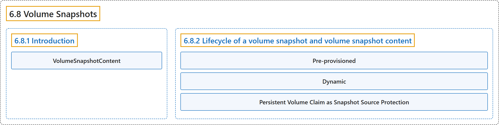

# 6.8 Volume Snapshots

## Classification

## Glossary

| Term | Definition | 中文翻译 | Source |
|---|---|---|---|
| **6.8 Volume Snapshots** 卷快照 | "In Kubernetes, a *VolumeSnapshot* **represents a snapshot of a volume on a storage system**." | 在 Kubernetes 中，*VolumeSnapshot* **代表存储系统上一个卷的快照**。 | [The Kubernetes Authors, n.d., "Volume Snapshots", para. 1](https://kubernetes.io/docs/concepts/storage/volume-snapshots/#:~:text=In%20Kubernetes%2C%20a%20%2AVolumeSnapshot%2A%20represents%20a%20snapshot) |
| **6.8.1 Introduction** 介绍 | (No definition) | （无定义） | [The Kubernetes Authors, n.d., "Introduction"](https://kubernetes.io/docs/concepts/storage/volume-snapshots/#introduction) |
| **VolumeSnapshotContent** VolumeSnapshotContent | (context) "`VolumeSnapshotContents` are **resources in the cluster**." | （语境）`VolumeSnapshotContent` 是**集群中的资源**。 | [The Kubernetes Authors, n.d., "Lifecycle of a volume snapshot and volume snapshot content", para. 1](https://kubernetes.io/docs/concepts/storage/volume-snapshots/#:~:text=%60VolumeSnapshotContents%60%20are%20resources%20in%20the%20cluster.) |
| **6.8.2 Lifecycle of a volume snapshot and volume snapshot content** 卷快照与卷快照内容的生命周期 | "There are **two ways snapshots may be provisioned: pre-provisioned or dynamically provisioned**." | 快照有**两种供应方式：预先供应或动态供应**。 | [The Kubernetes Authors, n.d., "Provisioning Volume Snapshot", para. 1](https://kubernetes.io/docs/concepts/storage/volume-snapshots/#:~:text=There%20are%20two%20ways%20snapshots%20may%20be) |
| **Pre-provisioned** 预先供应 | (context) "A cluster administrator **creates a number of `VolumeSnapshotContents`**." | （语境）集群管理员**创建若干 `VolumeSnapshotContent`**。 | [The Kubernetes Authors, n.d., "Pre-provisioned", para. 1](https://kubernetes.io/docs/concepts/storage/volume-snapshots/#:~:text=A%20cluster%20administrator%20creates%20a%20number%20of) |
| **Dynamic** 动态 | "Instead of using a pre-existing snapshot, you can **request that a snapshot to be dynamically taken from a PersistentVolumeClaim**." | 你可以不使用已有的快照，而是**请求从某个 PersistentVolumeClaim 动态拍摄快照**。 | [The Kubernetes Authors, n.d., "Dynamic", para. 1](https://kubernetes.io/docs/concepts/storage/volume-snapshots/#:~:text=Instead%20of%20using%20a%20pre-existing%20snapshot%2C%20you) |
| **Persistent Volume Claim as Snapshot Source Protection** 作为快照源的 PVC 保护 | "The purpose of this protection is to **ensure that in-use [PersistentVolumeClaim](https://kubernetes.io/docs/concepts/storage/persistent-volumes/#persistentvolumeclaims) API objects are not removed from the system while a snapshot is being taken from it**" | 这项保护的目的是**确保正被拍摄快照的 [PersistentVolumeClaim](https://kubernetes.io/docs/concepts/storage/persistent-volumes/#persistentvolumeclaims) API 对象不会被从系统中删除** | [The Kubernetes Authors, n.d., "Persistent Volume Claim as Snapshot Source Protection", para. 1](https://kubernetes.io/docs/concepts/storage/volume-snapshots/#:~:text=The%20purpose%20of%20this%20protection%20is%20to) |

## References

The Kubernetes Authors. (n.d.). *Volume Snapshots*. Kubernetes Documentation. Retrieved October 31, 2026, from <https://kubernetes.io/docs/concepts/storage/volume-snapshots/>
