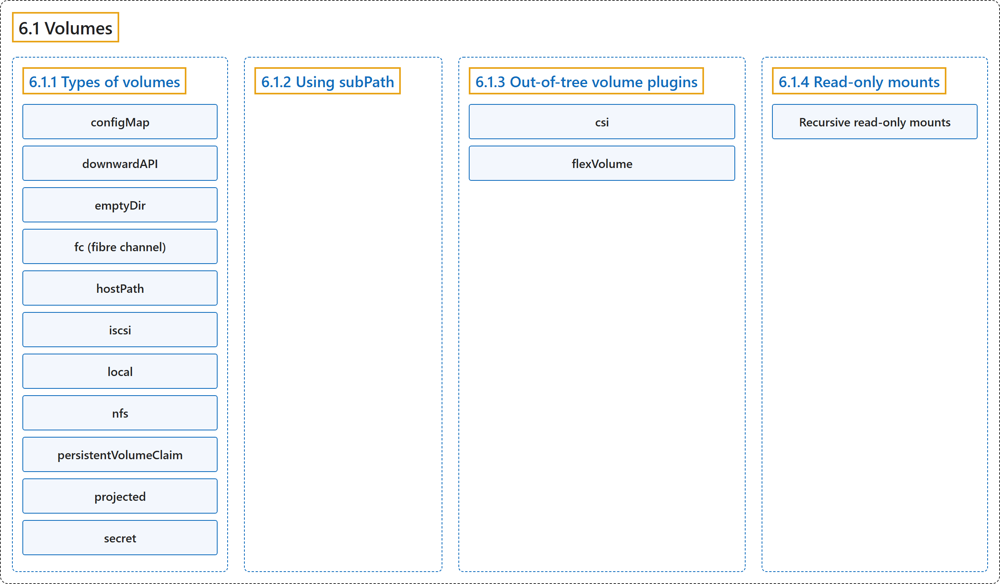

# 6.1 Volumes

## Classification

## Glossary

| Term | Definition | 中文翻译 | Source |
|---|---|---|---|
| **6.1 Volumes** 卷 | "Kubernetes *volumes* **provide a way for containers in a Pod** to **access and share data via the filesystem**." | Kubernetes *卷* **为 Pod 中的容器提供一种方式**，用来**通过文件系统访问和共享数据**。 | [The Kubernetes Authors, n.d., "Volumes", para. 1](https://kubernetes.io/docs/concepts/storage/volumes/#:~:text=Kubernetes%20%2Avolumes%2A%20provide%20a%20way%20for%20containers) |
| **6.1.1 Types of volumes** 卷的类型 | "**Kubernetes** supports **several types of volumes**." | **Kubernetes** 支持**多种类型的卷**。 | [The Kubernetes Authors, n.d., "Types of volumes", para. 1](https://kubernetes.io/docs/concepts/storage/volumes/#:~:text=Kubernetes%20supports%20several%20types%20of%20volumes.) |
| **configMap** configMap | "**A ConfigMap** provides a way to **inject configuration data into Pods**." | **ConfigMap** 提供一种**把配置数据注入 Pod** 的方式。 | [The Kubernetes Authors, n.d., "configMap", para. 1](https://kubernetes.io/docs/concepts/storage/volumes/#:~:text=A%20%5BConfigMap%5D%28https%3A%2F%2Fkubernetes.io%2Fdocs%2Ftasks%2Fconfigure-pod-container%2Fconfigure-pod-configmap%2F%29%20provides%20a%20way%20to%20inject) |
| **downwardAPI** downwardAPI | "**A `downwardAPI` volume** makes **downward API data available to applications**." | **`downwardAPI` 卷**让**应用可以使用 Downward API 数据**。 | [The Kubernetes Authors, n.d., "downwardAPI", para. 1](https://kubernetes.io/docs/concepts/storage/volumes/#:~:text=A%20%60downwardAPI%60%20volume%20makes%20%5Bdownward%20API%5D%28https%3A%2F%2Fkubernetes.io%2Fdocs%2Fconcepts%2Fworkloads%2Fpods%2Fdownward-api%2F%29%20data) |
| **emptyDir** emptyDir | "For **a Pod that defines an `emptyDir` volume**, **the volume is created when the Pod is assigned to a node**." | 对于**定义了 `emptyDir` 卷的 Pod** 来说，**该卷在 Pod 被分配到节点时创建**。 | [The Kubernetes Authors, n.d., "emptyDir", para. 1](https://kubernetes.io/docs/concepts/storage/volumes/#:~:text=For%20a%20Pod%20that%20defines%20an%20%60emptyDir%60) |
| **fc (fibre channel)** fc（光纤通道） | "**An `fc` volume type** allows **an existing fibre channel block storage volume to be mounted in a Pod**." | **`fc` 卷类型**允许**把现有的光纤通道块存储卷挂载到 Pod 中**。 | [The Kubernetes Authors, n.d., "fc (fibre channel)", para. 1](https://kubernetes.io/docs/concepts/storage/volumes/#:~:text=An%20%60fc%60%20volume%20type%20allows%20an%20existing) |
| **hostPath** hostPath | "**A `hostPath` volume** mounts **a file or directory from the host node's filesystem into your Pod**." | **`hostPath` 卷**会把**主机节点文件系统中的文件或目录挂载到 Pod 中**。 | [The Kubernetes Authors, n.d., "hostPath", para. 1](https://kubernetes.io/docs/concepts/storage/volumes/#:~:text=A%20%60hostPath%60%20volume%20mounts%20a%20file%20or) |
| **iscsi** iscsi | "**An `iscsi` volume** allows **an existing iSCSI (SCSI over IP) volume to be mounted into your Pod**." | **`iscsi` 卷**允许**把现有的 iSCSI（基于 IP 的 SCSI）卷挂载到 Pod 中**。 | [The Kubernetes Authors, n.d., "iscsi", para. 1](https://kubernetes.io/docs/concepts/storage/volumes/#:~:text=An%20%60iscsi%60%20volume%20allows%20an%20existing%20iSCSI) |
| **local** local | "**A `local` volume** represents **a mounted local storage device such as a disk, partition or directory**." | **`local` 卷**代表**一个已挂载的本地存储设备，例如磁盘、分区或目录**。 | [The Kubernetes Authors, n.d., "local", para. 1](https://kubernetes.io/docs/concepts/storage/volumes/#:~:text=A%20%60local%60%20volume%20represents%20a%20mounted%20local) |
| **nfs** nfs | "**An `nfs` volume** allows **an existing NFS (Network File System) share to be mounted into a Pod**." | **`nfs` 卷**允许**把现有的 NFS（网络文件系统）共享挂载到 Pod 中**。 | [The Kubernetes Authors, n.d., "nfs", para. 1](https://kubernetes.io/docs/concepts/storage/volumes/#:~:text=An%20%60nfs%60%20volume%20allows%20an%20existing%20NFS) |
| **persistentVolumeClaim** persistentVolumeClaim | "**A `persistentVolumeClaim` volume** is used to **mount a PersistentVolume into a Pod**." | **`persistentVolumeClaim` 卷**用于**把 PersistentVolume 挂载到 Pod 中**。 | [The Kubernetes Authors, n.d., "persistentVolumeClaim", para. 1](https://kubernetes.io/docs/concepts/storage/volumes/#:~:text=A%20%60persistentVolumeClaim%60%20volume%20is%20used%20to%20mount) |
| **projected** projected | "**A projected volume** maps **several existing volume sources into the same directory**." | **投射卷**会把**若干现有卷源映射到同一个目录**。 | [The Kubernetes Authors, n.d., "projected", para. 1](https://kubernetes.io/docs/concepts/storage/volumes/#:~:text=A%20projected%20volume%20maps%20several%20existing%20volume) |
| **secret** secret | "**A `secret` volume** is used to **pass sensitive information, such as passwords, to Pods**." | **`secret` 卷**用于**向 Pod 传递密码等敏感信息**。 | [The Kubernetes Authors, n.d., "secret", para. 1](https://kubernetes.io/docs/concepts/storage/volumes/#:~:text=A%20%60secret%60%20volume%20is%20used%20to%20pass) |
| **6.1.2 Using subPath** 使用 subPath | "Sometimes, it is useful to **share one volume for multiple uses** in **a single Pod**." | 有时，**把一个卷共享给多种用途**（都在**单个 Pod** 内）很有用。 | [The Kubernetes Authors, n.d., "Using subPath", para. 1](https://kubernetes.io/docs/concepts/storage/volumes/#:~:text=Sometimes%2C%20it%20is%20useful%20to%20share%20one) |
| **6.1.3 Out-of-tree volume plugins** 树外卷插件 | "The out-of-tree volume plugins include **Container Storage Interface (CSI)**, and also **FlexVolume** (which is deprecated)." | 树外卷插件包括**容器存储接口**（CSI），以及 **FlexVolume**（已弃用）。 | [The Kubernetes Authors, n.d., "Out-of-tree volume plugins", para. 1](https://kubernetes.io/docs/concepts/storage/volumes/#:~:text=The%20out-of-tree%20volume%20plugins%20include%20%5BContainer%20Storage) |
| **csi** csi | "**Container Storage Interface** (CSI) **defines a standard interface** for container orchestration systems (like Kubernetes) to **expose arbitrary storage systems to their container workloads**." | **容器存储接口**（CSI）**定义了一个标准接口**，让容器编排系统（如 Kubernetes）**把任意存储系统暴露给其容器工作负载**。 | [The Kubernetes Authors, n.d., "csi", para. 1](https://kubernetes.io/docs/concepts/storage/volumes/#:~:text=%5BContainer%20Storage%20Interface%5D%28https%3A%2F%2Fgithub.com%2Fcontainer-storage-interface%2Fspec%2Fblob%2Fmaster%2Fspec.md%29%20%28CSI%29%20defines%20a%20standard) |
| **flexVolume** flexVolume | "**FlexVolume** is **an out-of-tree plugin interface** that uses **an exec-based model to interface with storage drivers**." | **FlexVolume** 是**一个树外插件接口**，使用**基于 exec 的模型与存储驱动交互**。 | [The Kubernetes Authors, n.d., "flexVolume (deprecated)", para. 1](https://kubernetes.io/docs/concepts/storage/volumes/#:~:text=FlexVolume%20is%20an%20out-of-tree%20plugin%20interface%20that) |
| **6.1.4 Read-only mounts** 只读挂载 | "A mount can be **made read-only** by **setting the `.spec.containers[*].volumeMounts[*].readOnly` field to `true`**." | 挂载可以**变为只读**，方法是**把 `.spec.containers[*].volumeMounts[*].readOnly` 字段设为 `true`**。 | [The Kubernetes Authors, n.d., "Read-only mounts", para. 1](https://kubernetes.io/docs/concepts/storage/volumes/#:~:text=A%20mount%20can%20be%20made%20read-only%20by) |
| **Recursive read-only mounts** 递归只读挂载 | (context) "**Recursive read-only mounts** can be enabled by **setting the `RecursiveReadOnlyMounts` feature gate for kubelet and kube-apiserver**" | （语境）**递归只读挂载**可以通过**为 kubelet 和 kube-apiserver 设置 `RecursiveReadOnlyMounts` 特性门控**来启用 | [The Kubernetes Authors, n.d., "Recursive read-only mounts", para. 2](https://kubernetes.io/docs/concepts/storage/volumes/#:~:text=Recursive%20read-only%20mounts%20can%20be%20enabled%20by) |

## References

The Kubernetes Authors. (n.d.). *Volumes*. Kubernetes Documentation. Retrieved October 31, 2026, from <https://kubernetes.io/docs/concepts/storage/volumes/>
