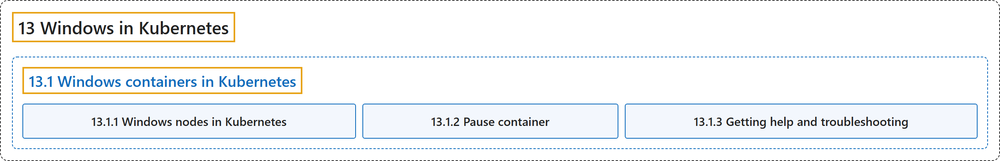

# 13 Windows in Kubernetes

## Classification

## Glossary

| Term | Definition | 中文翻译 | Source |
|---|---|---|---|
| **13 Windows in Kubernetes** Kubernetes 中的 Windows | (context) "**Kubernetes supports nodes that run Microsoft Windows.**" | （语境）**Kubernetes 支持运行 Microsoft Windows 的节点。** | [The Kubernetes Authors, n.d.-b, "Windows in Kubernetes", para. 1](https://kubernetes.io/docs/concepts/windows/#:~:text=Kubernetes%20supports%20nodes%20that%20run%20Microsoft%20Windows.) |
| **[13.1 Windows containers in Kubernetes](intro.md)** Kubernetes 中的 Windows 容器 | (context) "[Windows containers](https://aka.ms/windowscontainers) provide **a way to encapsulate processes and package dependencies**, making it easier to use DevOps practices and follow cloud native patterns for Windows applications." | （语境）[Windows 容器](https://aka.ms/windowscontainers)提供了**一种封装进程和打包依赖的方式**，让 Windows 应用更容易采用 DevOps 实践、遵循云原生模式。 | [The Kubernetes Authors, n.d.-a, "Windows containers in Kubernetes", para. 1](https://kubernetes.io/docs/concepts/windows/intro/#:~:text=%5BWindows%20containers%5D%28https%3A%2F%2Faka.ms%2Fwindowscontainers%29%20provide%20a%20way%20to%20encapsulate) |

## References

The Kubernetes Authors. (n.d.-a). *Windows containers in Kubernetes*. Kubernetes Documentation. Retrieved October 31, 2026, from <https://kubernetes.io/docs/concepts/windows/intro/>

The Kubernetes Authors. (n.d.-b). *Windows in Kubernetes*. Kubernetes Documentation. Retrieved October 31, 2026, from <https://kubernetes.io/docs/concepts/windows/>
