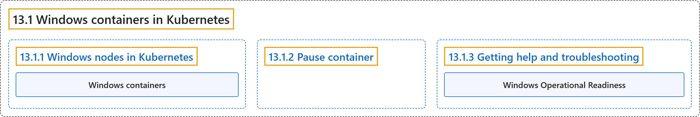

# 13.1 Windows containers in Kubernetes

## Classification

## Glossary

| Term | Definition | 中文翻译 | Source |
|---|---|---|---|
| **13.1 Windows containers in Kubernetes** Kubernetes 中的 Windows 容器 | (context) "Windows containers provide **a way to encapsulate processes and package dependencies**, making it easier to **use DevOps practices and follow cloud native patterns for Windows applications**." | （语境）Windows 容器提供了**一种封装进程和打包依赖的方式**，让 Windows 应用更容易**采用 DevOps 实践、遵循云原生模式**。 | [The Kubernetes Authors, n.d., "Windows containers in Kubernetes", para. 1](https://kubernetes.io/docs/concepts/windows/intro/#:~:text=%5BWindows%20containers%5D%28https%3A%2F%2Faka.ms%2Fwindowscontainers%29%20provide%20a%20way%20to%20encapsulate) |
| **13.1.1 Windows nodes in Kubernetes** Kubernetes 中的 Windows 节点 | "To **enable the orchestration of Windows containers in Kubernetes**, **include Windows nodes in your existing Linux cluster**." | 要**在 Kubernetes 中编排 Windows 容器**，就**在现有的 Linux 集群中加入 Windows 节点**。 | [The Kubernetes Authors, n.d., "Windows nodes in Kubernetes", para. 1](https://kubernetes.io/docs/concepts/windows/intro/#:~:text=To%20enable%20the%20orchestration%20of%20Windows%20containers) |
| **Windows containers** Windows 容器 | "This document uses the term ***Windows containers*** to mean **Windows containers with process isolation**." | 本文用 **Windows 容器**这个术语指**采用进程隔离的 Windows 容器**。 | [The Kubernetes Authors, n.d., "Windows nodes in Kubernetes", para. 4](https://kubernetes.io/docs/concepts/windows/intro/#:~:text=This%20document%20uses%20the%20term%20%2AWindows%20containers%2A) |
| **13.1.2 Pause container** pause 容器 | "In a Kubernetes Pod, **an infrastructure or “pause” container** is **first created to host the container**." | 在 Kubernetes Pod 中，**一个基础设施容器**，也就是“pause”容器，会**先被创建来承载容器**。 | [The Kubernetes Authors, n.d., "Pause container", para. 1](https://kubernetes.io/docs/concepts/windows/intro/#:~:text=In%20a%20Kubernetes%20Pod%2C%20an%20infrastructure%20or) |
| **13.1.3 Getting help and troubleshooting** 获取帮助与排障 | (No definition) | （无定义） | [The Kubernetes Authors, n.d., "Getting help and troubleshooting"](https://kubernetes.io/docs/concepts/windows/intro/#getting-help-and-troubleshooting) |
| **Windows Operational Readiness** Windows 运行就绪 | "The Kubernetes project provides **a *Windows Operational Readiness* specification**, accompanied by **a structured test suite**." | Kubernetes 项目提供**一份 *Windows 运行就绪*规范**，并附带**一套结构化的测试套件**。 | [The Kubernetes Authors, n.d., "Validating the Windows cluster operability", para. 1](https://kubernetes.io/docs/concepts/windows/intro/#:~:text=The%20Kubernetes%20project%20provides%20a%20%2AWindows%20Operational) |

## References

The Kubernetes Authors. (n.d.). *Windows containers in Kubernetes*. Kubernetes Documentation. Retrieved October 31, 2026, from <https://kubernetes.io/docs/concepts/windows/intro/>
