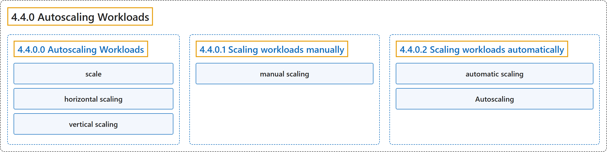

# 4.4.0 Autoscaling Workloads

## Classification

## Glossary

| Term | Definition | 中文翻译 | Source |
|---|---|---|---|
| **4.4.0 Autoscaling Workloads** 自动扩缩工作负载 | "With autoscaling, you can **automatically update your workloads in one way or another**." | 借助自动扩缩，你可以**以某种方式自动更新工作负载**。 | [The Kubernetes Authors, n.d., "Autoscaling Workloads", para. 1](https://kubernetes.io/docs/concepts/workloads/autoscaling/#:~:text=With%20autoscaling%2C%20you%20can%20automatically%20update%20your) |
| **4.4.0.0 Autoscaling Workloads** 自动扩缩工作负载 | (No definition) | （无定义） | [The Kubernetes Authors, n.d., "Autoscaling Workloads"](https://kubernetes.io/docs/concepts/workloads/autoscaling/#autoscaling-workloads) |
| **scale** 扩缩 | "In Kubernetes, you can ***scale* a workload depending on the current demand of resources**." | 在 Kubernetes 中，你可以**根据当前的资源需求*扩缩*工作负载**。 | [The Kubernetes Authors, n.d., "Autoscaling Workloads", para. 2](https://kubernetes.io/docs/concepts/workloads/autoscaling/#:~:text=In%20Kubernetes%2C%20you%20can%20%2Ascale%2A%20a%20workload) |
| **horizontal scaling** 水平扩缩 | (context) "The first approach is referred to as *horizontal scaling*, while the second is referred to as *vertical scaling*." | （语境）第一种方式称为*水平扩缩*，第二种称为*垂直扩缩*。 | [The Kubernetes Authors, n.d., "Autoscaling Workloads", para. 4](https://kubernetes.io/docs/concepts/workloads/autoscaling/#:~:text=The%20first%20approach%20is%20referred%20to%20as) |
| **vertical scaling** 垂直扩缩 | (context) "The first approach is referred to as *horizontal scaling*, while the second is referred to as *vertical scaling*." | （语境）第一种方式称为*水平扩缩*，第二种称为*垂直扩缩*。 | [The Kubernetes Authors, n.d., "Autoscaling Workloads", para. 4](https://kubernetes.io/docs/concepts/workloads/autoscaling/#:~:text=The%20first%20approach%20is%20referred%20to%20as) |
| **4.4.0.1 Scaling workloads manually** 手动扩缩工作负载 | (No definition) | （无定义） | [The Kubernetes Authors, n.d., "Scaling workloads manually"](https://kubernetes.io/docs/concepts/workloads/autoscaling/#scaling-workloads-manually) |
| **manual scaling** 手动扩缩 | "Kubernetes supports ***manual scaling* of workloads**." | Kubernetes 支持**工作负载的*手动扩缩***。 | [The Kubernetes Authors, n.d., "Scaling workloads manually", para. 1](https://kubernetes.io/docs/concepts/workloads/autoscaling/#:~:text=Kubernetes%20supports%20%2Amanual%20scaling%2A%20of%20workloads.) |
| **4.4.0.2 Scaling workloads automatically** 自动扩缩工作负载 | (No definition) | （无定义） | [The Kubernetes Authors, n.d., "Scaling workloads automatically"](https://kubernetes.io/docs/concepts/workloads/autoscaling/#scaling-workloads-automatically) |
| **automatic scaling** 自动扩缩 | "Kubernetes also supports ***automatic scaling* of workloads**, which is the focus of this page." | Kubernetes 还支持**工作负载的*自动扩缩***，这是本页的重点。 | [The Kubernetes Authors, n.d., "Scaling workloads automatically", para. 1](https://kubernetes.io/docs/concepts/workloads/autoscaling/#:~:text=Kubernetes%20also%20supports%20%2Aautomatic%20scaling%2A%20of%20workloads%2C) |
| **Autoscaling** 自动扩缩 | "The concept of *Autoscaling* in Kubernetes refers to **the ability to automatically update an object that manages a set of Pods**" | Kubernetes 中的*自动扩缩*概念指的是**自动更新管理一组 Pod 的对象的能力** | [The Kubernetes Authors, n.d., "Scaling workloads automatically", para. 2](https://kubernetes.io/docs/concepts/workloads/autoscaling/#:~:text=The%20concept%20of%20%2AAutoscaling%2A%20in%20Kubernetes%20refers) |

## References

The Kubernetes Authors. (n.d.). *Autoscaling Workloads*. Kubernetes Documentation. Retrieved October 31, 2026, from <https://kubernetes.io/docs/concepts/workloads/autoscaling/>
