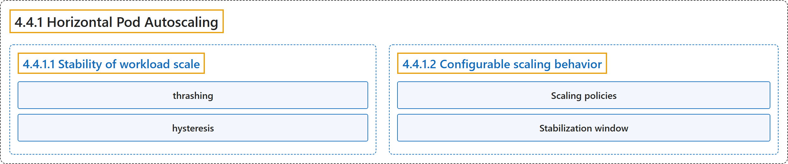

# 4.4.1 Horizontal Pod Autoscaling

## Classification

## Glossary

| Term | Definition | 中文翻译 | Source |
|---|---|---|---|
| **4.4.1 Horizontal Pod Autoscaling** Pod 水平自动扩缩 | "In Kubernetes, a *HorizontalPodAutoscaler* **automatically updates** a **workload resource**" | 在 Kubernetes 中，*HorizontalPodAutoscaler* **自动更新**一个**工作负载资源** | [The Kubernetes Authors, n.d., "Horizontal Pod Autoscaling", para. 1](https://kubernetes.io/docs/concepts/workloads/autoscaling/horizontal-pod-autoscale/#:~:text=In%20Kubernetes%2C%20a%20%2AHorizontalPodAutoscaler%2A%20automatically%20updates%20a) |
| **4.4.1.1 Stability of workload scale** 工作负载规模的稳定性 | "When managing the scale of a group of replicas using the HorizontalPodAutoscaler, it is possible that **the number of replicas keeps fluctuating frequently** due to **the dynamic nature of the metrics evaluated**." | 使用 HorizontalPodAutoscaler 管理一组副本的规模时，**副本数可能频繁波动**，原因是**所评估指标的动态变化**。 | [The Kubernetes Authors, n.d., "Stability of workload scale", para. 1](https://kubernetes.io/docs/concepts/workloads/autoscaling/horizontal-pod-autoscale/#:~:text=When%20managing%20the%20scale%20of%20a%20group) |
| **thrashing** 抖动 | (context) "This is sometimes referred to as *thrashing*, or *flapping*." | （语境）这有时称为*抖动*或*摆动*。 | [The Kubernetes Authors, n.d., "Stability of workload scale", para. 1](https://kubernetes.io/docs/concepts/workloads/autoscaling/horizontal-pod-autoscale/#:~:text=This%20is%20sometimes%20referred%20to%20as%20%2Athrashing%2A%2C) |
| **hysteresis** 迟滞 | (context) "It's similar to the concept of *hysteresis* in cybernetics." | （语境）它类似于控制论中*迟滞*的概念。 | [The Kubernetes Authors, n.d., "Stability of workload scale", para. 1](https://kubernetes.io/docs/concepts/workloads/autoscaling/horizontal-pod-autoscale/#:~:text=It%27s%20similar%20to%20the%20concept%20of%20%2Ahysteresis%2A) |
| **4.4.1.2 Configurable scaling behavior** 可配置的扩缩行为 | (No definition) | （无定义） | [The Kubernetes Authors, n.d., "Configurable scaling behavior"](https://kubernetes.io/docs/concepts/workloads/autoscaling/horizontal-pod-autoscale/#configurable-scaling-behavior) |
| **Scaling policies** 扩缩策略 | "**One or more scaling policies** can be specified in **the `behavior` section of the spec**." | **一个或多个扩缩策略**可以在**规约的 `behavior` 部分**指定。 | [The Kubernetes Authors, n.d., "Scaling policies", para. 1](https://kubernetes.io/docs/concepts/workloads/autoscaling/horizontal-pod-autoscale/#:~:text=One%20or%20more%20scaling%20policies%20can%20be) |
| **Stabilization window** 稳定窗口 | "The stabilization window is used to **restrict the flapping of replica count** when **the metrics used for scaling keep fluctuating**." | 稳定窗口用于**限制副本数的摆动**，当**扩缩所用指标持续波动**时。 | [The Kubernetes Authors, n.d., "Stabilization window", para. 1](https://kubernetes.io/docs/concepts/workloads/autoscaling/horizontal-pod-autoscale/#:~:text=The%20stabilization%20window%20is%20used%20to%20restrict) |

## References

The Kubernetes Authors. (n.d.). *Horizontal Pod Autoscaling*. Kubernetes Documentation. Retrieved October 31, 2026, from <https://kubernetes.io/docs/concepts/workloads/autoscaling/horizontal-pod-autoscale/>
