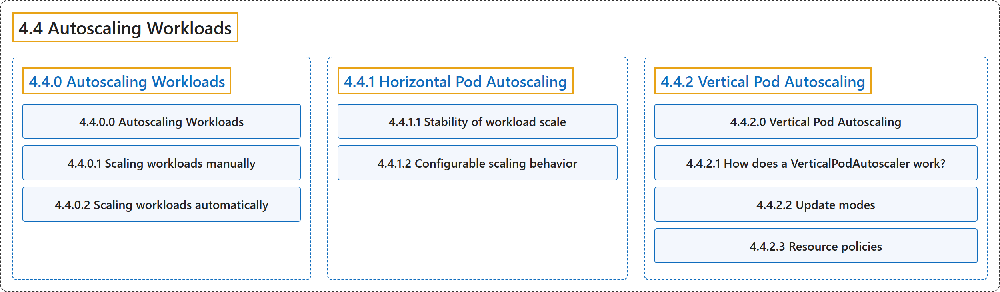

# 4.4 Autoscaling Workloads

## Classification

## Glossary

| Term | Definition | 中文翻译 | Source |
|---|---|---|---|
| **4.4 Autoscaling Workloads** 自动扩缩工作负载 | "With autoscaling, you can **automatically update your workloads in one way or another**." | 借助自动扩缩，你可以**以某种方式自动更新工作负载**。 | [The Kubernetes Authors, n.d.-a, "Autoscaling Workloads", para. 1](https://kubernetes.io/docs/concepts/workloads/autoscaling/#:~:text=With%20autoscaling%2C%20you%20can%20automatically%20update%20your) |
| **[4.4.0 Autoscaling Workloads](autoscaling-workloads.md)** 自动扩缩工作负载 | "With autoscaling, you can **automatically update your workloads in one way or another**." | 借助自动扩缩，你可以**以某种方式自动更新工作负载**。 | [The Kubernetes Authors, n.d.-a, "Autoscaling Workloads", para. 1](https://kubernetes.io/docs/concepts/workloads/autoscaling/#:~:text=With%20autoscaling%2C%20you%20can%20automatically%20update%20your) |
| **[4.4.1 Horizontal Pod Autoscaling](horizontal-pod-autoscale.md)** Pod 水平自动扩缩 | "In Kubernetes, a *HorizontalPodAutoscaler* **automatically updates a workload resource**" | 在 Kubernetes 中，*HorizontalPodAutoscaler* **自动更新工作负载资源** | [The Kubernetes Authors, n.d.-b, "Horizontal Pod Autoscaling", para. 1](https://kubernetes.io/docs/concepts/workloads/autoscaling/horizontal-pod-autoscale/#:~:text=In%20Kubernetes%2C%20a%20%2AHorizontalPodAutoscaler%2A%20automatically%20updates%20a) |
| **[4.4.2 Vertical Pod Autoscaling](vertical-pod-autoscale.md)** Pod 垂直自动扩缩 | "In Kubernetes, a *VerticalPodAutoscaler* **automatically updates a workload management [resource](https://kubernetes.io/docs/reference/using-api/api-concepts/#standard-api-terminology)**" | 在 Kubernetes 中，*VerticalPodAutoscaler* **自动更新工作负载管理[资源](https://kubernetes.io/docs/reference/using-api/api-concepts/#standard-api-terminology)** | [The Kubernetes Authors, n.d.-c, "Vertical Pod Autoscaling", para. 1](https://kubernetes.io/docs/concepts/workloads/autoscaling/vertical-pod-autoscale/#:~:text=In%20Kubernetes%2C%20a%20%2AVerticalPodAutoscaler%2A%20automatically%20updates%20a) |

## References

The Kubernetes Authors. (n.d.-a). *Autoscaling Workloads*. Kubernetes Documentation. Retrieved October 31, 2026, from <https://kubernetes.io/docs/concepts/workloads/autoscaling/>

The Kubernetes Authors. (n.d.-b). *Horizontal Pod Autoscaling*. Kubernetes Documentation. Retrieved October 31, 2026, from <https://kubernetes.io/docs/concepts/workloads/autoscaling/horizontal-pod-autoscale/>

The Kubernetes Authors. (n.d.-c). *Vertical Pod Autoscaling*. Kubernetes Documentation. Retrieved October 31, 2026, from <https://kubernetes.io/docs/concepts/workloads/autoscaling/vertical-pod-autoscale/>
