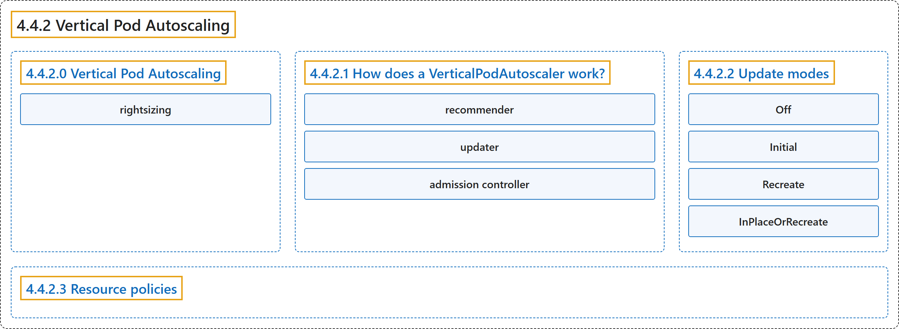

# 4.4.2 Vertical Pod Autoscaling

## Classification

## Glossary

| Term | Definition | 中文翻译 | Source |
|---|---|---|---|
| **4.4.2 Vertical Pod Autoscaling** Pod 垂直自动扩缩 | "In Kubernetes, a *VerticalPodAutoscaler* **automatically updates** a **workload management resource**" | 在 Kubernetes 中，*VerticalPodAutoscaler* **自动更新**一个**工作负载管理资源** | [The Kubernetes Authors, n.d., "Vertical Pod Autoscaling", para. 1](https://kubernetes.io/docs/concepts/workloads/autoscaling/vertical-pod-autoscale/#:~:text=In%20Kubernetes%2C%20a%20%2AVerticalPodAutoscaler%2A%20automatically%20updates%20a) |
| **4.4.2.0 Vertical Pod Autoscaling** Pod 垂直自动扩缩 | (No definition) | （无定义） | [The Kubernetes Authors, n.d., "Vertical Pod Autoscaling"](https://kubernetes.io/docs/concepts/workloads/autoscaling/vertical-pod-autoscale/#vertical-pod-autoscaling) |
| **rightsizing** 合理调整规格 | (context) "This is also known as *rightsizing*, or sometimes *autopilot*." | （语境）这也称为*合理调整规格*，有时称为*自动驾驶*。 | [The Kubernetes Authors, n.d., "Vertical Pod Autoscaling", para. 2](https://kubernetes.io/docs/concepts/workloads/autoscaling/vertical-pod-autoscale/#:~:text=This%20is%20also%20known%20as%20%2Arightsizing%2A%2C%20or) |
| **4.4.2.1 How does a VerticalPodAutoscaler work?** VerticalPodAutoscaler 如何工作 | (No definition) | （无定义） | [The Kubernetes Authors, n.d., "How does a VerticalPodAutoscaler work?"](https://kubernetes.io/docs/concepts/workloads/autoscaling/vertical-pod-autoscale/#how-does-a-verticalpodautoscaler-work) |
| **recommender** 推荐器 | "The *recommender*, which **analyzes resource usage** and **provides recommendations**." | *推荐器*，**分析资源用量**并**给出建议**。 | [The Kubernetes Authors, n.d., "How does a VerticalPodAutoscaler work?", para. 3](https://kubernetes.io/docs/concepts/workloads/autoscaling/vertical-pod-autoscale/#:~:text=The%20%2Arecommender%2A%2C%20which%20analyzes%20resource%20usage%20and) |
| **updater** 更新器 | "The *updater* component **monitors the VerticalPodAutoscaler resources** and **compares current Pod resource requests with the recommendations**." | *更新器*组件**监视 VerticalPodAutoscaler 资源**，并**把当前 Pod 的资源请求与建议进行比较**。 | [The Kubernetes Authors, n.d., "How does a VerticalPodAutoscaler work?", para. 16](https://kubernetes.io/docs/concepts/workloads/autoscaling/vertical-pod-autoscale/#:~:text=The%20%2Aupdater%2A%20component%20monitors%20the%20VerticalPodAutoscaler%20resources) |
| **admission controller** 准入控制器 | "The *admission controller* **operates as a mutating webhook** that **intercepts Pod creation requests**." | *准入控制器* **作为一个变更型 Webhook 运行**，**拦截 Pod 创建请求**。 | [The Kubernetes Authors, n.d., "How does a VerticalPodAutoscaler work?", para. 20](https://kubernetes.io/docs/concepts/workloads/autoscaling/vertical-pod-autoscale/#:~:text=The%20%2Aadmission%20controller%2A%20operates%20as%20a%20mutating) |
| **4.4.2.2 Update modes** 更新模式 | "A VerticalPodAutoscaler supports different *update modes* that **control how and when** resource recommendations are **applied to your Pods**." | VerticalPodAutoscaler 支持不同的*更新模式*，**控制以何种方式、在何时**把资源建议**应用到 Pod**。 | [The Kubernetes Authors, n.d., "Update modes", para. 1](https://kubernetes.io/docs/concepts/workloads/autoscaling/vertical-pod-autoscale/#:~:text=A%20VerticalPodAutoscaler%20supports%20different%20%2Aupdate%20modes%2A%20that) |
| **Off** Off | "In the *Off* update mode, the VPA recommender still analyzes resource usage and generates recommendations, but **these recommendations** are **not automatically applied to Pods**." | 在 *Off* 更新模式下，VPA 推荐器仍会分析资源用量并生成建议，但**这些建议**并**不会被自动应用到 Pod**。 | [The Kubernetes Authors, n.d., "Off", para. 1](https://kubernetes.io/docs/concepts/workloads/autoscaling/vertical-pod-autoscale/#:~:text=In%20the%20%2AOff%2A%20update%20mode%2C%20the%20VPA) |
| **Initial** Initial | "In *Initial* mode, **VPA only sets resource requests** when **Pods are first created**." | 在 *Initial* 模式下，**VPA 只设置资源请求**，时机是 **Pod 首次创建时**。 | [The Kubernetes Authors, n.d., "Initial", para. 1](https://kubernetes.io/docs/concepts/workloads/autoscaling/vertical-pod-autoscale/#:~:text=In%20%2AInitial%2A%20mode%2C%20VPA%20only%20sets%20resource) |
| **Recreate** Recreate | "In *Recreate* mode, **VPA actively manages Pod resources** by **evicting Pods** when **their current resource requests differ significantly from recommendations**." | 在 *Recreate* 模式下，**VPA 主动管理 Pod 资源**，方式是**驱逐 Pod**，当**其当前资源请求与建议差异显著**时。 | [The Kubernetes Authors, n.d., "Recreate", para. 1](https://kubernetes.io/docs/concepts/workloads/autoscaling/vertical-pod-autoscale/#:~:text=In%20%2ARecreate%2A%20mode%2C%20VPA%20actively%20manages%20Pod) |
| **InPlaceOrRecreate** InPlaceOrRecreate | "In `InPlaceOrRecreate` mode, VPA attempts to **update Pod resource requests and limits** without **restarting the Pod** when possible." | 在 `InPlaceOrRecreate` 模式下，VPA 会尽量**更新 Pod 的资源请求和限制**，而**不重启 Pod**。 | [The Kubernetes Authors, n.d., "InPlaceOrRecreate", para. 1](https://kubernetes.io/docs/concepts/workloads/autoscaling/vertical-pod-autoscale/#:~:text=In%20%60InPlaceOrRecreate%60%20mode%2C%20VPA%20attempts%20to%20update) |
| **4.4.2.3 Resource policies** 资源策略 | "Resource policies allow you to fine-tune how the VerticalPodAutoscaler **generates recommendations** and **applies updates**." | 资源策略让你微调 VerticalPodAutoscaler **生成建议**和**应用更新**的方式。 | [The Kubernetes Authors, n.d., "Resource policies", para. 1](https://kubernetes.io/docs/concepts/workloads/autoscaling/vertical-pod-autoscale/#:~:text=Resource%20policies%20allow%20you%20to%20fine-tune%20how) |

## References

The Kubernetes Authors. (n.d.). *Vertical Pod Autoscaling*. Kubernetes Documentation. Retrieved October 31, 2026, from <https://kubernetes.io/docs/concepts/workloads/autoscaling/vertical-pod-autoscale/>
