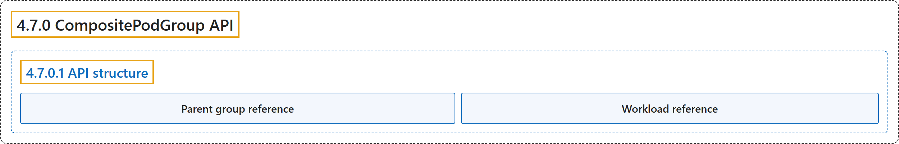

# 4.7.0 CompositePodGroup API

## Classification

## Glossary

| Term | Definition | 中文翻译 | Source |
|---|---|---|---|
| **4.7.0 CompositePodGroup API** CompositePodGroup API | (context) "A `CompositePodGroup` is **a runtime object** that represents **a non-leaf node in a multi-level workload hierarchy**." | （语境）`CompositePodGroup` 是**一个运行时对象**，代表**多级工作负载层次结构中的非叶节点**。 | [The Kubernetes Authors, n.d., "CompositePodGroup API", para. 3](https://kubernetes.io/docs/concepts/workloads/compositepodgroup-api/#:~:text=A%20%60CompositePodGroup%60%20is%20a%20runtime%20object%20that) |
| **4.7.0.1 API structure** API 结构 | "A `CompositePodGroup` consists of **a `spec`** that defines **the desired scheduling behavior for its child groups**, and **a `status` subresource**." | `CompositePodGroup` 由**一个 `spec`**（定义**其子组的期望调度行为**）和**一个 `status` 子资源**组成。 | [The Kubernetes Authors, n.d., "API structure", para. 1](https://kubernetes.io/docs/concepts/workloads/compositepodgroup-api/#:~:text=A%20%60CompositePodGroup%60%20consists%20of%20a%20%60spec%60%20that) |
| **Parent group reference** 父组引用 | "**Non-root `CompositePodGroup` resources** specify **their parent group** using **`spec.parentCompositePodGroupName`**." | **非根 `CompositePodGroup` 资源**指定**其父组**，使用的是 **`spec.parentCompositePodGroupName`**。 | [The Kubernetes Authors, n.d., "Parent group reference", para. 1](https://kubernetes.io/docs/concepts/workloads/compositepodgroup-api/#:~:text=Non-root%20%60CompositePodGroup%60%20resources%20specify%20their%20parent%20group) |
| **Workload reference** Workload 引用 | "**The `spec.workloadRef` field** links the `CompositePodGroup` back to **the `CompositePodGroupTemplate` in the `Workload` object** it was derived from." | **`spec.workloadRef` 字段**把 `CompositePodGroup` 关联回**派生它的 `Workload` 对象中的 `CompositePodGroupTemplate`**。 | [The Kubernetes Authors, n.d., "Workload reference", para. 1](https://kubernetes.io/docs/concepts/workloads/compositepodgroup-api/#:~:text=The%20%60spec.workloadRef%60%20field%20links%20the%20%60CompositePodGroup%60%20back) |

## References

The Kubernetes Authors. (n.d.). *CompositePodGroup API*. Kubernetes Documentation. Retrieved October 31, 2026, from <https://kubernetes.io/docs/concepts/workloads/compositepodgroup-api/>
