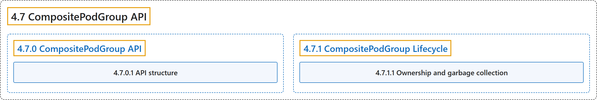

# 4.7 CompositePodGroup API

## Classification

## Glossary

| Term | Definition | 中文翻译 | Source |
|---|---|---|---|
| **4.7 CompositePodGroup API** CompositePodGroup API | (context) "A `CompositePodGroup` is **a runtime object that represents a non-leaf node in a multi-level workload hierarchy**." | （语境）`CompositePodGroup` 是**一个运行时对象，代表多级工作负载层次结构中的非叶节点**。 | [The Kubernetes Authors, n.d.-a, "CompositePodGroup API", para. 3](https://kubernetes.io/docs/concepts/workloads/compositepodgroup-api/#:~:text=A%20%60CompositePodGroup%60%20is%20a%20runtime%20object%20that) |
| **[4.7.0 CompositePodGroup API](compositepodgroup-api.md)** CompositePodGroup API | (context) "A `CompositePodGroup` is **a runtime object that represents a non-leaf node in a multi-level workload hierarchy**." | （语境）`CompositePodGroup` 是**一个运行时对象，代表多级工作负载层次结构中的非叶节点**。 | [The Kubernetes Authors, n.d.-a, "CompositePodGroup API", para. 3](https://kubernetes.io/docs/concepts/workloads/compositepodgroup-api/#:~:text=A%20%60CompositePodGroup%60%20is%20a%20runtime%20object%20that) |
| **[4.7.1 CompositePodGroup Lifecycle](lifecycle.md)** CompositePodGroup 生命周期 | (No definition) | （无定义） | [The Kubernetes Authors, n.d.-b, "CompositePodGroup Lifecycle"](https://kubernetes.io/docs/concepts/workloads/compositepodgroup-api/lifecycle/#compositepodgroup-lifecycle) |

## References

The Kubernetes Authors. (n.d.-a). *CompositePodGroup API*. Kubernetes Documentation. Retrieved October 31, 2026, from <https://kubernetes.io/docs/concepts/workloads/compositepodgroup-api/>

The Kubernetes Authors. (n.d.-b). *CompositePodGroup Lifecycle*. Kubernetes Documentation. Retrieved October 31, 2026, from <https://kubernetes.io/docs/concepts/workloads/compositepodgroup-api/lifecycle/>
