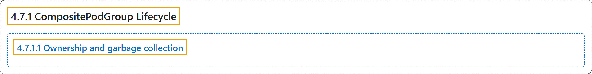

# 4.7.1 CompositePodGroup Lifecycle

## Classification

## Glossary

| Term | Definition | 中文翻译 | Source |
|---|---|---|---|
| **4.7.1 CompositePodGroup Lifecycle** CompositePodGroup 生命周期 | (No definition) | （无定义） | [The Kubernetes Authors, n.d., "CompositePodGroup Lifecycle"](https://kubernetes.io/docs/concepts/workloads/compositepodgroup-api/lifecycle/#compositepodgroup-lifecycle) |
| **4.7.1.1 Ownership and garbage collection** 属主与垃圾回收 | "A `CompositePodGroup` object, together with its descendant `CompositePodGroup` and `PodGroup` resources, **is owned by the workload controller that created it via Kubernetes `ownerReferences`**." | `CompositePodGroup` 对象连同其后代 `CompositePodGroup` 和 `PodGroup` 资源，**通过 Kubernetes `ownerReferences` 归创建它的工作负载控制器所有**。 | [The Kubernetes Authors, n.d., "Ownership and garbage collection", para. 1](https://kubernetes.io/docs/concepts/workloads/compositepodgroup-api/lifecycle/#:~:text=A%20%60CompositePodGroup%60%20object%2C%20together%20with%20its%20descendant) |

## References

The Kubernetes Authors. (n.d.). *CompositePodGroup Lifecycle*. Kubernetes Documentation. Retrieved October 31, 2026, from <https://kubernetes.io/docs/concepts/workloads/compositepodgroup-api/lifecycle/>
