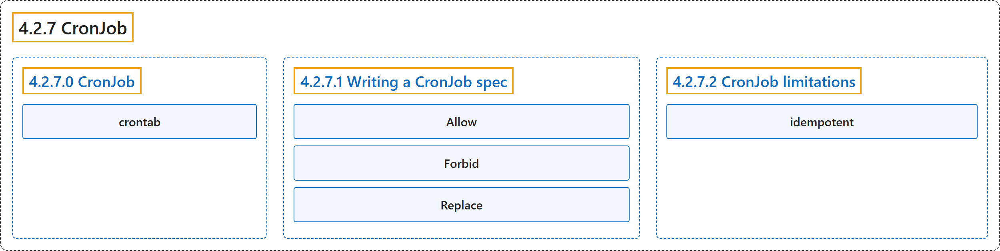

# 4.2.7 CronJob

## Classification

## Glossary

| Term | Definition | 中文翻译 | Source |
|---|---|---|---|
| **4.2.7 CronJob** CronJob | "A *CronJob* **creates Jobs** on **a repeating schedule**." | *CronJob* **创建 Job**，依据的是**重复的时间表**。 | [The Kubernetes Authors, n.d., "CronJob", para. 2](https://kubernetes.io/docs/concepts/workloads/controllers/cron-jobs/#:~:text=A%20%2ACronJob%2A%20creates%20%5BJobs%5D%28https%3A%2F%2Fkubernetes.io%2Fdocs%2Fconcepts%2Fworkloads%2Fcontrollers%2Fjob%2F%29%20on%20a%20repeating) |
| **4.2.7.0 CronJob** CronJob | (No definition) | （无定义） | [The Kubernetes Authors, n.d., "CronJob"](https://kubernetes.io/docs/concepts/workloads/controllers/cron-jobs/#cronjob) |
| **crontab** crontab | (context) "**One CronJob object** is like **one line of a *crontab* (cron table) file** on a Unix system." | （语境）**一个 CronJob 对象**就像 **Unix 系统上 *crontab*（cron 表）文件中的一行**。 | [The Kubernetes Authors, n.d., "CronJob", para. 3](https://kubernetes.io/docs/concepts/workloads/controllers/cron-jobs/#:~:text=One%20CronJob%20object%20is%20like%20one%20line) |
| **4.2.7.1 Writing a CronJob spec** 编写 CronJob 规约 | (No definition) | （无定义） | [The Kubernetes Authors, n.d., "Writing a CronJob spec"](https://kubernetes.io/docs/concepts/workloads/controllers/cron-jobs/#writing-a-cronjob-spec) |
| **Allow** Allow | "`Allow` (default): **The CronJob** allows **concurrently running Jobs**" | `Allow`（默认）：**CronJob** 允许**并发运行的 Job** | [The Kubernetes Authors, n.d., "Concurrency policy", para. 2](https://kubernetes.io/docs/concepts/workloads/controllers/cron-jobs/#:~:text=%60Allow%60%20%28default%29%3A%20The%20CronJob%20allows%20concurrently%20running) |
| **Forbid** Forbid | "`Forbid`: **The CronJob** does not allow **concurrent runs**" | `Forbid`：**CronJob** 不允许**并发运行** | [The Kubernetes Authors, n.d., "Concurrency policy", para. 3](https://kubernetes.io/docs/concepts/workloads/controllers/cron-jobs/#:~:text=%60Forbid%60%3A%20The%20CronJob%20does%20not%20allow%20concurrent) |
| **Replace** Replace | "`Replace`: If it is time for a new Job run and **the previous Job run hasn't finished yet**, the CronJob **replaces the currently running Job run** with **a new Job run**" | `Replace`：如果到了新一次 Job 运行的时间而**上一次 Job 运行还没完成**，CronJob 就**替换当前正在运行的那次 Job 运行**，换成**新的一次 Job 运行** | [The Kubernetes Authors, n.d., "Concurrency policy", para. 4](https://kubernetes.io/docs/concepts/workloads/controllers/cron-jobs/#:~:text=%60Replace%60%3A%20If%20it%20is%20time%20for%20a) |
| **4.2.7.2 CronJob limitations** CronJob 的局限 | (No definition) | （无定义） | [The Kubernetes Authors, n.d., "CronJob limitations"](https://kubernetes.io/docs/concepts/workloads/controllers/cron-jobs/#cronjob-limitations) |
| **idempotent** 幂等 | (context) "Therefore, **the Jobs that you define** should be ***idempotent***." | （语境）因此，**你定义的 Job** 应当**是*幂等*的**。 | [The Kubernetes Authors, n.d., "Job creation", para. 1](https://kubernetes.io/docs/concepts/workloads/controllers/cron-jobs/#:~:text=Therefore%2C%20the%20Jobs%20that%20you%20define%20should) |

## References

The Kubernetes Authors. (n.d.). *CronJob*. Kubernetes Documentation. Retrieved October 31, 2026, from <https://kubernetes.io/docs/concepts/workloads/controllers/cron-jobs/>
