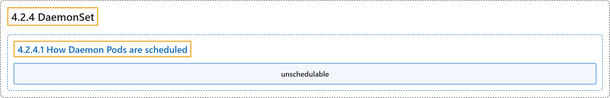

# 4.2.4 DaemonSet

## Classification

## Glossary

| Term | Definition | 中文翻译 | Source |
|---|---|---|---|
| **4.2.4 DaemonSet** DaemonSet | "A *DaemonSet* **ensures that all (or some) Nodes** run **a copy of a Pod**." | *DaemonSet* **确保全部（或部分）节点**都运行**一个 Pod 的副本**。 | [The Kubernetes Authors, n.d., "DaemonSet", para. 2](https://kubernetes.io/docs/concepts/workloads/controllers/daemonset/#:~:text=A%20%2ADaemonSet%2A%20ensures%20that%20all%20%28or%20some%29) |
| **4.2.4.1 How Daemon Pods are scheduled** Daemon Pod 如何被调度 | "A DaemonSet can be used to **ensure that all eligible nodes** run **a copy of a Pod**." | DaemonSet 可用来**确保所有符合条件的节点**都运行**一个 Pod 的副本**。 | [The Kubernetes Authors, n.d., "How Daemon Pods are scheduled", para. 1](https://kubernetes.io/docs/concepts/workloads/controllers/daemonset/#:~:text=A%20DaemonSet%20can%20be%20used%20to%20ensure) |
| **unschedulable** 不可调度 | (context) "Kubernetes can **run DaemonSet Pods** on nodes that are **marked as *unschedulable***." | （语境）Kubernetes 可以**运行 DaemonSet 的 Pod**，在被**标记为*不可调度*的节点**上。 | [The Kubernetes Authors, n.d., "Taints and tolerations", para. 12](https://kubernetes.io/docs/concepts/workloads/controllers/daemonset/#:~:text=Kubernetes%20can%20run%20DaemonSet%20Pods%20on%20nodes) |

## References

The Kubernetes Authors. (n.d.). *DaemonSet*. Kubernetes Documentation. Retrieved October 31, 2026, from <https://kubernetes.io/docs/concepts/workloads/controllers/daemonset/>
