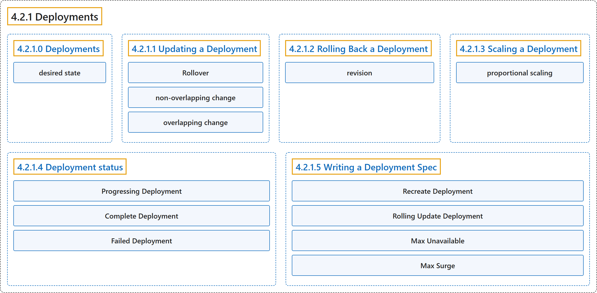

# 4.2.1 Deployments

## Classification

## Glossary

| Term | Definition | 中文翻译 | Source |
|---|---|---|---|
| **4.2.1 Deployments** Deployment | "A *Deployment* provides **declarative updates for [Pods](https://kubernetes.io/docs/concepts/workloads/pods/) and [ReplicaSets](https://kubernetes.io/docs/concepts/workloads/controllers/replicaset/)**." | *Deployment* 为 [Pod](https://kubernetes.io/docs/concepts/workloads/pods/) 和 [ReplicaSet](https://kubernetes.io/docs/concepts/workloads/controllers/replicaset/) **提供声明式更新**。 | [The Kubernetes Authors, n.d., "Deployments", para. 2](https://kubernetes.io/docs/concepts/workloads/controllers/deployment/#:~:text=A%20%2ADeployment%2A%20provides%20declarative%20updates%20for%20%5BPods%5D%28https%3A%2F%2Fkubernetes.io%2Fdocs%2Fconcepts%2Fworkloads%2Fpods%2F%29) |
| **4.2.1.0 Deployments** Deployment | (No definition) | （无定义） | [The Kubernetes Authors, n.d., "Deployments"](https://kubernetes.io/docs/concepts/workloads/controllers/deployment/#deployments) |
| **desired state** 期望状态 | (context) "You describe a *desired state* in a Deployment, and **the Deployment [Controller](https://kubernetes.io/docs/concepts/architecture/controller/) changes the actual state to the desired state at a controlled rate**." | （语境）你在 Deployment 中描述*期望状态*，**Deployment [控制器](https://kubernetes.io/docs/concepts/architecture/controller/)以受控的速率把实际状态变为期望状态**。 | [The Kubernetes Authors, n.d., "Deployments", para. 3](https://kubernetes.io/docs/concepts/workloads/controllers/deployment/#:~:text=You%20describe%20a%20%2Adesired%20state%2A%20in%20a) |
| **4.2.1.1 Updating a Deployment** 更新 Deployment | (No definition) | （无定义） | [The Kubernetes Authors, n.d., "Updating a Deployment"](https://kubernetes.io/docs/concepts/workloads/controllers/deployment/#updating-a-deployment) |
| **Rollover** 滚动覆盖 | (context) "Each time a new Deployment is observed by the Deployment controller, **a ReplicaSet is created to bring up the desired Pods**." | （语境）Deployment 控制器每观察到一个新的 Deployment，**就创建一个 ReplicaSet 来启动期望的 Pod**。 | [The Kubernetes Authors, n.d., "Rollover (aka multiple updates in-flight)", para. 1](https://kubernetes.io/docs/concepts/workloads/controllers/deployment/#:~:text=Each%20time%20a%20new%20Deployment%20is%20observed) |
| **non-overlapping change** 不重叠的变更 | (context) "This is a *non-overlapping* change: **the new Deployment will not "see" the old Pods** (which lack the new label)" | （语境）这是一种*不重叠*的变更：**新的 Deployment 不会“看到”旧的 Pod**（它们缺少新标签） | [The Kubernetes Authors, n.d., "Label selector updates", para. 3](https://kubernetes.io/docs/concepts/workloads/controllers/deployment/#:~:text=This%20is%20a%20%2Anon-overlapping%2A%20change%3A%20the%20new) |
| **overlapping change** 重叠的变更 | (context) "This is an *overlapping* change: **the new, broader selector would match the old Pods**." | （语境）这是一种*重叠*的变更：**新的、更宽泛的选择算符会匹配旧的 Pod**。 | [The Kubernetes Authors, n.d., "Label selector updates", para. 5](https://kubernetes.io/docs/concepts/workloads/controllers/deployment/#:~:text=This%20is%20an%20%2Aoverlapping%2A%20change%3A%20the%20new%2C) |
| **4.2.1.2 Rolling Back a Deployment** 回滚 Deployment | (context) "Sometimes, you may want to **rollback a Deployment**; for example, **when the Deployment is not stable**, such as crash looping." | （语境）有时你可能想要**回滚 Deployment**，例如**在 Deployment 不稳定时**，比如崩溃循环。 | [The Kubernetes Authors, n.d., "Rolling Back a Deployment", para. 1](https://kubernetes.io/docs/concepts/workloads/controllers/deployment/#:~:text=Sometimes%2C%20you%20may%20want%20to%20rollback%20a) |
| **revision** 修订版本 | "A Deployment's revision is **created when a Deployment's rollout is triggered**. This means that the new revision is created **if and only if the Deployment's Pod template (`.spec.template`) is changed**, for example if you update the labels or container images of the template." | Deployment 的修订版本**在 Deployment 的上线被触发时创建**。这意味着新的修订版本**当且仅当 Deployment 的 Pod 模板（`.spec.template`）发生变更时才会创建**，例如你更新了模板的标签或容器镜像。 | [The Kubernetes Authors, n.d., "Rolling Back a Deployment", Note, para. 1](https://kubernetes.io/docs/concepts/workloads/controllers/deployment/#:~:text=A%20Deployment%27s%20revision%20is%20created%20when) |
| **4.2.1.3 Scaling a Deployment** 扩缩 Deployment | (No definition) | （无定义） | [The Kubernetes Authors, n.d., "Scaling a Deployment"](https://kubernetes.io/docs/concepts/workloads/controllers/deployment/#scaling-a-deployment) |
| **proportional scaling** 按比例扩缩 | (context) "This is called *proportional scaling*." | （语境）这称为*按比例扩缩*。 | [The Kubernetes Authors, n.d., "Proportional scaling", para. 1](https://kubernetes.io/docs/concepts/workloads/controllers/deployment/#:~:text=This%20is%20called%20%2Aproportional%20scaling%2A.) |
| **4.2.1.4 Deployment status** Deployment 状态 | "A Deployment **enters various states during its lifecycle**." | Deployment **在其生命周期中会进入多种状态**。 | [The Kubernetes Authors, n.d., "Deployment status", para. 1](https://kubernetes.io/docs/concepts/workloads/controllers/deployment/#:~:text=A%20Deployment%20enters%20various%20states%20during%20its) |
| **Progressing Deployment** 进行中的 Deployment | (context) "Kubernetes marks a Deployment as *progressing* **when one of the following tasks is performed**:" | （语境）Kubernetes **在执行以下任一任务时**把 Deployment 标记为*进行中*： | [The Kubernetes Authors, n.d., "Progressing Deployment", para. 1](https://kubernetes.io/docs/concepts/workloads/controllers/deployment/#:~:text=Kubernetes%20marks%20a%20Deployment%20as%20%2Aprogressing%2A%20when) |
| **Complete Deployment** 已完成的 Deployment | (context) "Kubernetes marks a Deployment as *complete* **when it has the following characteristics**:" | （语境）Kubernetes **在 Deployment 具备以下特征时**把它标记为*已完成*： | [The Kubernetes Authors, n.d., "Complete Deployment", para. 1](https://kubernetes.io/docs/concepts/workloads/controllers/deployment/#:~:text=Kubernetes%20marks%20a%20Deployment%20as%20%2Acomplete%2A%20when) |
| **Failed Deployment** 失败的 Deployment | (context) "Your Deployment may get **stuck trying to deploy its newest ReplicaSet without ever completing**." | （语境）你的 Deployment 可能会**卡在部署最新 ReplicaSet 的过程中，始终无法完成**。 | [The Kubernetes Authors, n.d., "Failed Deployment", para. 1](https://kubernetes.io/docs/concepts/workloads/controllers/deployment/#:~:text=Your%20Deployment%20may%20get%20stuck%20trying%20to) |
| **4.2.1.5 Writing a Deployment Spec** 编写 Deployment 规约 | (context) "As with all other Kubernetes configs, **a Deployment needs `.apiVersion`, `.kind`, and `.metadata` fields**." | （语境）与其他所有 Kubernetes 配置一样，**Deployment 需要 `.apiVersion`、`.kind` 和 `.metadata` 字段**。 | [The Kubernetes Authors, n.d., "Writing a Deployment Spec", para. 1](https://kubernetes.io/docs/concepts/workloads/controllers/deployment/#:~:text=As%20with%20all%20other%20Kubernetes%20configs%2C%20a) |
| **Recreate Deployment** Recreate 策略 | "**All existing Pods are killed before new ones are created** when `.spec.strategy.type==Recreate`." | 当 `.spec.strategy.type==Recreate` 时，**先杀死所有现有 Pod，再创建新的 Pod**。 | [The Kubernetes Authors, n.d., "Recreate Deployment", para. 1](https://kubernetes.io/docs/concepts/workloads/controllers/deployment/#:~:text=All%20existing%20Pods%20are%20killed%20before%20new) |
| **Rolling Update Deployment** RollingUpdate 策略 | "The Deployment **updates Pods in a rolling update fashion (gradually scale down the old ReplicaSets and scale up the new one)** when `.spec.strategy.type==RollingUpdate`." | 当 `.spec.strategy.type==RollingUpdate` 时，Deployment **以滚动更新方式更新 Pod（逐步缩容旧的 ReplicaSet、扩容新的 ReplicaSet）**。 | [The Kubernetes Authors, n.d., "Rolling Update Deployment", para. 1](https://kubernetes.io/docs/concepts/workloads/controllers/deployment/#:~:text=The%20Deployment%20updates%20Pods%20in%20a%20rolling) |
| **Max Unavailable** 最大不可用 | "`.spec.strategy.rollingUpdate.maxUnavailable` is an optional field that **specifies the maximum number of Pods that can be unavailable during the update process**." | `.spec.strategy.rollingUpdate.maxUnavailable` 是一个可选字段，**指定更新过程中最多可以有多少个 Pod 不可用**。 | [The Kubernetes Authors, n.d., "Max Unavailable", para. 1](https://kubernetes.io/docs/concepts/workloads/controllers/deployment/#:~:text=%60.spec.strategy.rollingUpdate.maxUnavailable%60%20is%20an%20optional%20field%20that%20specifies) |
| **Max Surge** 最大峰值 | "`.spec.strategy.rollingUpdate.maxSurge` is an optional field that **specifies the maximum number of Pods that can be created over the desired number of Pods**." | `.spec.strategy.rollingUpdate.maxSurge` 是一个可选字段，**指定在期望 Pod 数之上最多可以额外创建多少个 Pod**。 | [The Kubernetes Authors, n.d., "Max Surge", para. 1](https://kubernetes.io/docs/concepts/workloads/controllers/deployment/#:~:text=%60.spec.strategy.rollingUpdate.maxSurge%60%20is%20an%20optional%20field%20that%20specifies) |

## References

The Kubernetes Authors. (n.d.). *Deployments*. Kubernetes Documentation. Retrieved October 31, 2026, from <https://kubernetes.io/docs/concepts/workloads/controllers/deployment/>
