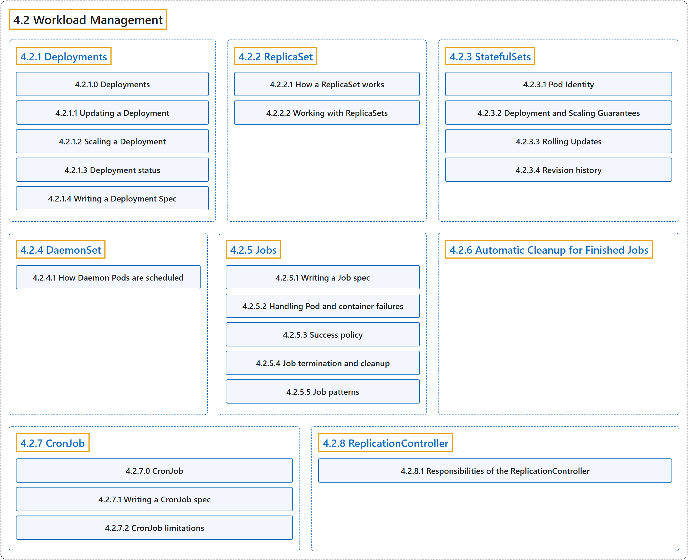

# 4.2 Workload Management

## Classification

## Glossary

| Term | Definition | 中文翻译 | Source |
|---|---|---|---|
| **4.2 Workload Management** 工作负载管理 | (context) "Kubernetes provides **several built-in APIs for declarative management of your [workloads](https://kubernetes.io/docs/concepts/workloads/) and the components of those workloads**." | （语境）Kubernetes 提供**若干内置 API，用于声明式地管理你的[工作负载](https://kubernetes.io/docs/concepts/workloads/)及其组件**。 | [The Kubernetes Authors, n.d.-i, "Workload Management", para. 1](https://kubernetes.io/docs/concepts/workloads/controllers/#:~:text=Kubernetes%20provides%20several%20built-in%20APIs%20for%20declarative) |
| **[4.2.1 Deployments](deployment.md)** Deployment | "A *Deployment* provides **declarative updates for [Pods](https://kubernetes.io/docs/concepts/workloads/pods/) and [ReplicaSets](https://kubernetes.io/docs/concepts/workloads/controllers/replicaset/)**." | *Deployment* 为 [Pod](https://kubernetes.io/docs/concepts/workloads/pods/) 和 [ReplicaSet](https://kubernetes.io/docs/concepts/workloads/controllers/replicaset/) **提供声明式更新**。 | [The Kubernetes Authors, n.d.-d, "Deployments", para. 2](https://kubernetes.io/docs/concepts/workloads/controllers/deployment/#:~:text=A%20%2ADeployment%2A%20provides%20declarative%20updates%20for%20%5BPods%5D%28https%3A%2F%2Fkubernetes.io%2Fdocs%2Fconcepts%2Fworkloads%2Fpods%2F%29) |
| **[4.2.2 ReplicaSet](replicaset.md)** ReplicaSet | "A ReplicaSet's purpose is **to maintain a stable set of replica Pods running at any given time**." | ReplicaSet 的目的是**在任何时刻都维持一组稳定运行的副本 Pod**。 | [The Kubernetes Authors, n.d.-f, "ReplicaSet", para. 1](https://kubernetes.io/docs/concepts/workloads/controllers/replicaset/#:~:text=A%20ReplicaSet%27s%20purpose%20is%20to%20maintain%20a) |
| **[4.2.3 StatefulSets](statefulset.md)** StatefulSet | "A StatefulSet **runs a group of Pods, and maintains a sticky identity for each of those Pods**." | StatefulSet **运行一组 Pod，并为每个 Pod 维持一个粘性身份**。 | [The Kubernetes Authors, n.d.-h, "StatefulSets", para. 1](https://kubernetes.io/docs/concepts/workloads/controllers/statefulset/#:~:text=A%20StatefulSet%20runs%20a%20group%20of%20Pods%2C) |
| **[4.2.4 DaemonSet](daemonset.md)** DaemonSet | "A *DaemonSet* **ensures that all (or some) Nodes run a copy of a Pod**." | *DaemonSet* **确保全部（或部分）节点都运行一个 Pod 的副本**。 | [The Kubernetes Authors, n.d.-c, "DaemonSet", para. 2](https://kubernetes.io/docs/concepts/workloads/controllers/daemonset/#:~:text=A%20%2ADaemonSet%2A%20ensures%20that%20all%20%28or%20some%29) |
| **[4.2.5 Jobs](job.md)** Job | "Jobs represent **one-off tasks that run to completion and then stop**." | Job 代表**运行至完成后即停止的一次性任务**。 | [The Kubernetes Authors, n.d.-e, "Jobs", para. 1](https://kubernetes.io/docs/concepts/workloads/controllers/job/#:~:text=Jobs%20represent%20one-off%20tasks%20that%20run%20to) |
| **[4.2.6 Automatic Cleanup for Finished Jobs](ttlafterfinished.md)** 已完成 Job 的自动清理 | "**A time-to-live mechanism to clean up old Jobs that have finished execution.**" | **一种清理已执行完毕的旧 Job 的存活时间（TTL）机制。** | [The Kubernetes Authors, n.d.-a, "Automatic Cleanup for Finished Jobs", para. 1](https://kubernetes.io/docs/concepts/workloads/controllers/ttlafterfinished/#:~:text=A%20time-to-live%20mechanism%20to%20clean%20up%20old) |
| **[4.2.7 CronJob](cron-jobs.md)** CronJob | "A *CronJob* **creates [Jobs](https://kubernetes.io/docs/concepts/workloads/controllers/job/) on a repeating schedule**." | *CronJob* **按重复的时间表创建 [Job](https://kubernetes.io/docs/concepts/workloads/controllers/job/)**。 | [The Kubernetes Authors, n.d.-b, "CronJob", para. 2](https://kubernetes.io/docs/concepts/workloads/controllers/cron-jobs/#:~:text=A%20%2ACronJob%2A%20creates%20%5BJobs%5D%28https%3A%2F%2Fkubernetes.io%2Fdocs%2Fconcepts%2Fworkloads%2Fcontrollers%2Fjob%2F%29%20on%20a%20repeating) |
| **[4.2.8 ReplicationController](replicationcontroller.md)** ReplicationController | "**Legacy API for managing workloads that can scale horizontally.**" | **用于管理可水平扩缩工作负载的旧版 API。** | [The Kubernetes Authors, n.d.-g, "ReplicationController", para. 1](https://kubernetes.io/docs/concepts/workloads/controllers/replicationcontroller/#:~:text=Legacy%20API%20for%20managing%20workloads%20that%20can) |

## References

The Kubernetes Authors. (n.d.-a). *Automatic Cleanup for Finished Jobs*. Kubernetes Documentation. Retrieved October 31, 2026, from <https://kubernetes.io/docs/concepts/workloads/controllers/ttlafterfinished/>

The Kubernetes Authors. (n.d.-b). *CronJob*. Kubernetes Documentation. Retrieved October 31, 2026, from <https://kubernetes.io/docs/concepts/workloads/controllers/cron-jobs/>

The Kubernetes Authors. (n.d.-c). *DaemonSet*. Kubernetes Documentation. Retrieved October 31, 2026, from <https://kubernetes.io/docs/concepts/workloads/controllers/daemonset/>

The Kubernetes Authors. (n.d.-d). *Deployments*. Kubernetes Documentation. Retrieved October 31, 2026, from <https://kubernetes.io/docs/concepts/workloads/controllers/deployment/>

The Kubernetes Authors. (n.d.-e). *Jobs*. Kubernetes Documentation. Retrieved October 31, 2026, from <https://kubernetes.io/docs/concepts/workloads/controllers/job/>

The Kubernetes Authors. (n.d.-f). *ReplicaSet*. Kubernetes Documentation. Retrieved October 31, 2026, from <https://kubernetes.io/docs/concepts/workloads/controllers/replicaset/>

The Kubernetes Authors. (n.d.-g). *ReplicationController*. Kubernetes Documentation. Retrieved October 31, 2026, from <https://kubernetes.io/docs/concepts/workloads/controllers/replicationcontroller/>

The Kubernetes Authors. (n.d.-h). *StatefulSets*. Kubernetes Documentation. Retrieved October 31, 2026, from <https://kubernetes.io/docs/concepts/workloads/controllers/statefulset/>

The Kubernetes Authors. (n.d.-i). *Workload Management*. Kubernetes Documentation. Retrieved October 31, 2026, from <https://kubernetes.io/docs/concepts/workloads/controllers/>
