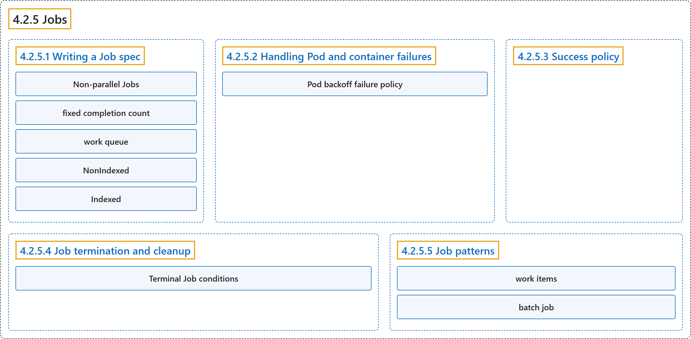

# 4.2.5 Jobs

## Classification

## Glossary

| Term | Definition | 中文翻译 | Source |
|---|---|---|---|
| **4.2.5 Jobs** Job | "Jobs represent **one-off tasks** that **run to completion and then stop**." | Job 代表**一次性任务**，它们**运行至完成后即停止**。 | [The Kubernetes Authors, n.d., "Jobs", para. 1](https://kubernetes.io/docs/concepts/workloads/controllers/job/#:~:text=Jobs%20represent%20one-off%20tasks%20that%20run%20to) |
| **4.2.5.1 Writing a Job spec** 编写 Job 规约 | "There are **three main types of task** suitable to **run as a Job**:" | 有**三种主要类型的任务**适合**以 Job 运行**： | [The Kubernetes Authors, n.d., "Parallel execution for Jobs", para. 1](https://kubernetes.io/docs/concepts/workloads/controllers/job/#:~:text=There%20are%20three%20main%20types%20of%20task) |
| **Non-parallel Jobs** 非并行 Job | "Non-parallel Jobsnormally, **only one Pod is started**, unless **the Pod fails**." | 非并行 Job：通常**只启动一个 Pod**，除非**该 Pod 失败**。 | [The Kubernetes Authors, n.d., "Parallel execution for Jobs", para. 2](https://kubernetes.io/docs/concepts/workloads/controllers/job/#:~:text=Non-parallel%20Jobsnormally%2C%20only%20one%20Pod%20is%20started%2C) |
| **fixed completion count** 固定完成计数 | "**Parallel Jobs with a *fixed completion count***:specify **a non-zero positive value for `.spec.completions`**." | **具有*固定完成计数*的并行 Job**：指定 **`.spec.completions` 的一个非零正值**。 | [The Kubernetes Authors, n.d., "Parallel execution for Jobs", para. 3](https://kubernetes.io/docs/concepts/workloads/controllers/job/#:~:text=Parallel%20Jobs%20with%20a%20%2Afixed%20completion%20count%2A%3Aspecify) |
| **work queue** 工作队列 | "**Parallel Jobs with a *work queue***:do **not specify `.spec.completions`**, default to `.spec.parallelism`." | **使用*工作队列*的并行 Job**：此时**不指定 `.spec.completions`**，默认取 `.spec.parallelism`。 | [The Kubernetes Authors, n.d., "Parallel execution for Jobs", para. 4](https://kubernetes.io/docs/concepts/workloads/controllers/job/#:~:text=Parallel%20Jobs%20with%20a%20%2Awork%20queue%2A%3Ado%20not) |
| **NonIndexed** NonIndexed | "`NonIndexed` (default): **the Job is considered complete** when there have been **`.spec.completions` successfully completed Pods**." | `NonIndexed`（默认）：**Job 被视为完成**，当**成功完成的 Pod 数达到 `.spec.completions`** 时。 | [The Kubernetes Authors, n.d., "Completion mode", para. 2](https://kubernetes.io/docs/concepts/workloads/controllers/job/#:~:text=%60NonIndexed%60%20%28default%29%3A%20the%20Job%20is%20considered%20complete) |
| **Indexed** Indexed | "`Indexed`: **the Pods of a Job** get **an associated completion index** from **0 to `.spec.completions-1`**." | `Indexed`：**Job 的各个 Pod** 获得**一个关联的完成索引**，范围是 **0 到 `.spec.completions-1`**。 | [The Kubernetes Authors, n.d., "Completion mode", para. 3](https://kubernetes.io/docs/concepts/workloads/controllers/job/#:~:text=%60Indexed%60%3A%20the%20Pods%20of%20a%20Job%20get) |
| **4.2.5.2 Handling Pod and container failures** 处理 Pod 和容器失败 | (No definition) | （无定义） | [The Kubernetes Authors, n.d., "Handling Pod and container failures"](https://kubernetes.io/docs/concepts/workloads/controllers/job/#handling-pod-and-container-failures) |
| **Pod backoff failure policy** Pod 回退失败策略 | (context) "There are situations where you want to **fail a Job** after **some amount of retries** due to **a logical error in configuration** etc." | （语境）有些情况下，你希望**让 Job 失败**，在**若干次重试**之后，原因是**配置中的逻辑错误**等。 | [The Kubernetes Authors, n.d., "Pod backoff failure policy", para. 1](https://kubernetes.io/docs/concepts/workloads/controllers/job/#:~:text=There%20are%20situations%20where%20you%20want%20to) |
| **4.2.5.3 Success policy** 成功策略 | "When creating an Indexed Job, you can **define when a Job can be declared as succeeded** using **a `.spec.successPolicy`**, based on **the pods that succeeded**." | 创建 Indexed Job 时，你可以**定义何时可以宣告 Job 成功**，方法是用**一个 `.spec.successPolicy`**，依据是**成功的 Pod**。 | [The Kubernetes Authors, n.d., "Success policy", para. 1](https://kubernetes.io/docs/concepts/workloads/controllers/job/#:~:text=When%20creating%20an%20Indexed%20Job%2C%20you%20can) |
| **4.2.5.4 Job termination and cleanup** Job 的终止与清理 | (No definition) | （无定义） | [The Kubernetes Authors, n.d., "Job termination and cleanup"](https://kubernetes.io/docs/concepts/workloads/controllers/job/#job-termination-and-cleanup) |
| **Terminal Job conditions** Job 终止状况 | "A Job has **two possible terminal states**, each of which has **a corresponding Job condition**:" | Job 有**两种可能的终止状态**，每种都有**对应的 Job 状况**： | [The Kubernetes Authors, n.d., "Terminal Job conditions", para. 1](https://kubernetes.io/docs/concepts/workloads/controllers/job/#:~:text=A%20Job%20has%20two%20possible%20terminal%20states%2C) |
| **4.2.5.5 Job patterns** Job 模式 | (No definition) | （无定义） | [The Kubernetes Authors, n.d., "Job patterns"](https://kubernetes.io/docs/concepts/workloads/controllers/job/#job-patterns) |
| **work items** 工作项 | "The Job object can be used to **process a set** of **independent but related *work items***." | Job 对象可用来**处理一组**相互**独立但又相关的*工作项***。 | [The Kubernetes Authors, n.d., "Job patterns", para. 1](https://kubernetes.io/docs/concepts/workloads/controllers/job/#:~:text=The%20Job%20object%20can%20be%20used%20to) |
| **batch job** 批处理作业 | (context) "Here we are just considering **one set of work items** that the user wants to **manage together** — a *batch job*." | （语境）这里我们只考虑**一组工作项**，用户想**把它们一起管理**，即*批处理作业*。 | [The Kubernetes Authors, n.d., "Job patterns", para. 2](https://kubernetes.io/docs/concepts/workloads/controllers/job/#:~:text=Here%20we%20are%20just%20considering%20one%20set) |

## References

The Kubernetes Authors. (n.d.). *Jobs*. Kubernetes Documentation. Retrieved October 31, 2026, from <https://kubernetes.io/docs/concepts/workloads/controllers/job/>
