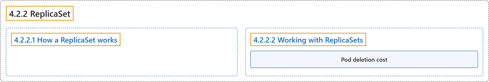

# 4.2.2 ReplicaSet

## Classification

## Glossary

| Term | Definition | 中文翻译 | Source |
|---|---|---|---|
| **4.2.2 ReplicaSet** ReplicaSet | "A ReplicaSet's purpose is to maintain **a stable set of replica Pods** running at **any given time**." | ReplicaSet 的目的是维持**一组稳定的副本 Pod**，在**任何时刻**都保持运行。 | [The Kubernetes Authors, n.d., "ReplicaSet", para. 1](https://kubernetes.io/docs/concepts/workloads/controllers/replicaset/#:~:text=A%20ReplicaSet%27s%20purpose%20is%20to%20maintain%20a) |
| **4.2.2.1 How a ReplicaSet works** ReplicaSet 的工作方式 | "A ReplicaSet is defined with fields, including **a selector that specifies how to identify Pods it can acquire**, **a number of replicas indicating how many Pods it should be maintaining**, and **a pod template specifying the data of new Pods it should create** to meet the number of replicas criteria." | ReplicaSet 由若干字段定义，包括**一个说明如何识别可获取 Pod 的选择算符**、**一个表示应维持多少 Pod 的副本数**，以及**一个指定新建 Pod 数据的 Pod 模板**，以满足副本数要求。 | [The Kubernetes Authors, n.d., "How a ReplicaSet works", para. 1](https://kubernetes.io/docs/concepts/workloads/controllers/replicaset/#:~:text=A%20ReplicaSet%20is%20defined%20with%20fields%2C%20including) |
| **4.2.2.2 Working with ReplicaSets** 使用 ReplicaSet | (No definition) | （无定义） | [The Kubernetes Authors, n.d., "Working with ReplicaSets"](https://kubernetes.io/docs/concepts/workloads/controllers/replicaset/#working-with-replicasets) |
| **Pod deletion cost** Pod 删除开销 | "Using the controller.kubernetes.io/pod-deletion-cost annotation, **users can set a preference** regarding **which pods to remove first when downscaling a ReplicaSet**." | 使用 controller.kubernetes.io/pod-deletion-cost 注解，**用户可以设定偏好**，决定**在缩容 ReplicaSet 时优先删除哪些 Pod**。 | [The Kubernetes Authors, n.d., "Pod deletion cost", para. 1](https://kubernetes.io/docs/concepts/workloads/controllers/replicaset/#:~:text=Using%20the%20%5Bcontroller.kubernetes.io%2Fpod-deletion-cost%5D%28https%3A%2F%2Fkubernetes.io%2Fdocs%2Freference%2Flabels-annotations-taints%2F%23pod-deletion-cost%29%20annotation%2C%20users%20can%20set) |

## References

The Kubernetes Authors. (n.d.). *ReplicaSet*. Kubernetes Documentation. Retrieved October 31, 2026, from <https://kubernetes.io/docs/concepts/workloads/controllers/replicaset/>
