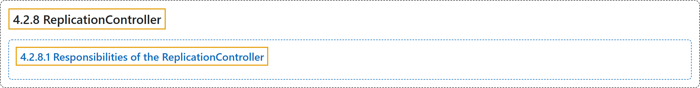

# 4.2.8 ReplicationController

## Classification

## Glossary

| Term | Definition | 中文翻译 | Source |
|---|---|---|---|
| **4.2.8 ReplicationController** ReplicationController | "**Legacy API for managing workloads that can scale horizontally.**" | **用于管理可水平扩缩工作负载的旧版 API。** | [The Kubernetes Authors, n.d., "ReplicationController", para. 1](https://kubernetes.io/docs/concepts/workloads/controllers/replicationcontroller/#:~:text=Legacy%20API%20for%20managing%20workloads%20that%20can) |
| **4.2.8.1 Responsibilities of the ReplicationController** ReplicationController 的职责 | "The ReplicationController **ensures that the desired number of pods matches its label selector and are operational**." | ReplicationController **确保与其标签选择算符匹配的 Pod 数等于期望数量，并且都在正常运行**。 | [The Kubernetes Authors, n.d., "Responsibilities of the ReplicationController", para. 1](https://kubernetes.io/docs/concepts/workloads/controllers/replicationcontroller/#:~:text=The%20ReplicationController%20ensures%20that%20the%20desired%20number) |

## References

The Kubernetes Authors. (n.d.). *ReplicationController*. Kubernetes Documentation. Retrieved October 31, 2026, from <https://kubernetes.io/docs/concepts/workloads/controllers/replicationcontroller/>
