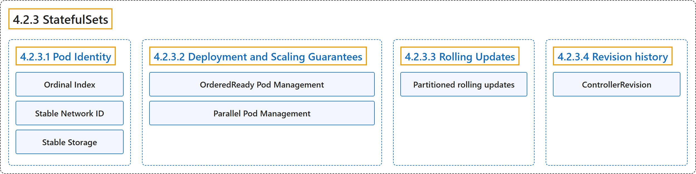

# 4.2.3 StatefulSets

## Classification

## Glossary

| Term | Definition | 中文翻译 | Source |
|---|---|---|---|
| **4.2.3 StatefulSets** StatefulSet | "A StatefulSet **runs a group of Pods, and maintains a sticky identity for each of those Pods**." | StatefulSet **运行一组 Pod，并为每个 Pod 维持一个粘性身份**。 | [The Kubernetes Authors, n.d., "StatefulSets", para. 1](https://kubernetes.io/docs/concepts/workloads/controllers/statefulset/#:~:text=A%20StatefulSet%20runs%20a%20group%20of%20Pods%2C) |
| **4.2.3.1 Pod Identity** Pod 身份 | "StatefulSet Pods have **a unique identity that consists of an ordinal, a stable network identity, and stable storage**." | StatefulSet 的 Pod 拥有**由序号、稳定的网络标识和稳定的存储组成的唯一身份**。 | [The Kubernetes Authors, n.d., "Pod Identity", para. 1](https://kubernetes.io/docs/concepts/workloads/controllers/statefulset/#:~:text=StatefulSet%20Pods%20have%20a%20unique%20identity%20that) |
| **Ordinal Index** 序号索引 | "For a StatefulSet with N [replicas](#replicas), **each Pod in the StatefulSet will be assigned an integer ordinal, that is unique over the Set**." | 对于有 N 个[副本](#replicas)的 StatefulSet，**其中每个 Pod 都会被分配一个在该集合内唯一的整数序号**。 | [The Kubernetes Authors, n.d., "Ordinal Index", para. 1](https://kubernetes.io/docs/concepts/workloads/controllers/statefulset/#:~:text=For%20a%20StatefulSet%20with%20N%20%5Breplicas%5D%28%23replicas%29%2C%20each) |
| **Stable Network ID** 稳定的网络标识 | "Each Pod in a StatefulSet **derives its hostname from the name of the StatefulSet and the ordinal of the Pod**." | StatefulSet 中每个 Pod **的主机名由 StatefulSet 的名称和该 Pod 的序号得出**。 | [The Kubernetes Authors, n.d., "Stable Network ID", para. 1](https://kubernetes.io/docs/concepts/workloads/controllers/statefulset/#:~:text=Each%20Pod%20in%20a%20StatefulSet%20derives%20its) |
| **Stable Storage** 稳定的存储 | "For each VolumeClaimTemplate entry defined in a StatefulSet, **each Pod receives one PersistentVolumeClaim**." | 对于 StatefulSet 中定义的每个 VolumeClaimTemplate 条目，**每个 Pod 都会获得一个 PersistentVolumeClaim**。 | [The Kubernetes Authors, n.d., "Stable Storage", para. 1](https://kubernetes.io/docs/concepts/workloads/controllers/statefulset/#:~:text=For%20each%20VolumeClaimTemplate%20entry%20defined%20in%20a) |
| **4.2.3.2 Deployment and Scaling Guarantees** 部署和扩缩保证 | (No definition) | （无定义） | [The Kubernetes Authors, n.d., "Deployment and Scaling Guarantees"](https://kubernetes.io/docs/concepts/workloads/controllers/statefulset/#deployment-and-scaling-guarantees) |
| **OrderedReady Pod Management** OrderedReady Pod 管理 | "`OrderedReady` pod management is **the default for StatefulSets**." | `OrderedReady` Pod 管理是 **StatefulSet 的默认方式**。 | [The Kubernetes Authors, n.d., "OrderedReady Pod Management", para. 1](https://kubernetes.io/docs/concepts/workloads/controllers/statefulset/#:~:text=%60OrderedReady%60%20pod%20management%20is%20the%20default%20for) |
| **Parallel Pod Management** Parallel Pod 管理 | "`Parallel` pod management **tells the StatefulSet controller to launch or terminate all Pods in parallel**" | `Parallel` Pod 管理**让 StatefulSet 控制器并行启动或终止所有 Pod** | [The Kubernetes Authors, n.d., "Parallel Pod Management", para. 1](https://kubernetes.io/docs/concepts/workloads/controllers/statefulset/#:~:text=%60Parallel%60%20pod%20management%20tells%20the%20StatefulSet%20controller) |
| **4.2.3.3 Rolling Updates** 滚动更新 | "When a StatefulSet's `.spec.updateStrategy.type` is set to `RollingUpdate`, **the StatefulSet controller will delete and recreate each Pod in the StatefulSet**." | 当 StatefulSet 的 `.spec.updateStrategy.type` 设为 `RollingUpdate` 时，**StatefulSet 控制器会删除并重建 StatefulSet 中的每个 Pod**。 | [The Kubernetes Authors, n.d., "Rolling Updates", para. 1](https://kubernetes.io/docs/concepts/workloads/controllers/statefulset/#:~:text=When%20a%20StatefulSet%27s%20%60.spec.updateStrategy.type%60%20is%20set%20to) |
| **Partitioned rolling updates** 分区滚动更新 | "The `RollingUpdate` update strategy **can be partitioned, by specifying a `.spec.updateStrategy.rollingUpdate.partition`**." | `RollingUpdate` 更新策略**可以通过指定 `.spec.updateStrategy.rollingUpdate.partition` 进行分区**。 | [The Kubernetes Authors, n.d., "Partitioned rolling updates", para. 1](https://kubernetes.io/docs/concepts/workloads/controllers/statefulset/#:~:text=The%20%60RollingUpdate%60%20update%20strategy%20can%20be%20partitioned%2C) |
| **4.2.3.4 Revision history** 修订历史 | (No definition) | （无定义） | [The Kubernetes Authors, n.d., "Revision history"](https://kubernetes.io/docs/concepts/workloads/controllers/statefulset/#revision-history) |
| **ControllerRevision** ControllerRevision | "ControllerRevision is **a Kubernetes API resource used by controllers, such as the StatefulSet controller, to track historical configuration changes**." | ControllerRevision 是**一种 Kubernetes API 资源，供 StatefulSet 控制器等控制器跟踪历史配置变更**。 | [The Kubernetes Authors, n.d., "Revision history", para. 1](https://kubernetes.io/docs/concepts/workloads/controllers/statefulset/#:~:text=ControllerRevision%20is%20a%20Kubernetes%20API%20resource%20used) |

## References

The Kubernetes Authors. (n.d.). *StatefulSets*. Kubernetes Documentation. Retrieved October 31, 2026, from <https://kubernetes.io/docs/concepts/workloads/controllers/statefulset/>
