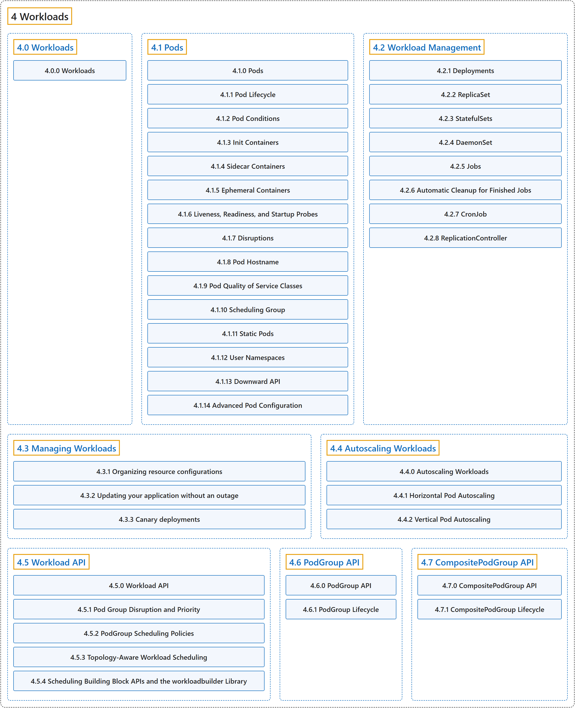

# 4 Workloads

## Classification

## Glossary

| Term | Definition | 中文翻译 | Source |
|---|---|---|---|
| **4 Workloads** 工作负载 | (context) "Understand Pods, **the smallest deployable compute object in Kubernetes**, and the higher-level abstractions that help you to run them." | （语境）了解 Pod，即 **Kubernetes 中最小的可部署计算对象**，以及帮助你运行它们的更高层抽象。 | [The Kubernetes Authors, n.d.-h, "Workloads", para. 1](https://kubernetes.io/docs/concepts/workloads/#:~:text=Understand%20Pods%2C%20the%20smallest%20deployable%20compute%20object) |
| **[4.0 Workloads](workloads.md)** 工作负载 | (context) "Understand Pods, **the smallest deployable compute object in Kubernetes**, and the higher-level abstractions that help you to run them." | （语境）了解 Pod，即 **Kubernetes 中最小的可部署计算对象**，以及帮助你运行它们的更高层抽象。 | [The Kubernetes Authors, n.d.-h, "Workloads", para. 1](https://kubernetes.io/docs/concepts/workloads/#:~:text=Understand%20Pods%2C%20the%20smallest%20deployable%20compute%20object) |
| **[4.1 Pods](pods/index.md)** Pod | "*Pods* are **the smallest deployable units of computing that you can create and manage in Kubernetes**." | *Pod* 是**你在 Kubernetes 中可以创建和管理的最小可部署计算单元**。 | [The Kubernetes Authors, n.d.-e, "Pods", para. 1](https://kubernetes.io/docs/concepts/workloads/pods/#:~:text=%2APods%2A%20are%20the%20smallest%20deployable%20units%20of) |
| **[4.2 Workload Management](controllers/index.md)** 工作负载管理 | (context) "Kubernetes provides **several built-in APIs for declarative management of your [workloads](https://kubernetes.io/docs/concepts/workloads/) and the components of those workloads**." | （语境）Kubernetes 提供**若干内置 API，用于声明式地管理你的[工作负载](https://kubernetes.io/docs/concepts/workloads/)及其组件**。 | [The Kubernetes Authors, n.d.-g, "Workload Management", para. 1](https://kubernetes.io/docs/concepts/workloads/controllers/#:~:text=Kubernetes%20provides%20several%20built-in%20APIs%20for%20declarative) |
| **[4.3 Managing Workloads](management.md)** 管理工作负载 | (context) "Kubernetes provides **a number of tools to help you manage your application deployment, including scaling and updating**." | （语境）Kubernetes 提供**多种工具帮助你管理应用部署，包括扩缩容和更新**。 | [The Kubernetes Authors, n.d.-c, "Managing Workloads", para. 1](https://kubernetes.io/docs/concepts/workloads/management/#:~:text=Kubernetes%20provides%20a%20number%20of%20tools%20to) |
| **[4.4 Autoscaling Workloads](autoscaling/index.md)** 自动扩缩工作负载 | "With autoscaling, you can **automatically update your workloads in one way or another**." | 借助自动扩缩，你可以**以某种方式自动更新工作负载**。 | [The Kubernetes Authors, n.d.-a, "Autoscaling Workloads", para. 1](https://kubernetes.io/docs/concepts/workloads/autoscaling/#:~:text=With%20autoscaling%2C%20you%20can%20automatically%20update%20your) |
| **[4.5 Workload API](workload-api/index.md)** Workload API | (context) "A `Workload` is **a static, long-lived policy template**." | （语境）`Workload` 是**一个静态、长期存在的策略模板**。 | [The Kubernetes Authors, n.d.-f, "What is a Workload?", para. 2](https://kubernetes.io/docs/concepts/workloads/workload-api/#:~:text=A%20%60Workload%60%20is%20a%20static%2C%20long-lived%20policy) |
| **[4.6 PodGroup API](podgroup-api/index.md)** PodGroup API | (context) "A PodGroup is **a runtime object that represents a group of Pods scheduled together as a single unit**." | （语境）PodGroup 是**一个运行时对象，代表作为单个单元一起调度的一组 Pod**。 | [The Kubernetes Authors, n.d.-d, "PodGroup API", para. 3](https://kubernetes.io/docs/concepts/workloads/podgroup-api/#:~:text=A%20PodGroup%20is%20a%20runtime%20object%20that) |
| **[4.7 CompositePodGroup API](compositepodgroup-api/index.md)** CompositePodGroup API | (context) "A `CompositePodGroup` is **a runtime object that represents a non-leaf node in a multi-level workload hierarchy**." | （语境）`CompositePodGroup` 是**一个运行时对象，代表多级工作负载层次结构中的非叶节点**。 | [The Kubernetes Authors, n.d.-b, "CompositePodGroup API", para. 3](https://kubernetes.io/docs/concepts/workloads/compositepodgroup-api/#:~:text=A%20%60CompositePodGroup%60%20is%20a%20runtime%20object%20that) |

## References

The Kubernetes Authors. (n.d.-a). *Autoscaling Workloads*. Kubernetes Documentation. Retrieved October 31, 2026, from <https://kubernetes.io/docs/concepts/workloads/autoscaling/>

The Kubernetes Authors. (n.d.-b). *CompositePodGroup API*. Kubernetes Documentation. Retrieved October 31, 2026, from <https://kubernetes.io/docs/concepts/workloads/compositepodgroup-api/>

The Kubernetes Authors. (n.d.-c). *Managing Workloads*. Kubernetes Documentation. Retrieved October 31, 2026, from <https://kubernetes.io/docs/concepts/workloads/management/>

The Kubernetes Authors. (n.d.-d). *PodGroup API*. Kubernetes Documentation. Retrieved October 31, 2026, from <https://kubernetes.io/docs/concepts/workloads/podgroup-api/>

The Kubernetes Authors. (n.d.-e). *Pods*. Kubernetes Documentation. Retrieved October 31, 2026, from <https://kubernetes.io/docs/concepts/workloads/pods/>

The Kubernetes Authors. (n.d.-f). *Workload API*. Kubernetes Documentation. Retrieved October 31, 2026, from <https://kubernetes.io/docs/concepts/workloads/workload-api/>

The Kubernetes Authors. (n.d.-g). *Workload Management*. Kubernetes Documentation. Retrieved October 31, 2026, from <https://kubernetes.io/docs/concepts/workloads/controllers/>

The Kubernetes Authors. (n.d.-h). *Workloads*. Kubernetes Documentation. Retrieved October 31, 2026, from <https://kubernetes.io/docs/concepts/workloads/>
