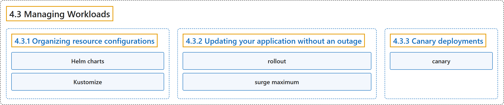

# 4.3 Managing Workloads

## Classification

## Glossary

| Term | Definition | 中文翻译 | Source |
|---|---|---|---|
| **4.3 Managing Workloads** 管理工作负载 | (context) "Kubernetes provides **a number of tools** to help you **manage your application deployment**, including **scaling and updating**." | （语境）Kubernetes 提供**多种工具**，帮助你**管理应用部署**，包括**扩缩容和更新**。 | [The Kubernetes Authors, n.d., "Managing Workloads", para. 1](https://kubernetes.io/docs/concepts/workloads/management/#:~:text=Kubernetes%20provides%20a%20number%20of%20tools%20to) |
| **4.3.1 Organizing resource configurations** 组织资源配置 | (context) "Many applications require **multiple resources** to be created, such as **a Deployment along with a Service**." | （语境）许多应用需要创建**多个资源**，例如**一个 Deployment 加上一个 Service**。 | [The Kubernetes Authors, n.d., "Organizing resource configurations", para. 1](https://kubernetes.io/docs/concepts/workloads/management/#:~:text=Many%20applications%20require%20multiple%20resources%20to%20be) |
| **Helm charts** Helm Chart | (context) "These packages are known as *Helm charts*." | （语境）这些软件包称为 *Helm Chart*。 | [The Kubernetes Authors, n.d., "Helm", para. 2](https://kubernetes.io/docs/concepts/workloads/management/#:~:text=These%20packages%20are%20known%20as%20%2AHelm%20charts%2A.) |
| **Kustomize** Kustomize | "Kustomize **traverses a Kubernetes manifest** to **add, remove or update configuration options**." | Kustomize **遍历 Kubernetes 清单**，以**添加、删除或更新配置选项**。 | [The Kubernetes Authors, n.d., "Kustomize", para. 1](https://kubernetes.io/docs/concepts/workloads/management/#:~:text=%5BKustomize%5D%28https%3A%2F%2Fkustomize.io%2F%29%20traverses%20a%20Kubernetes%20manifest%20to%20add%2C) |
| **4.3.2 Updating your application without an outage** 不中断地更新应用 | (No definition) | （无定义） | [The Kubernetes Authors, n.d., "Updating your application without an outage"](https://kubernetes.io/docs/concepts/workloads/management/#updating-your-application-without-an-outage) |
| **rollout** 上线 | (context) "You can run multiple copies of your app, and **use a *rollout*** to **gradually shift the traffic to new healthy Pods**." | （语境）你可以运行应用的多个副本，并**使用*上线*的方式**来**逐步把流量转移到新的健康 Pod 上**。 | [The Kubernetes Authors, n.d., "Updating your application without an outage", para. 2](https://kubernetes.io/docs/concepts/workloads/management/#:~:text=You%20can%20run%20multiple%20copies%20of%20your) |
| **surge maximum** 峰值上限 | (context) "and allow Kubernetes to **add more temporary replicas during a rollout**, by setting **a *surge maximum* of 100%**:" | （语境）并且允许 Kubernetes **在上线期间添加更多临时副本**，方法是**把*峰值上限*设为 100%**： | [The Kubernetes Authors, n.d., "Updating your application without an outage", para. 6](https://kubernetes.io/docs/concepts/workloads/management/#:~:text=and%20allow%20Kubernetes%20to%20add%20more%20temporary) |
| **4.3.3 Canary deployments** 金丝雀部署 | (context) "Another scenario where **multiple labels are needed** is to **distinguish deployments** of **different releases or configurations of the same component**." | （语境）另一种**需要多个标签**的场景，是**区分部署**，这些部署属于**同一组件的不同版本或不同配置**。 | [The Kubernetes Authors, n.d., "Canary deployments", para. 1](https://kubernetes.io/docs/concepts/workloads/management/#:~:text=Another%20scenario%20where%20multiple%20labels%20are%20needed) |
| **canary** 金丝雀 | (context) "It is common practice to **deploy a *canary*** of **a new application release** (specified via image tag in the pod template) **side by side with the previous release**" | （语境）常见做法是**部署一个*金丝雀***，它属于**新的应用版本**（通过 Pod 模板中的镜像标签指定），**与上一版本并行运行** | [The Kubernetes Authors, n.d., "Canary deployments", para. 1](https://kubernetes.io/docs/concepts/workloads/management/#:~:text=It%20is%20common%20practice%20to%20deploy%20a) |

## References

The Kubernetes Authors. (n.d.). *Managing Workloads*. Kubernetes Documentation. Retrieved October 31, 2026, from <https://kubernetes.io/docs/concepts/workloads/management/>
