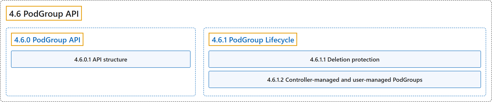

# 4.6 PodGroup API

## Classification

## Glossary

| Term | Definition | 中文翻译 | Source |
|---|---|---|---|
| **4.6 PodGroup API** PodGroup API | (context) "A PodGroup is **a runtime object** that represents **a group of Pods scheduled together as a single unit**." | （语境）PodGroup 是**一个运行时对象**，代表**作为单个单元一起调度的一组 Pod**。 | [The Kubernetes Authors, n.d.-a, "PodGroup API", para. 3](https://kubernetes.io/docs/concepts/workloads/podgroup-api/#:~:text=A%20PodGroup%20is%20a%20runtime%20object%20that) |
| **[4.6.0 PodGroup API](podgroup-api.md)** PodGroup API | (context) "A PodGroup is **a runtime object** that represents **a group of Pods scheduled together as a single unit**." | （语境）PodGroup 是**一个运行时对象**，代表**作为单个单元一起调度的一组 Pod**。 | [The Kubernetes Authors, n.d.-a, "PodGroup API", para. 3](https://kubernetes.io/docs/concepts/workloads/podgroup-api/#:~:text=A%20PodGroup%20is%20a%20runtime%20object%20that) |
| **[4.6.1 PodGroup Lifecycle](lifecycle.md)** PodGroup 生命周期 | (No definition) | （无定义） | [The Kubernetes Authors, n.d.-b, "PodGroup Lifecycle"](https://kubernetes.io/docs/concepts/workloads/podgroup-api/lifecycle/#podgroup-lifecycle) |

## References

The Kubernetes Authors. (n.d.-a). *PodGroup API*. Kubernetes Documentation. Retrieved October 31, 2026, from <https://kubernetes.io/docs/concepts/workloads/podgroup-api/>

The Kubernetes Authors. (n.d.-b). *PodGroup Lifecycle*. Kubernetes Documentation. Retrieved October 31, 2026, from <https://kubernetes.io/docs/concepts/workloads/podgroup-api/lifecycle/>
