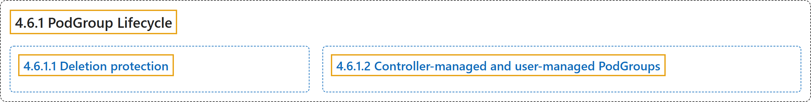

# 4.6.1 PodGroup Lifecycle

## Classification

## Glossary

| Term | Definition | 中文翻译 | Source |
|---|---|---|---|
| **4.6.1 PodGroup Lifecycle** PodGroup 生命周期 | (No definition) | （无定义） | [The Kubernetes Authors, n.d., "PodGroup Lifecycle"](https://kubernetes.io/docs/concepts/workloads/podgroup-api/lifecycle/#podgroup-lifecycle) |
| **4.6.1.1 Deletion protection** 删除保护 | "A `PodGroup` **cannot be fully deleted while any of its Pods are still running**." | 只要还有任何 Pod 在运行，`PodGroup` **就不能被彻底删除**。 | [The Kubernetes Authors, n.d., "Deletion protection", para. 1](https://kubernetes.io/docs/concepts/workloads/podgroup-api/lifecycle/#:~:text=A%20%60PodGroup%60%20cannot%20be%20fully%20deleted%20while) |
| **4.6.1.2 Controller-managed and user-managed PodGroups** 控制器管理与用户管理的 PodGroup | "In most cases, workload controllers (for example, Job) **create `PodGroups` automatically (controller-managed)**." | 大多数情况下，工作负载控制器（例如 Job）**会自动创建 `PodGroup`（由控制器管理）**。 | [The Kubernetes Authors, n.d., "Controller-managed and user-managed PodGroups", para. 1](https://kubernetes.io/docs/concepts/workloads/podgroup-api/lifecycle/#:~:text=In%20most%20cases%2C%20workload%20controllers%20%28for%20example%2C) |

## References

The Kubernetes Authors. (n.d.). *PodGroup Lifecycle*. Kubernetes Documentation. Retrieved October 31, 2026, from <https://kubernetes.io/docs/concepts/workloads/podgroup-api/lifecycle/>
