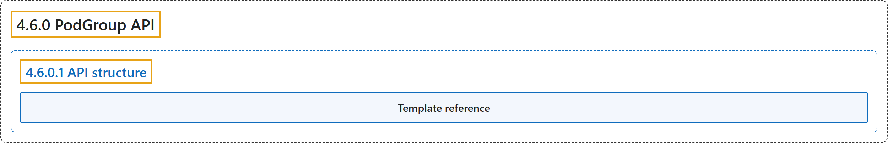

# 4.6.0 PodGroup API

## Classification

## Glossary

| Term | Definition | 中文翻译 | Source |
|---|---|---|---|
| **4.6.0 PodGroup API** PodGroup API | (context) "A PodGroup is **a runtime object that represents a group of Pods scheduled together as a single unit**." | （语境）PodGroup 是**一个运行时对象，代表作为单个单元一起调度的一组 Pod**。 | [The Kubernetes Authors, n.d., "PodGroup API", para. 3](https://kubernetes.io/docs/concepts/workloads/podgroup-api/#:~:text=A%20PodGroup%20is%20a%20runtime%20object%20that) |
| **4.6.0.1 API structure** API 结构 | "A PodGroup consists of **a `spec` that defines the desired scheduling behavior and a `status` that reflects the current scheduling state**." | PodGroup 由**定义期望调度行为的 `spec` 和反映当前调度状态的 `status`** 组成。 | [The Kubernetes Authors, n.d., "API structure", para. 1](https://kubernetes.io/docs/concepts/workloads/podgroup-api/#:~:text=A%20PodGroup%20consists%20of%20a%20%60spec%60%20that) |
| **Template reference** 模板引用 | "The optional `spec.podGroupTemplateRef` **links the PodGroup back to the PodGroupTemplate in the Workload it was created from**." | 可选的 `spec.podGroupTemplateRef` **把 PodGroup 关联回创建它的 Workload 中的 PodGroupTemplate**。 | [The Kubernetes Authors, n.d., "Template reference", para. 1](https://kubernetes.io/docs/concepts/workloads/podgroup-api/#:~:text=The%20optional%20%60spec.podGroupTemplateRef%60%20links%20the%20PodGroup%20back) |

## References

The Kubernetes Authors. (n.d.). *PodGroup API*. Kubernetes Documentation. Retrieved October 31, 2026, from <https://kubernetes.io/docs/concepts/workloads/podgroup-api/>
