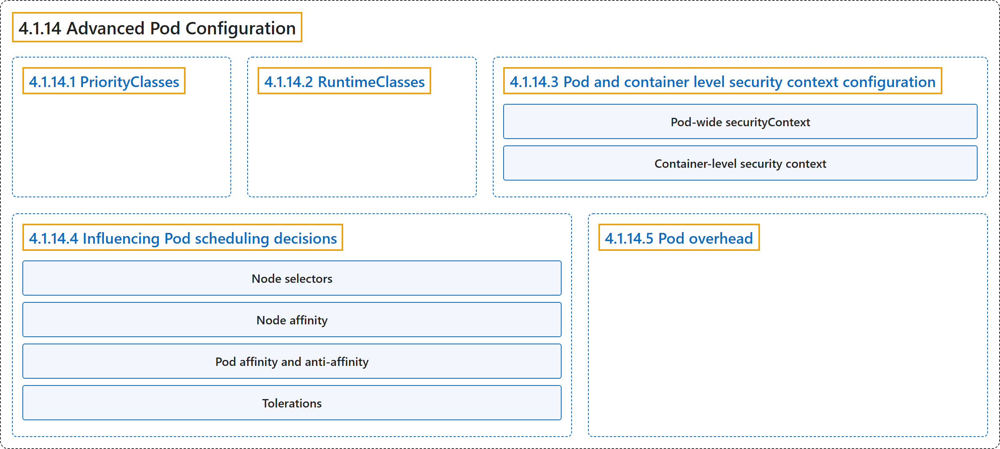

# 4.1.14 Advanced Pod Configuration

## Classification

## Glossary

| Term | Definition | 中文翻译 | Source |
|---|---|---|---|
| **4.1.14 Advanced Pod Configuration** Pod 高级配置 | (context) "This page covers **advanced Pod configuration topics**" | （语境）本页介绍 **Pod 的高级配置主题** | [The Kubernetes Authors, n.d., "Advanced Pod Configuration", para. 1](https://kubernetes.io/docs/concepts/workloads/pods/advanced-pod-config/#:~:text=This%20page%20covers%20advanced%20Pod%20configuration%20topics) |
| **4.1.14.1 PriorityClasses** PriorityClass | "*PriorityClasses* allow you to **set the importance of Pods relative to other Pods**." | *PriorityClass* 让你**设定 Pod 相对于其他 Pod 的重要性**。 | [The Kubernetes Authors, n.d., "PriorityClasses", para. 1](https://kubernetes.io/docs/concepts/workloads/pods/advanced-pod-config/#:~:text=%2APriorityClasses%2A%20allow%20you%20to%20set%20the%20importance) |
| **4.1.14.2 RuntimeClasses** RuntimeClass | "A *RuntimeClass* allows you to **specify the low-level container runtime for a Pod**." | *RuntimeClass* 让你**为 Pod 指定底层容器运行时**。 | [The Kubernetes Authors, n.d., "RuntimeClasses", para. 1](https://kubernetes.io/docs/concepts/workloads/pods/advanced-pod-config/#:~:text=A%20%2ARuntimeClass%2A%20allows%20you%20to%20specify%20the) |
| **4.1.14.3 Pod and container level security context configuration** Pod 与容器级安全上下文配置 | "The `Security context` field in the Pod specification **provides granular control over security settings for Pods and containers**." | Pod 规约中的 `Security context` 字段**为 Pod 和容器的安全设置提供细粒度控制**。 | [The Kubernetes Authors, n.d., "Pod and container level security context configuration", para. 1](https://kubernetes.io/docs/concepts/workloads/pods/advanced-pod-config/#:~:text=The%20%60Security%20context%60%20field%20in%20the%20Pod) |
| **Pod-wide securityContext** Pod 范围的 securityContext | (context) "Some aspects of security **apply to the whole Pod**; for other aspects, you might want to set a default, without any container-level overrides." | （语境）有些安全方面**适用于整个 Pod**；另一些方面你可能想设置默认值，而不做任何容器级覆盖。 | [The Kubernetes Authors, n.d., "Pod-wide securityContext", para. 1](https://kubernetes.io/docs/concepts/workloads/pods/advanced-pod-config/#:~:text=Some%20aspects%20of%20security%20apply%20to%20the) |
| **Container-level security context** 容器级安全上下文 | "You can **specify the security context just for a specific container**." | 你可以**只为特定容器指定安全上下文**。 | [The Kubernetes Authors, n.d., "Container-level security context", para. 1](https://kubernetes.io/docs/concepts/workloads/pods/advanced-pod-config/#:~:text=You%20can%20specify%20the%20security%20context%20just) |
| **4.1.14.4 Influencing Pod scheduling decisions** 影响 Pod 调度决策 | "Kubernetes provides **several mechanisms to control which nodes your Pods are scheduled on**." | Kubernetes 提供**多种机制来控制 Pod 被调度到哪些节点**。 | [The Kubernetes Authors, n.d., "Influencing Pod scheduling decisions", para. 1](https://kubernetes.io/docs/concepts/workloads/pods/advanced-pod-config/#:~:text=Kubernetes%20provides%20several%20mechanisms%20to%20control%20which) |
| **Node selectors** 节点选择器 | "**The simplest form of node selection constraint:**" | **最简单的节点选择约束形式：** | [The Kubernetes Authors, n.d., "Node selectors", para. 1](https://kubernetes.io/docs/concepts/workloads/pods/advanced-pod-config/#:~:text=The%20simplest%20form%20of%20node%20selection%20constraint%3A) |
| **Node affinity** 节点亲和性 | "Node affinity **allows you to specify rules that constrain which nodes your Pod can be scheduled on**." | 节点亲和性**让你指定规则，约束 Pod 可以被调度到哪些节点上**。 | [The Kubernetes Authors, n.d., "Node affinity", para. 1](https://kubernetes.io/docs/concepts/workloads/pods/advanced-pod-config/#:~:text=Node%20affinity%20allows%20you%20to%20specify%20rules) |
| **Pod affinity and anti-affinity** Pod 亲和性与反亲和性 | "In addition to node affinity, you can also **constrain which nodes a Pod can be scheduled on based on the labels of *other Pods* that are already running on nodes**." | 除了节点亲和性，你还可以**根据节点上已在运行的*其他 Pod* 的标签，约束 Pod 可以被调度到哪些节点**。 | [The Kubernetes Authors, n.d., "Pod affinity and anti-affinity", para. 1](https://kubernetes.io/docs/concepts/workloads/pods/advanced-pod-config/#:~:text=In%20addition%20to%20node%20affinity%2C%20you%20can) |
| **Tolerations** 容忍度 | "*Tolerations* allow **Pods to be scheduled on nodes with matching taints**:" | *容忍度*允许 **Pod 被调度到带有匹配污点的节点上**： | [The Kubernetes Authors, n.d., "Tolerations", para. 1](https://kubernetes.io/docs/concepts/workloads/pods/advanced-pod-config/#:~:text=%2ATolerations%2A%20allow%20Pods%20to%20be%20scheduled%20on) |
| **4.1.14.5 Pod overhead** Pod 开销 | "Pod overhead **allows you to account for the resources consumed by the Pod infrastructure on top of the container requests and limits**." | Pod 开销**让你在容器请求和限制之外，计入 Pod 基础设施所消耗的资源**。 | [The Kubernetes Authors, n.d., "Pod overhead", para. 1](https://kubernetes.io/docs/concepts/workloads/pods/advanced-pod-config/#:~:text=Pod%20overhead%20allows%20you%20to%20account%20for) |

## References

The Kubernetes Authors. (n.d.). *Advanced Pod Configuration*. Kubernetes Documentation. Retrieved October 31, 2026, from <https://kubernetes.io/docs/concepts/workloads/pods/advanced-pod-config/>
