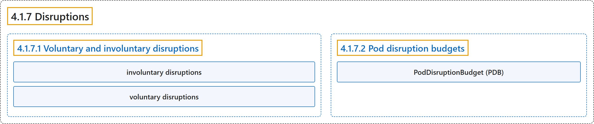

# 4.1.7 Disruptions

## Classification

## Glossary

| Term | Definition | 中文翻译 | Source |
|---|---|---|---|
| **4.1.7 Disruptions** 干扰 | (context) "This guide is for application owners who want to **build highly available applications**, and thus need to understand **what types of disruptions can happen to Pods**." | （语境）本指南面向想**构建高可用应用**的应用所有者，他们因此需要了解 **Pod 可能遇到哪些类型的干扰**。 | [The Kubernetes Authors, n.d., "Disruptions", para. 1](https://kubernetes.io/docs/concepts/workloads/pods/disruptions/#:~:text=This%20guide%20is%20for%20application%20owners%20who) |
| **4.1.7.1 Voluntary and involuntary disruptions** 自愿与非自愿干扰 | (No definition) | （无定义） | [The Kubernetes Authors, n.d., "Voluntary and involuntary disruptions"](https://kubernetes.io/docs/concepts/workloads/pods/disruptions/#voluntary-and-involuntary-disruptions) |
| **involuntary disruptions** 非自愿干扰 | "We call these **unavoidable** cases ***involuntary disruptions* to an application**." | 我们把这些**无法避免**的情况称为**对应用的*非自愿干扰***。 | [The Kubernetes Authors, n.d., "Voluntary and involuntary disruptions", para. 2](https://kubernetes.io/docs/concepts/workloads/pods/disruptions/#:~:text=We%20call%20these%20unavoidable%20cases%20%2Ainvoluntary%20disruptions%2A) |
| **voluntary disruptions** 自愿干扰 | (context) "We call other cases *voluntary disruptions*." | （语境）我们把其他情况称为*自愿干扰*。 | [The Kubernetes Authors, n.d., "Voluntary and involuntary disruptions", para. 10](https://kubernetes.io/docs/concepts/workloads/pods/disruptions/#:~:text=We%20call%20other%20cases%20%2Avoluntary%20disruptions%2A.) |
| **4.1.7.2 Pod disruption budgets** Pod 干扰预算 | "Kubernetes offers features to help you **run highly available applications** even when you introduce **frequent voluntary disruptions**." | Kubernetes 提供的功能帮助你**运行高可用的应用**，即使你引入**频繁的自愿干扰**。 | [The Kubernetes Authors, n.d., "Pod disruption budgets", para. 1](https://kubernetes.io/docs/concepts/workloads/pods/disruptions/#:~:text=Kubernetes%20offers%20features%20to%20help%20you%20run) |
| **PodDisruptionBudget (PDB)** Pod 干扰预算（PDB） | "A PDB **limits the number of Pods of a replicated application** that are **down simultaneously from voluntary disruptions**." | PDB **限制一个多副本应用中的 Pod 数量**，即**因自愿干扰而同时宕掉**的那些。 | [The Kubernetes Authors, n.d., "Pod disruption budgets", para. 2](https://kubernetes.io/docs/concepts/workloads/pods/disruptions/#:~:text=A%20PDB%20limits%20the%20number%20of%20Pods) |

## References

The Kubernetes Authors. (n.d.). *Disruptions*. Kubernetes Documentation. Retrieved October 31, 2026, from <https://kubernetes.io/docs/concepts/workloads/pods/disruptions/>
