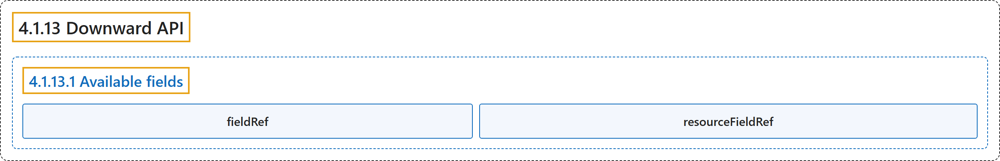

# 4.1.13 Downward API

## Classification

## Glossary

| Term | Definition | 中文翻译 | Source |
|---|---|---|---|
| **4.1.13 Downward API** Downward API | "The ***downward API*** allows containers to **consume information about themselves or the cluster** without using **the Kubernetes client or API server**." | ***Downward API*** 让容器**获取关于自身或集群的信息**，而无需使用 **Kubernetes 客户端或 API 服务器**。 | [The Kubernetes Authors, n.d., "Downward API", para. 2](https://kubernetes.io/docs/concepts/workloads/pods/downward-api/#:~:text=The%20%2Adownward%20API%2A%20allows%20containers%20to%20consume) |
| **4.1.13.1 Available fields** 可用字段 | "**Only some Kubernetes API fields** are **available through the downward API**." | **只有部分 Kubernetes API 字段**可以**通过 Downward API 获取**。 | [The Kubernetes Authors, n.d., "Available fields", para. 1](https://kubernetes.io/docs/concepts/workloads/pods/downward-api/#:~:text=Only%20some%20Kubernetes%20API%20fields%20are%20available) |
| **fieldRef** fieldRef | (context) "For **some Pod-level fields**, you can provide them to a container either as **an environment variable** or using **a `downwardAPI` volume**." | （语境）对于**某些 Pod 级字段**，你可以通过**环境变量**或 **`downwardAPI` 卷**把它们提供给容器。 | [The Kubernetes Authors, n.d., "Information available via fieldRef", para. 1](https://kubernetes.io/docs/concepts/workloads/pods/downward-api/#:~:text=For%20some%20Pod-level%20fields%2C%20you%20can%20provide) |
| **resourceFieldRef** resourceFieldRef | (context) "**These container-level fields** allow you to provide information about **requests and limits** for resources such as **CPU and memory**." | （语境）**这些容器级字段**让你提供**请求与限制**的信息，针对的是 **CPU 和内存**等资源。 | [The Kubernetes Authors, n.d., "Information available via resourceFieldRef", para. 1](https://kubernetes.io/docs/concepts/workloads/pods/downward-api/#:~:text=These%20container-level%20fields%20allow%20you%20to%20provide) |

## References

The Kubernetes Authors. (n.d.). *Downward API*. Kubernetes Documentation. Retrieved October 31, 2026, from <https://kubernetes.io/docs/concepts/workloads/pods/downward-api/>
