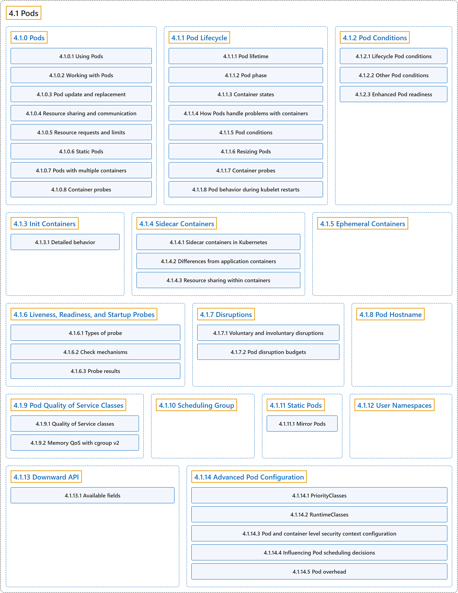

# 4.1 Pods

## Classification

## Glossary

| Term | Definition | 中文翻译 | Source |
|---|---|---|---|
| **4.1 Pods** Pod | "*Pods* are **the smallest deployable units of computing that you can create and manage in Kubernetes**." | *Pod* 是**你在 Kubernetes 中可以创建和管理的最小可部署计算单元**。 | [The Kubernetes Authors, n.d.-k, "Pods", para. 1](https://kubernetes.io/docs/concepts/workloads/pods/#:~:text=%2APods%2A%20are%20the%20smallest%20deployable%20units%20of) |
| **[4.1.0 Pods](pods.md)** Pod | "A *Pod* (as in a pod of whales or pea pod) is **a group of one or more [containers](https://kubernetes.io/docs/concepts/containers/), with shared storage and network resources, and a specification for how to run the containers**." | *Pod*（就像一群鲸鱼或一个豌豆荚）是**一组一个或多个[容器](https://kubernetes.io/docs/concepts/containers/)，共享存储和网络资源，并带有如何运行这些容器的规约**。 | [The Kubernetes Authors, n.d.-k, "Pods", para. 2](https://kubernetes.io/docs/concepts/workloads/pods/#:~:text=A%20%2APod%2A%20%28as%20in%20a%20pod%20of) |
| **[4.1.1 Pod Lifecycle](pod-lifecycle.md)** Pod 的生命周期 | (context) "Pods follow **a defined lifecycle**," | （语境）Pod 遵循**一个既定的生命周期**， | [The Kubernetes Authors, n.d.-i, "Pod Lifecycle", para. 1](https://kubernetes.io/docs/concepts/workloads/pods/pod-lifecycle/#:~:text=Pods%20follow%20a%20defined%20lifecycle%2C) |
| **[4.1.2 Pod Conditions](pod-condition.md)** Pod 状况 | "Conditions are **markers for some aspect of the actual state of the thing the object represents**." | 状况是**对象所代表事物实际状态某一方面的标记**。 | [The Kubernetes Authors, n.d.-g, "Pod Conditions", para. 1](https://kubernetes.io/docs/concepts/workloads/pods/pod-condition/#:~:text=Conditions%20are%20markers%20for%20some%20aspect%20of) |
| **[4.1.3 Init Containers](init-containers.md)** Init 容器 | "This page provides an overview of init containers: **specialized containers that run before app containers in a [Pod](https://kubernetes.io/docs/concepts/workloads/pods/)**." | 本页概述 Init 容器：**在 [Pod](https://kubernetes.io/docs/concepts/workloads/pods/) 中先于应用容器运行的专用容器**。 | [The Kubernetes Authors, n.d.-e, "Init Containers", para. 1](https://kubernetes.io/docs/concepts/workloads/pods/init-containers/#:~:text=This%20page%20provides%20an%20overview%20of%20init) |
| **[4.1.4 Sidecar Containers](sidecar-containers.md)** 边车容器 | "Sidecar containers are **the secondary containers that run along with the main application container within the same [Pod](https://kubernetes.io/docs/concepts/workloads/pods/)**." | 边车容器是**在同一个 [Pod](https://kubernetes.io/docs/concepts/workloads/pods/) 中与主应用容器一起运行的辅助容器**。 | [The Kubernetes Authors, n.d.-m, "Sidecar Containers", para. 2](https://kubernetes.io/docs/concepts/workloads/pods/sidecar-containers/#:~:text=Sidecar%20containers%20are%20the%20secondary%20containers%20that) |
| **[4.1.5 Ephemeral Containers](ephemeral-containers.md)** 临时容器 | "ephemeral containers: **a special type of container that runs temporarily in an existing [Pod](https://kubernetes.io/docs/concepts/workloads/pods/)**" | 临时容器：**一种在已有 [Pod](https://kubernetes.io/docs/concepts/workloads/pods/) 中临时运行的特殊容器** | [The Kubernetes Authors, n.d.-d, "Ephemeral Containers", para. 1](https://kubernetes.io/docs/concepts/workloads/pods/ephemeral-containers/#:~:text=ephemeral%20containers%3A%20a%20special%20type%20of%20container) |
| **[4.1.6 Liveness, Readiness, and Startup Probes](probes.md)** 存活、就绪和启动探针 | "Kubernetes lets you define *probes* to **continuously monitor the health of containers in a Pod**." | Kubernetes 让你定义*探针*，**持续监控 Pod 中容器的健康状况**。 | [The Kubernetes Authors, n.d.-f, "Liveness, Readiness, and Startup Probes", para. 1](https://kubernetes.io/docs/concepts/workloads/pods/probes/#:~:text=Kubernetes%20lets%20you%20define%20%2Aprobes%2A%20to%20continuously) |
| **[4.1.7 Disruptions](disruptions.md)** 干扰 | (context) "This guide is for application owners who want to build highly available applications, and thus **need to understand what types of disruptions can happen to Pods**." | （语境）本指南面向想构建高可用应用的应用所有者，他们因此**需要了解 Pod 可能遇到哪些类型的干扰**。 | [The Kubernetes Authors, n.d.-b, "Disruptions", para. 1](https://kubernetes.io/docs/concepts/workloads/pods/disruptions/#:~:text=This%20guide%20is%20for%20application%20owners%20who) |
| **[4.1.8 Pod Hostname](pod-hostname.md)** Pod 主机名 | (context) "When a Pod is created, **its hostname (as observed from within the Pod) is derived from the Pod's metadata.name value**." | （语境）创建 Pod 时，**它的主机名（从 Pod 内部看到的）取自 Pod 的 metadata.name 值**。 | [The Kubernetes Authors, n.d.-h, "Default Pod hostname", para. 1](https://kubernetes.io/docs/concepts/workloads/pods/pod-hostname/#:~:text=When%20a%20Pod%20is%20created%2C%20its%20hostname) |
| **[4.1.9 Pod Quality of Service Classes](pod-qos.md)** Pod 服务质量类 | "Kubernetes classifies the Pods that you run and **allocates each Pod into a specific *quality of service (QoS) class***." | Kubernetes 对你运行的 Pod 进行分类，**把每个 Pod 归入特定的*服务质量（QoS）类***。 | [The Kubernetes Authors, n.d.-j, "Quality of Service classes", para. 1](https://kubernetes.io/docs/concepts/workloads/pods/pod-qos/#:~:text=Kubernetes%20classifies%20the%20Pods%20that%20you%20run) |
| **[4.1.10 Scheduling Group](scheduling-group.md)** 调度组 | (context) "When the [GenericWorkload](https://kubernetes.io/docs/reference/command-line-tools-reference/feature-gates/#GenericWorkload) feature gate is enabled, **you can set the `spec.schedulingGroup` field in your `Pod` manifest**." | （语境）启用 [GenericWorkload](https://kubernetes.io/docs/reference/command-line-tools-reference/feature-gates/#GenericWorkload) 特性门控后，**你可以在 `Pod` 清单中设置 `spec.schedulingGroup` 字段**。 | [The Kubernetes Authors, n.d.-l, "Specifying a scheduling group", para. 1](https://kubernetes.io/docs/concepts/workloads/pods/scheduling-group/#:~:text=When%20the%20%5BGenericWorkload%5D%28https%3A%2F%2Fkubernetes.io%2Fdocs%2Freference%2Fcommand-line-tools-reference%2Ffeature-gates%2F%23GenericWorkload%29%20feature%20gate%20is%20enabled%2C) |
| **[4.1.11 Static Pods](static-pods.md)** 静态 Pod | "*Static Pods* are **managed directly by the kubelet daemon on a specific node, without the [API server](https://kubernetes.io/docs/concepts/architecture/#kube-apiserver) observing them**." | *静态 Pod* **由特定节点上的 kubelet 守护进程直接管理，[API 服务器](https://kubernetes.io/docs/concepts/architecture/#kube-apiserver)不会观察它们**。 | [The Kubernetes Authors, n.d.-n, "Static Pods", para. 1](https://kubernetes.io/docs/concepts/workloads/pods/static-pods/#:~:text=%2AStatic%20Pods%2A%20are%20managed%20directly%20by%20the) |
| **[4.1.12 User Namespaces](user-namespaces.md)** 用户命名空间 | "User namespaces is **a Linux feature that allows you to map users in the container to different users in the host**." | 用户命名空间是**一项 Linux 功能，让你把容器内的用户映射为主机上的不同用户**。 | [The Kubernetes Authors, n.d.-o, "Introduction", para. 1](https://kubernetes.io/docs/concepts/workloads/pods/user-namespaces/#:~:text=User%20namespaces%20is%20a%20Linux%20feature%20that) |
| **[4.1.13 Downward API](downward-api.md)** Downward API | "The *downward API* **allows containers to consume information about themselves or the cluster without using the Kubernetes client or API server**." | *Downward API* **让容器无需使用 Kubernetes 客户端或 API 服务器，就能获取关于自身或集群的信息**。 | [The Kubernetes Authors, n.d.-c, "Downward API", para. 2](https://kubernetes.io/docs/concepts/workloads/pods/downward-api/#:~:text=The%20%2Adownward%20API%2A%20allows%20containers%20to%20consume) |
| **[4.1.14 Advanced Pod Configuration](advanced-pod-config.md)** Pod 高级配置 | (context) "This page covers **advanced Pod configuration topics**" | （语境）本页介绍 **Pod 的高级配置主题** | [The Kubernetes Authors, n.d.-a, "Advanced Pod Configuration", para. 1](https://kubernetes.io/docs/concepts/workloads/pods/advanced-pod-config/#:~:text=This%20page%20covers%20advanced%20Pod%20configuration%20topics) |

## References

The Kubernetes Authors. (n.d.-a). *Advanced Pod Configuration*. Kubernetes Documentation. Retrieved October 31, 2026, from <https://kubernetes.io/docs/concepts/workloads/pods/advanced-pod-config/>

The Kubernetes Authors. (n.d.-b). *Disruptions*. Kubernetes Documentation. Retrieved October 31, 2026, from <https://kubernetes.io/docs/concepts/workloads/pods/disruptions/>

The Kubernetes Authors. (n.d.-c). *Downward API*. Kubernetes Documentation. Retrieved October 31, 2026, from <https://kubernetes.io/docs/concepts/workloads/pods/downward-api/>

The Kubernetes Authors. (n.d.-d). *Ephemeral Containers*. Kubernetes Documentation. Retrieved October 31, 2026, from <https://kubernetes.io/docs/concepts/workloads/pods/ephemeral-containers/>

The Kubernetes Authors. (n.d.-e). *Init Containers*. Kubernetes Documentation. Retrieved October 31, 2026, from <https://kubernetes.io/docs/concepts/workloads/pods/init-containers/>

The Kubernetes Authors. (n.d.-f). *Liveness, Readiness, and Startup Probes*. Kubernetes Documentation. Retrieved October 31, 2026, from <https://kubernetes.io/docs/concepts/workloads/pods/probes/>

The Kubernetes Authors. (n.d.-g). *Pod Conditions*. Kubernetes Documentation. Retrieved October 31, 2026, from <https://kubernetes.io/docs/concepts/workloads/pods/pod-condition/>

The Kubernetes Authors. (n.d.-h). *Pod Hostname*. Kubernetes Documentation. Retrieved October 31, 2026, from <https://kubernetes.io/docs/concepts/workloads/pods/pod-hostname/>

The Kubernetes Authors. (n.d.-i). *Pod Lifecycle*. Kubernetes Documentation. Retrieved October 31, 2026, from <https://kubernetes.io/docs/concepts/workloads/pods/pod-lifecycle/>

The Kubernetes Authors. (n.d.-j). *Pod Quality of Service Classes*. Kubernetes Documentation. Retrieved October 31, 2026, from <https://kubernetes.io/docs/concepts/workloads/pods/pod-qos/>

The Kubernetes Authors. (n.d.-k). *Pods*. Kubernetes Documentation. Retrieved October 31, 2026, from <https://kubernetes.io/docs/concepts/workloads/pods/>

The Kubernetes Authors. (n.d.-l). *Scheduling Group*. Kubernetes Documentation. Retrieved October 31, 2026, from <https://kubernetes.io/docs/concepts/workloads/pods/scheduling-group/>

The Kubernetes Authors. (n.d.-m). *Sidecar Containers*. Kubernetes Documentation. Retrieved October 31, 2026, from <https://kubernetes.io/docs/concepts/workloads/pods/sidecar-containers/>

The Kubernetes Authors. (n.d.-n). *Static Pods*. Kubernetes Documentation. Retrieved October 31, 2026, from <https://kubernetes.io/docs/concepts/workloads/pods/static-pods/>

The Kubernetes Authors. (n.d.-o). *User Namespaces*. Kubernetes Documentation. Retrieved October 31, 2026, from <https://kubernetes.io/docs/concepts/workloads/pods/user-namespaces/>
