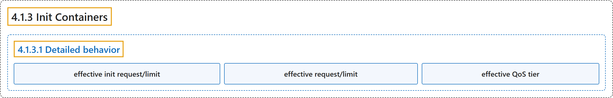

# 4.1.3 Init Containers

## Classification

## Glossary

| Term | Definition | 中文翻译 | Source |
|---|---|---|---|
| **4.1.3 Init Containers** Init 容器 | "This page provides an overview of init containers: **specialized containers that run before app containers in a [Pod](https://kubernetes.io/docs/concepts/workloads/pods/)**." | 本页概述 Init 容器：**在 [Pod](https://kubernetes.io/docs/concepts/workloads/pods/) 中先于应用容器运行的专用容器**。 | [The Kubernetes Authors, n.d., "Init Containers", para. 1](https://kubernetes.io/docs/concepts/workloads/pods/init-containers/#:~:text=This%20page%20provides%20an%20overview%20of%20init) |
| **4.1.3.1 Detailed behavior** 详细行为 | (No definition) | （无定义） | [The Kubernetes Authors, n.d., "Detailed behavior"](https://kubernetes.io/docs/concepts/workloads/pods/init-containers/#detailed-behavior) |
| **effective init request/limit** 有效 Init 请求/限制 | "The highest of any particular resource request or limit defined on all init containers is **the *effective init request/limit***." | 所有 Init 容器上定义的某种资源请求或限制中的最高值，就是**有效 Init 请求/限制**。 | [The Kubernetes Authors, n.d., "Resource sharing within containers", para. 2](https://kubernetes.io/docs/concepts/workloads/pods/init-containers/#:~:text=The%20highest%20of%20any%20particular%20resource%20request) |
| **effective request/limit** 有效请求/限制 | "The Pod's *effective request/limit* for a resource is **the higher of**:" | Pod 对某种资源的*有效请求/限制*是**以下两者中的较高者**： | [The Kubernetes Authors, n.d., "Resource sharing within containers", para. 3](https://kubernetes.io/docs/concepts/workloads/pods/init-containers/#:~:text=The%20Pod%27s%20%2Aeffective%20request%2Flimit%2A%20for%20a%20resource) |
| **effective QoS tier** 有效 QoS 层级 | "The QoS (quality of service) tier of the Pod's *effective QoS tier* is **the QoS tier for init containers and app containers alike**." | Pod 的*有效 QoS 层级*，**对 Init 容器和应用容器都同样适用**。 | [The Kubernetes Authors, n.d., "Resource sharing within containers", para. 5](https://kubernetes.io/docs/concepts/workloads/pods/init-containers/#:~:text=The%20QoS%20%28quality%20of%20service%29%20tier%20of) |

## References

The Kubernetes Authors. (n.d.). *Init Containers*. Kubernetes Documentation. Retrieved October 31, 2026, from <https://kubernetes.io/docs/concepts/workloads/pods/init-containers/>
