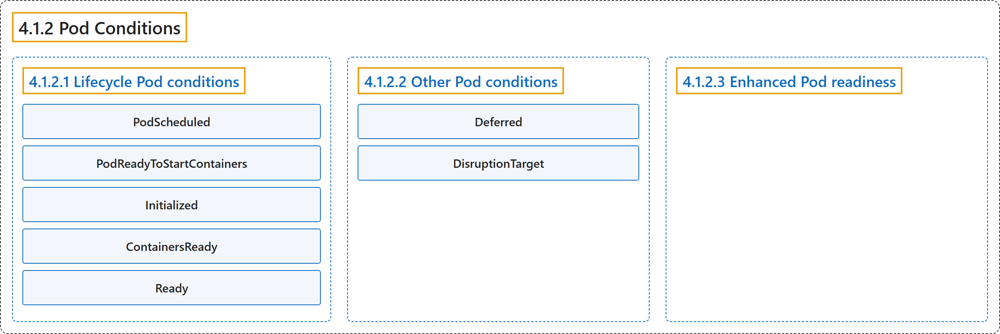

# 4.1.2 Pod Conditions

## Classification

## Glossary

| Term | Definition | 中文翻译 | Source |
|---|---|---|---|
| **4.1.2 Pod Conditions** Pod 状况 | "**Conditions** are **markers for some aspect of the actual state** of the thing the object represents." | **状况**是对象所代表事物**实际状态某一方面的标记**。 | [The Kubernetes Authors, n.d., "Pod Conditions", para. 1](https://kubernetes.io/docs/concepts/workloads/pods/pod-condition/#:~:text=Conditions%20are%20markers%20for%20some%20aspect%20of) |
| **4.1.2.1 Lifecycle Pod conditions** 生命周期 Pod 状况 | (context) "**As a Pod progresses through its lifecycle**, the kubelet sets **the following conditions roughly in this order**:" | （语境）**随着 Pod 在生命周期中推进**，kubelet 会设置**下列状况，顺序大致如下**： | [The Kubernetes Authors, n.d., "Lifecycle Pod conditions", para. 1](https://kubernetes.io/docs/concepts/workloads/pods/pod-condition/#:~:text=As%20a%20Pod%20progresses%20through%20its%20lifecycle%2C) |
| **PodScheduled** PodScheduled | "`PodScheduled`: **the Pod** has been **scheduled to a node**." | `PodScheduled`：**Pod** 已被**调度到某个节点**。 | [The Kubernetes Authors, n.d., "Lifecycle Pod conditions", para. 2](https://kubernetes.io/docs/concepts/workloads/pods/pod-condition/#:~:text=%60PodScheduled%60%3A%20the%20Pod%20has%20been%20scheduled%20to) |
| **PodReadyToStartContainers** PodReadyToStartContainers | "`PodReadyToStartContainers`: **the Pod sandbox has been successfully created** and **networking configured**." | `PodReadyToStartContainers`：**Pod 沙箱已成功创建**，**网络已配置**。 | [The Kubernetes Authors, n.d., "Lifecycle Pod conditions", para. 3](https://kubernetes.io/docs/concepts/workloads/pods/pod-condition/#:~:text=%60PodReadyToStartContainers%60%3A%20the%20Pod%20sandbox%20has%20been%20successfully) |
| **Initialized** Initialized | "`Initialized`: **all init containers** have **completed successfully**." | `Initialized`：**所有 Init 容器**都已**成功完成**。 | [The Kubernetes Authors, n.d., "Lifecycle Pod conditions", para. 4](https://kubernetes.io/docs/concepts/workloads/pods/pod-condition/#:~:text=%60Initialized%60%3A%20all%20%5Binit%20containers%5D%28https%3A%2F%2Fkubernetes.io%2Fdocs%2Fconcepts%2Fworkloads%2Fpods%2Finit-containers%2F%29%20have%20completed%20successfully.) |
| **ContainersReady** ContainersReady | "`ContainersReady`: **all containers in the Pod** are **ready**." | `ContainersReady`：**Pod 中所有容器**都已**就绪**。 | [The Kubernetes Authors, n.d., "Lifecycle Pod conditions", para. 5](https://kubernetes.io/docs/concepts/workloads/pods/pod-condition/#:~:text=%60ContainersReady%60%3A%20all%20containers%20in%20the%20Pod%20are) |
| **Ready** Ready | "`Ready`: the Pod is **able to serve requests** and should be **added to the load balancing pools of all matching Services**." | `Ready`：Pod **能够处理请求**，应被**加入所有匹配 Service 的负载均衡池**。 | [The Kubernetes Authors, n.d., "Lifecycle Pod conditions", para. 6](https://kubernetes.io/docs/concepts/workloads/pods/pod-condition/#:~:text=%60Ready%60%3A%20the%20Pod%20is%20able%20to%20serve) |
| **4.1.2.2 Other Pod conditions** 其他 Pod 状况 | (No definition) | （无定义） | [The Kubernetes Authors, n.d., "Other Pod conditions"](https://kubernetes.io/docs/concepts/workloads/pods/pod-condition/#other-pod-conditions) |
| **Deferred** Deferred | (context) "If the requested resize is ***Deferred***, the kubelet will **periodically re-attempt the resize**, for example when another pod is removed or scaled down." | （语境）如果请求的调整处于 ***Deferred*** 状态，kubelet 会**定期重新尝试调整**，例如在另一个 Pod 被移除或缩容时。 | [The Kubernetes Authors, n.d., "PodResizePending and PodResizeInProgress", para. 4](https://kubernetes.io/docs/concepts/workloads/pods/pod-condition/#:~:text=If%20the%20requested%20resize%20is%20%2ADeferred%2A%2C%20the) |
| **DisruptionTarget** DisruptionTarget | "A dedicated Pod **`DisruptionTarget` condition** is added to indicate that the Pod is **about to be deleted due to a disruption**." | 专门的 Pod **`DisruptionTarget` 状况**用来表示 Pod **即将因干扰而被删除**。 | [The Kubernetes Authors, n.d., "DisruptionTarget", para. 1](https://kubernetes.io/docs/concepts/workloads/pods/pod-condition/#:~:text=A%20dedicated%20Pod%20%60DisruptionTarget%60%20condition%20is%20added) |
| **4.1.2.3 Enhanced Pod readiness** 增强的 Pod 就绪 | "Your application can **inject extra feedback or signals** into the Pod's `.status`; this is known as ***enhanced Pod readiness***." | 你的应用可以向 Pod 的 `.status` **注入额外的反馈或信号**；这称为***增强的 Pod 就绪***。 | [The Kubernetes Authors, n.d., "Enhanced Pod readiness", para. 1](https://kubernetes.io/docs/concepts/workloads/pods/pod-condition/#:~:text=Your%20application%20can%20inject%20extra%20feedback%20or) |

## References

The Kubernetes Authors. (n.d.). *Pod Conditions*. Kubernetes Documentation. Retrieved October 31, 2026, from <https://kubernetes.io/docs/concepts/workloads/pods/pod-condition/>
