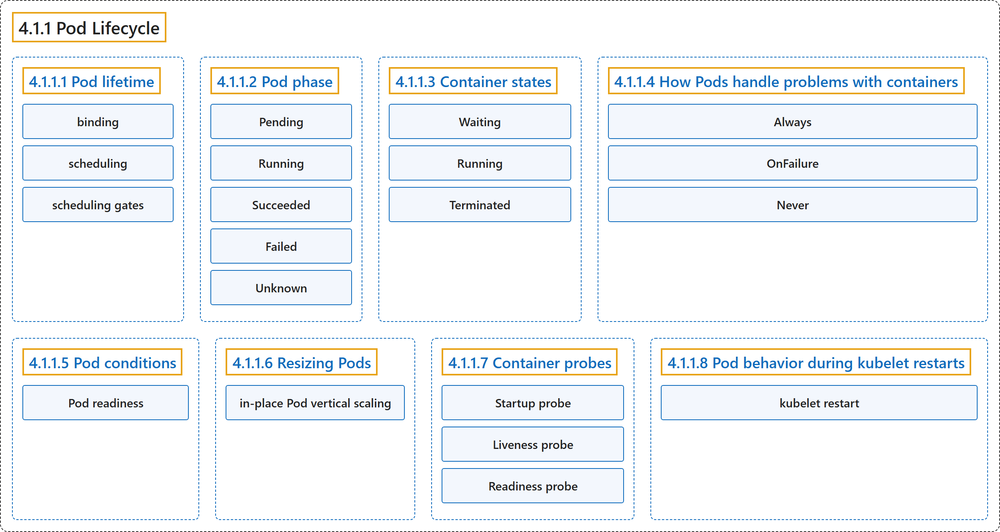

# 4.1.1 Pod Lifecycle

## Classification

## Glossary

| Term | Definition | 中文翻译 | Source |
|---|---|---|---|
| **4.1.1 Pod Lifecycle** Pod 的生命周期 | (context) "Pods follow **a defined lifecycle**," | （语境）Pod 遵循**一个既定的生命周期**， | [The Kubernetes Authors, n.d., "Pod Lifecycle", para. 1](https://kubernetes.io/docs/concepts/workloads/pods/pod-lifecycle/#:~:text=Pods%20follow%20a%20defined%20lifecycle%2C) |
| **4.1.1.1 Pod lifetime** Pod 的生存期 | (No definition) | （无定义） | [The Kubernetes Authors, n.d., "Pod lifetime"](https://kubernetes.io/docs/concepts/workloads/pods/pod-lifecycle/#pod-lifetime) |
| **binding** 绑定 | (context) "**assigning a Pod to a specific node** is called ***binding***, and the process of selecting which node to use is called *scheduling*" | （语境）**把 Pod 分配给特定节点**称为***绑定***，而选择使用哪个节点的过程称为*调度* | [The Kubernetes Authors, n.d., "Pod lifetime", para. 4](https://kubernetes.io/docs/concepts/workloads/pods/pod-lifecycle/#:~:text=assigning%20a%20Pod%20to%20a%20specific%20node) |
| **scheduling** 调度 | (context) "assigning a Pod to a specific node is called *binding*, and **the process of selecting which node to use** is called ***scheduling***" | （语境）把 Pod 分配给特定节点称为*绑定*，而**选择使用哪个节点的过程**称为***调度*** | [The Kubernetes Authors, n.d., "Pod lifetime", para. 4](https://kubernetes.io/docs/concepts/workloads/pods/pod-lifecycle/#:~:text=assigning%20a%20Pod%20to%20a%20specific%20node) |
| **scheduling gates** 调度门控 | (context) "You can use Pod Scheduling Readiness to **delay scheduling for a Pod** until **all its *scheduling gates* are removed**." | （语境）你可以使用 Pod 调度就绪**推迟 Pod 的调度**，直到**它的所有*调度门控*都被移除**。 | [The Kubernetes Authors, n.d., "Pod lifetime", para. 5](https://kubernetes.io/docs/concepts/workloads/pods/pod-lifecycle/#:~:text=You%20can%20use%20%5BPod%20Scheduling%20Readiness%5D%28https%3A%2F%2Fkubernetes.io%2Fdocs%2Fconcepts%2Fscheduling-eviction%2Fpod-scheduling-readiness%2F%29%20to) |
| **4.1.1.2 Pod phase** Pod 阶段 | (context) "A Pod's **`status` field** is **a PodStatus object**, which has **a `phase` field**." | （语境）Pod 的 **`status` 字段**是**一个 PodStatus 对象**，其中有**一个 `phase` 字段**。 | [The Kubernetes Authors, n.d., "Pod phase", para. 1](https://kubernetes.io/docs/concepts/workloads/pods/pod-lifecycle/#:~:text=A%20Pod%27s%20%60status%60%20field%20is%20a%20%5BPodStatus%5D%28https%3A%2F%2Fkubernetes.io%2Fdocs%2Freference%2Fgenerated%2Fkubernetes-api%2Fv1.37%2F%23podstatus-v1-core%29) |
| **Pending** Pending | "The Pod has been **accepted by the Kubernetes cluster**, but one or more of the containers has **not been set up and made ready to run**." | Pod 已被 **Kubernetes 集群接受**，但有一个或多个容器**尚未设置好并准备运行**。 | [The Kubernetes Authors, n.d., "Pod phase", para. 7](https://kubernetes.io/docs/concepts/workloads/pods/pod-lifecycle/#:~:text=The%20Pod%20has%20been%20accepted%20by%20the) |
| **Running** Running | "**The Pod has been bound to a node**, and **all of the containers have been created**." | **Pod 已绑定到节点**，并且**所有容器都已创建**。 | [The Kubernetes Authors, n.d., "Pod phase", para. 8](https://kubernetes.io/docs/concepts/workloads/pods/pod-lifecycle/#:~:text=The%20Pod%20has%20been%20bound%20to%20a) |
| **Succeeded** Succeeded | "All containers in the Pod have **terminated in success**, and **will not be restarted**." | Pod 中所有容器都已**成功终止**，并且**不会再重启**。 | [The Kubernetes Authors, n.d., "Pod phase", para. 9](https://kubernetes.io/docs/concepts/workloads/pods/pod-lifecycle/#:~:text=All%20containers%20in%20the%20Pod%20have%20terminated) |
| **Failed** Failed | "**All containers in the Pod have terminated**, and **at least one container has terminated in failure**." | **Pod 中所有容器都已终止**，并且**至少有一个容器以失败告终**。 | [The Kubernetes Authors, n.d., "Pod phase", para. 10](https://kubernetes.io/docs/concepts/workloads/pods/pod-lifecycle/#:~:text=All%20containers%20in%20the%20Pod%20have%20terminated%2C) |
| **Unknown** Unknown | "**For some reason** the state of the Pod **could not be obtained**." | **由于某种原因**，Pod 的状态**无法获取**。 | [The Kubernetes Authors, n.d., "Pod phase", para. 11](https://kubernetes.io/docs/concepts/workloads/pods/pod-lifecycle/#:~:text=For%20some%20reason%20the%20state%20of%20the) |
| **4.1.1.3 Container states** 容器状态 | (context) "As well as **the phase of the Pod overall**, Kubernetes tracks **the state of each container inside a Pod**." | （语境）除了 **Pod 整体的阶段**，Kubernetes 还跟踪 **Pod 内每个容器的状态**。 | [The Kubernetes Authors, n.d., "Container states", para. 1](https://kubernetes.io/docs/concepts/workloads/pods/pod-lifecycle/#:~:text=As%20well%20as%20the%20%5Bphase%5D%28%23pod-phase%29%20of%20the) |
| **Waiting** Waiting | "If a container is **not in either the `Running` or `Terminated` state**, it is **`Waiting`**." | 如果容器既**不处于 `Running` 也不处于 `Terminated` 状态**，它就处于 **`Waiting`** 状态。 | [The Kubernetes Authors, n.d., "Waiting", para. 1](https://kubernetes.io/docs/concepts/workloads/pods/pod-lifecycle/#:~:text=If%20a%20container%20is%20not%20in%20either) |
| **Running** Running | "The `Running` status indicates that **a container** is **executing without issues**." | `Running` 状态表示**容器**正在**正常执行**。 | [The Kubernetes Authors, n.d., "Running", para. 1](https://kubernetes.io/docs/concepts/workloads/pods/pod-lifecycle/#:~:text=The%20%60Running%60%20status%20indicates%20that%20a%20container) |
| **Terminated** Terminated | "A container in the `Terminated` state **began execution** and then either **ran to completion or failed for some reason**." | 处于 `Terminated` 状态的容器**开始执行**，之后**要么运行完成，要么因某种原因失败**。 | [The Kubernetes Authors, n.d., "Terminated", para. 1](https://kubernetes.io/docs/concepts/workloads/pods/pod-lifecycle/#:~:text=A%20container%20in%20the%20%60Terminated%60%20state%20began) |
| **4.1.1.4 How Pods handle problems with containers** Pod 如何处理容器问题 | "Kubernetes **manages container failures within Pods** using **a restartPolicy defined in the Pod `spec`**." | Kubernetes **处理 Pod 内的容器故障**时，使用的是 **Pod `spec` 中定义的 restartPolicy**。 | [The Kubernetes Authors, n.d., "How Pods handle problems with containers", para. 1](https://kubernetes.io/docs/concepts/workloads/pods/pod-lifecycle/#:~:text=Kubernetes%20manages%20container%20failures%20within%20Pods%20using) |
| **Always** Always | "`Always`: **Automatically restarts the container** after **any termination**." | `Always`：**自动重启容器**，不论**何种形式的终止**。 | [The Kubernetes Authors, n.d., "Pod-level container restart policy", para. 3](https://kubernetes.io/docs/concepts/workloads/pods/pod-lifecycle/#:~:text=%60Always%60%3A%20Automatically%20restarts%20the%20container%20after%20any) |
| **OnFailure** OnFailure | "`OnFailure`: **Only restarts the container** if it **exits with an error (non-zero exit status)**." | `OnFailure`：**仅重启容器**，且仅当它**出错退出**（退出状态非零）时。 | [The Kubernetes Authors, n.d., "Pod-level container restart policy", para. 4](https://kubernetes.io/docs/concepts/workloads/pods/pod-lifecycle/#:~:text=%60OnFailure%60%3A%20Only%20restarts%20the%20container%20if%20it) |
| **Never** Never | "`Never`: **Does not automatically restart** the **terminated container**." | `Never`：**不自动重启**该**已终止的容器**。 | [The Kubernetes Authors, n.d., "Pod-level container restart policy", para. 5](https://kubernetes.io/docs/concepts/workloads/pods/pod-lifecycle/#:~:text=%60Never%60%3A%20Does%20not%20automatically%20restart%20the%20terminated) |
| **4.1.1.5 Pod conditions** Pod 状况 | (No definition) | （无定义） | [The Kubernetes Authors, n.d., "Pod conditions"](https://kubernetes.io/docs/concepts/workloads/pods/pod-lifecycle/#pod-conditions) |
| **Pod readiness** Pod 就绪 | (context) "Your application can **inject extra feedback or signals** into PodStatus: ***Pod readiness***." | （语境）你的应用可以向 PodStatus **注入额外的反馈或信号**：***Pod 就绪***。 | [The Kubernetes Authors, n.d., "Pod readiness", para. 1](https://kubernetes.io/docs/concepts/workloads/pods/pod-lifecycle/#:~:text=Your%20application%20can%20inject%20extra%20feedback%20or) |
| **4.1.1.6 Resizing Pods** 调整 Pod 大小 | (No definition) | （无定义） | [The Kubernetes Authors, n.d., "Resizing Pods"](https://kubernetes.io/docs/concepts/workloads/pods/pod-lifecycle/#resizing-pods) |
| **in-place Pod vertical scaling** 原地 Pod 垂直扩缩 | (context) "This is also called *in-place Pod vertical scaling*." | （语境）这也称为*原地 Pod 垂直扩缩*。 | [The Kubernetes Authors, n.d., "In-place Pod resize", para. 1](https://kubernetes.io/docs/concepts/workloads/pods/pod-lifecycle/#:~:text=This%20is%20also%20called%20%2Ain-place%20Pod%20vertical) |
| **4.1.1.7 Container probes** 容器探针 | "Kubernetes lets you define ***probes*** to **continuously monitor the health of containers** in a Pod." | Kubernetes 让你定义***探针***，**持续监控 Pod 中容器的健康状况**。 | [The Kubernetes Authors, n.d., "Container probes", para. 1](https://kubernetes.io/docs/concepts/workloads/pods/pod-lifecycle/#:~:text=Kubernetes%20lets%20you%20define%20%2Aprobes%2A%20to%20continuously) |
| **Startup probe** 启动探针 | "**Startup probes** verify whether **the application within a container is started**." | **启动探针**验证**容器内的应用是否已启动**。 | [The Kubernetes Authors, n.d., "Startup probe", para. 1](https://kubernetes.io/docs/concepts/workloads/pods/pod-lifecycle/#:~:text=Startup%20probes%20verify%20whether%20the%20application%20within) |
| **Liveness probe** 存活探针 | "**Liveness probes** determine **when to restart a container**." | **存活探针**决定**何时重启容器**。 | [The Kubernetes Authors, n.d., "Liveness probe", para. 1](https://kubernetes.io/docs/concepts/workloads/pods/pod-lifecycle/#:~:text=Liveness%20probes%20determine%20when%20to%20restart%20a) |
| **Readiness probe** 就绪探针 | "**Readiness probes** determine **when a container is ready to accept traffic**." | **就绪探针**决定**容器何时准备好接收流量**。 | [The Kubernetes Authors, n.d., "Readiness probe", para. 1](https://kubernetes.io/docs/concepts/workloads/pods/pod-lifecycle/#:~:text=Readiness%20probes%20determine%20when%20a%20container%20is) |
| **4.1.1.8 Pod behavior during kubelet restarts** kubelet 重启期间的 Pod 行为 | (No definition) | （无定义） | [The Kubernetes Authors, n.d., "Pod behavior during kubelet restarts"](https://kubernetes.io/docs/concepts/workloads/pods/pod-lifecycle/#pod-behavior-during-kubelet-restarts) |
| **kubelet restart** kubelet 重启 | (context) "in other words **the condition has not transitioned from true to false**, Kubernetes detects this **a *kubelet restart***" | （语境）也就是说**该状况没有从 true 变为 false**，Kubernetes 会把这种情况检测为**一次 *kubelet 重启*** | [The Kubernetes Authors, n.d., "Detection of kubelet restarts", para. 3](https://kubernetes.io/docs/concepts/workloads/pods/pod-lifecycle/#:~:text=in%20other%20words%20the%20condition%20has%20not) |

## References

The Kubernetes Authors. (n.d.). *Pod Lifecycle*. Kubernetes Documentation. Retrieved October 31, 2026, from <https://kubernetes.io/docs/concepts/workloads/pods/pod-lifecycle/>
