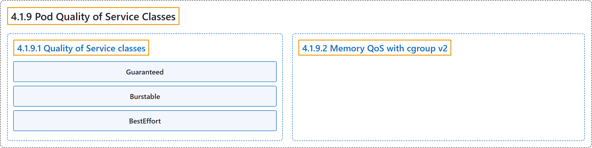

# 4.1.9 Pod Quality of Service Classes

## Classification

## Glossary

| Term | Definition | 中文翻译 | Source |
|---|---|---|---|
| **4.1.9 Pod Quality of Service Classes** Pod 服务质量类 | "Kubernetes **classifies the Pods that you run** and **allocates each Pod into a specific *quality of service (QoS) class***." | Kubernetes **对你运行的 Pod 进行分类**，并**把每个 Pod 归入特定的*服务质量（QoS）类***。 | [The Kubernetes Authors, n.d., "Quality of Service classes", para. 1](https://kubernetes.io/docs/concepts/workloads/pods/pod-qos/#:~:text=Kubernetes%20classifies%20the%20Pods%20that%20you%20run) |
| **4.1.9.1 Quality of Service classes** 服务质量类 | (No definition) | （无定义） | [The Kubernetes Authors, n.d., "Quality of Service classes"](https://kubernetes.io/docs/concepts/workloads/pods/pod-qos/#quality-of-service-classes) |
| **Guaranteed** Guaranteed | "Pods that are `Guaranteed` have **the strictest resource limits** and are **least likely to face eviction**." | `Guaranteed` 的 Pod **资源限制最严格**，**最不可能被驱逐**。 | [The Kubernetes Authors, n.d., "Guaranteed", para. 1](https://kubernetes.io/docs/concepts/workloads/pods/pod-qos/#:~:text=Pods%20that%20are%20%60Guaranteed%60%20have%20the%20strictest) |
| **Burstable** Burstable | "Pods that are `Burstable` have **some lower-bound resource guarantees based on the request**, but **do not require a specific limit**." | `Burstable` 的 Pod **基于请求有一定的资源下限保证**，但**不要求特定的限制**。 | [The Kubernetes Authors, n.d., "Burstable", para. 1](https://kubernetes.io/docs/concepts/workloads/pods/pod-qos/#:~:text=Pods%20that%20are%20%60Burstable%60%20have%20some%20lower-bound) |
| **BestEffort** BestEffort | "Pods in the `BestEffort` QoS class **can use node resources** that **aren't specifically assigned to Pods in other QoS classes**." | `BestEffort` QoS 类中的 Pod **可以使用节点资源**，只要这些资源**未专门分配给其他 QoS 类的 Pod**。 | [The Kubernetes Authors, n.d., "BestEffort", para. 1](https://kubernetes.io/docs/concepts/workloads/pods/pod-qos/#:~:text=Pods%20in%20the%20%60BestEffort%60%20QoS%20class%20can) |
| **4.1.9.2 Memory QoS with cgroup v2** 基于 cgroup v2 的内存 QoS | "**Memory QoS** uses **the memory controller of cgroup v2** to manage **memory throttling and protection** in Kubernetes." | **内存 QoS** 使用 **cgroup v2 的内存控制器**来管理 Kubernetes 中的**内存限流和保护**。 | [The Kubernetes Authors, n.d., "Memory QoS with cgroup v2", para. 1](https://kubernetes.io/docs/concepts/workloads/pods/pod-qos/#:~:text=%5BMemory%20QoS%5D%28https%3A%2F%2Fkubernetes.io%2Fdocs%2Freference%2Fcommand-line-tools-reference%2Ffeature-gates%2F%23memoryqos%29%20uses%20the%20memory%20controller%20of) |

## References

The Kubernetes Authors. (n.d.). *Pod Quality of Service Classes*. Kubernetes Documentation. Retrieved October 31, 2026, from <https://kubernetes.io/docs/concepts/workloads/pods/pod-qos/>
