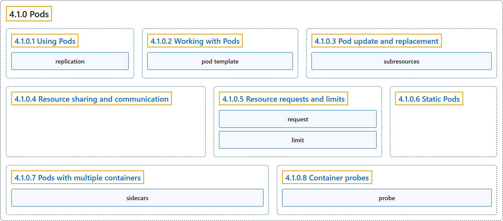

# 4.1.0 Pods

## Classification

## Glossary

| Term | Definition | 中文翻译 | Source |
|---|---|---|---|
| **4.1.0 Pods** Pod | "A *Pod* (as in a pod of whales or pea pod) is **a group of one or more containers**, with **shared storage and network resources**, and **a specification for how to run the containers**." | *Pod*（就像一群鲸鱼或一个豌豆荚）是**一组一个或多个容器**，**共享存储和网络资源**，并带有**如何运行这些容器的规约**。 | [The Kubernetes Authors, n.d., "Pods", para. 2](https://kubernetes.io/docs/concepts/workloads/pods/#:~:text=A%20%2APod%2A%20%28as%20in%20a%20pod%20of) |
| **4.1.0.1 Using Pods** 使用 Pod | (No definition) | （无定义） | [The Kubernetes Authors, n.d., "Using Pods"](https://kubernetes.io/docs/concepts/workloads/pods/#using-pods) |
| **replication** 复制 | (context) "In Kubernetes, this is typically referred to as *replication*." | （语境）在 Kubernetes 中，这通常称为*复制*。 | [The Kubernetes Authors, n.d., "Workload resources for managing pods", para. 2](https://kubernetes.io/docs/concepts/workloads/pods/#:~:text=In%20Kubernetes%2C%20this%20is%20typically%20referred%20to) |
| **4.1.0.2 Working with Pods** 操作 Pod | (No definition) | （无定义） | [The Kubernetes Authors, n.d., "Working with Pods"](https://kubernetes.io/docs/concepts/workloads/pods/#working-with-pods) |
| **pod template** Pod 模板 | (context) "Controllers for workload resources **create Pods from a *pod template*** and **manage those Pods on your behalf**." | （语境）工作负载资源的控制器**根据 *Pod 模板*创建 Pod**，并**代你管理这些 Pod**。 | [The Kubernetes Authors, n.d., "Pod templates", para. 1](https://kubernetes.io/docs/concepts/workloads/pods/#:~:text=Controllers%20for%20%5Bworkload%5D%28https%3A%2F%2Fkubernetes.io%2Fdocs%2Fconcepts%2Fworkloads%2F%29%20resources%20create%20Pods%20from) |
| **4.1.0.3 Pod update and replacement** Pod 的更新与替换 | (No definition) | （无定义） | [The Kubernetes Authors, n.d., "Pod update and replacement"](https://kubernetes.io/docs/concepts/workloads/pods/#pod-update-and-replacement) |
| **subresources** 子资源 | (context) "The above update rules apply to regular pod updates, but **other pod fields** can be **updated through *subresources***." | （语境）上述更新规则适用于常规的 Pod 更新，但**其他 Pod 字段**可以**通过*子资源*更新**。 | [The Kubernetes Authors, n.d., "Pod subresources", para. 1](https://kubernetes.io/docs/concepts/workloads/pods/#:~:text=The%20above%20update%20rules%20apply%20to%20regular) |
| **4.1.0.4 Resource sharing and communication** 资源共享与通信 | "**Pods** enable **data sharing and communication among their constituent containers**." | **Pod** 能让**其中的各容器之间共享数据和通信**。 | [The Kubernetes Authors, n.d., "Resource sharing and communication", para. 1](https://kubernetes.io/docs/concepts/workloads/pods/#:~:text=Pods%20enable%20data%20sharing%20and%20communication%20among) |
| **4.1.0.5 Resource requests and limits** 资源请求与限制 | (No definition) | （无定义） | [The Kubernetes Authors, n.d., "Resource requests and limits"](https://kubernetes.io/docs/concepts/workloads/pods/#resource-requests-and-limits) |
| **request** 请求 | (context) "When you specify the resource *request* for containers in a Pod, **the kube-scheduler uses this information** to **decide which node to place the Pod on**." | （语境）当你为 Pod 中的容器指定资源*请求*时，**kube-scheduler 用这一信息**来**决定把 Pod 放到哪个节点上**。 | [The Kubernetes Authors, n.d., "Resource requests and limits", para. 2](https://kubernetes.io/docs/concepts/workloads/pods/#:~:text=When%20you%20specify%20the%20resource%20%2Arequest%2A%20for) |
| **limit** 限制 | (context) "When you specify a resource *limit* for a container, **the kubelet enforces those limits** so that the running container is **not allowed to use more of that resource than the limit you set**." | （语境）当你为容器指定资源*限制*时，**kubelet 会强制执行这些限制**，使运行中的容器**不能使用超过所设上限的资源**。 | [The Kubernetes Authors, n.d., "Resource requests and limits", para. 2](https://kubernetes.io/docs/concepts/workloads/pods/#:~:text=When%20you%20specify%20a%20resource%20%2Alimit%2A%20for) |
| **4.1.0.6 Static Pods** 静态 Pod | "*Static Pods* are **managed directly by the kubelet daemon on a specific node**, **without the API server observing them**." | *静态 Pod* **由特定节点上的 kubelet 守护进程直接管理**，**API 服务器不会观察它们**。 | [The Kubernetes Authors, n.d., "Static Pods", para. 1](https://kubernetes.io/docs/concepts/workloads/pods/#:~:text=%2AStatic%20Pods%2A%20are%20managed%20directly%20by%20the) |
| **4.1.0.7 Pods with multiple containers** 多容器 Pod | "Pods are designed to **support multiple cooperating processes (as containers)** that **form a cohesive unit of service**." | Pod 的设计**支持多个相互协作的进程（以容器形式）**，它们**组成一个内聚的服务单元**。 | [The Kubernetes Authors, n.d., "Pods with multiple containers", para. 1](https://kubernetes.io/docs/concepts/workloads/pods/#:~:text=Pods%20are%20designed%20to%20support%20multiple%20cooperating) |
| **sidecars** 边车 | (context) "Setting the `Always` restart policy ensures that the containers where you set it are **treated as *sidecars*** that are **kept running during the entire lifetime of the Pod**." | （语境）设置 `Always` 重启策略，可确保设置了它的容器**被视为*边车***，**在 Pod 的整个生命周期内保持运行**。 | [The Kubernetes Authors, n.d., "Pods with multiple containers", para. 9](https://kubernetes.io/docs/concepts/workloads/pods/#:~:text=Setting%20the%20%60Always%60%20restart%20policy%20ensures%20that) |
| **4.1.0.8 Container probes** 容器探针 | (No definition) | （无定义） | [The Kubernetes Authors, n.d., "Container probes"](https://kubernetes.io/docs/concepts/workloads/pods/#container-probes) |
| **probe** 探针 | "A *probe* is **a diagnostic** performed **periodically by the kubelet on a container**." | *探针*是**一种诊断**，**由 kubelet 定期对容器执行**。 | [The Kubernetes Authors, n.d., "Container probes", para. 1](https://kubernetes.io/docs/concepts/workloads/pods/#:~:text=A%20%2Aprobe%2A%20is%20a%20diagnostic%20performed%20periodically) |

## References

The Kubernetes Authors. (n.d.). *Pods*. Kubernetes Documentation. Retrieved October 31, 2026, from <https://kubernetes.io/docs/concepts/workloads/pods/>
