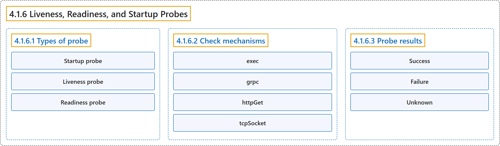

# 4.1.6 Liveness, Readiness, and Startup Probes

## Classification

## Glossary

| Term | Definition | 中文翻译 | Source |
|---|---|---|---|
| **4.1.6 Liveness, Readiness, and Startup Probes** 存活、就绪和启动探针 | "Kubernetes lets you define ***probes*** to **continuously monitor the health of containers** in a Pod." | Kubernetes 让你定义***探针***，**持续监控 Pod 中容器的健康状况**。 | [The Kubernetes Authors, n.d., "Liveness, Readiness, and Startup Probes", para. 1](https://kubernetes.io/docs/concepts/workloads/pods/probes/#:~:text=Kubernetes%20lets%20you%20define%20%2Aprobes%2A%20to%20continuously) |
| **4.1.6.1 Types of probe** 探针类型 | "**The kubelet** can optionally perform and react to **three kinds of probes on running containers**, each serving **a different purpose**:" | **kubelet** 可以选择执行**针对运行中容器的三种探针**并做出响应，每种**用途不同**： | [The Kubernetes Authors, n.d., "Types of probe", para. 1](https://kubernetes.io/docs/concepts/workloads/pods/probes/#:~:text=The%20kubelet%20can%20optionally%20perform%20and%20react) |
| **Startup probe** 启动探针 | "**Startup probes** verify whether **the application within a container is started**." | **启动探针**验证**容器内的应用是否已启动**。 | [The Kubernetes Authors, n.d., "Startup probe", para. 1](https://kubernetes.io/docs/concepts/workloads/pods/probes/#:~:text=Startup%20probes%20verify%20whether%20the%20application%20within) |
| **Liveness probe** 存活探针 | "**Liveness probes** determine **when to restart a container**." | **存活探针**决定**何时重启容器**。 | [The Kubernetes Authors, n.d., "Liveness probe", para. 1](https://kubernetes.io/docs/concepts/workloads/pods/probes/#:~:text=Liveness%20probes%20determine%20when%20to%20restart%20a) |
| **Readiness probe** 就绪探针 | "**Readiness probes** determine **when a container is ready to accept traffic**." | **就绪探针**决定**容器何时准备好接收流量**。 | [The Kubernetes Authors, n.d., "Readiness probe", para. 1](https://kubernetes.io/docs/concepts/workloads/pods/probes/#:~:text=Readiness%20probes%20determine%20when%20a%20container%20is) |
| **4.1.6.2 Check mechanisms** 检查机制 | "There are **four different ways** to **check a container using a probe**." | 有**四种不同的方式**可以**用探针检查容器**。 | [The Kubernetes Authors, n.d., "Check mechanisms", para. 1](https://kubernetes.io/docs/concepts/workloads/pods/probes/#:~:text=There%20are%20four%20different%20ways%20to%20check) |
| **exec** exec | "**Executes a specified command** inside **the container**." | **执行指定的命令**，在**容器**内部进行。 | [The Kubernetes Authors, n.d., "Check mechanisms", para. 3](https://kubernetes.io/docs/concepts/workloads/pods/probes/#:~:text=Executes%20a%20specified%20command%20inside%20the%20container.) |
| **grpc** grpc | "**Performs a remote procedure call** using **gRPC**." | **执行远程过程调用**，使用 **gRPC**。 | [The Kubernetes Authors, n.d., "Check mechanisms", para. 5](https://kubernetes.io/docs/concepts/workloads/pods/probes/#:~:text=Performs%20a%20remote%20procedure%20call%20using%20%5BgRPC%5D%28https%3A%2F%2Fgrpc.io%2F%29.) |
| **httpGet** httpGet | "**Performs an HTTP `GET` request** against **the Pod's IP address** on **a specified port and path**." | **执行 HTTP `GET` 请求**，目标是 **Pod 的 IP 地址**上**指定的端口和路径**。 | [The Kubernetes Authors, n.d., "Check mechanisms", para. 7](https://kubernetes.io/docs/concepts/workloads/pods/probes/#:~:text=Performs%20an%20HTTP%20%60GET%60%20request%20against%20the) |
| **tcpSocket** tcpSocket | "**Performs a TCP check** against **the Pod's IP address** on **a specified port**." | **执行 TCP 检查**，目标是 **Pod 的 IP 地址**上**指定的端口**。 | [The Kubernetes Authors, n.d., "Check mechanisms", para. 9](https://kubernetes.io/docs/concepts/workloads/pods/probes/#:~:text=Performs%20a%20TCP%20check%20against%20the%20Pod%27s) |
| **4.1.6.3 Probe results** 探针结果 | "The kubelet **evaluates the result of each probe execution** and **takes action accordingly**." | kubelet **评估每次探针执行的结果**，并**据此采取行动**。 | [The Kubernetes Authors, n.d., "Probe results", para. 1](https://kubernetes.io/docs/concepts/workloads/pods/probes/#:~:text=The%20kubelet%20evaluates%20the%20result%20of%20each) |
| **Success** Success | "**The container passed the diagnostic.**" | **容器通过了诊断。** | [The Kubernetes Authors, n.d., "Probe results", para. 3](https://kubernetes.io/docs/concepts/workloads/pods/probes/#:~:text=The%20container%20passed%20the%20diagnostic.) |
| **Failure** Failure | "**The container failed the diagnostic.**" | **容器未通过诊断。** | [The Kubernetes Authors, n.d., "Probe results", para. 5](https://kubernetes.io/docs/concepts/workloads/pods/probes/#:~:text=The%20container%20failed%20the%20diagnostic.) |
| **Unknown** Unknown | "**The diagnostic failed** (**no action should be taken**, and **the kubelet will make further checks**)." | **诊断本身失败**（**不应采取任何行动**，**kubelet 会进一步检查**）。 | [The Kubernetes Authors, n.d., "Probe results", para. 7](https://kubernetes.io/docs/concepts/workloads/pods/probes/#:~:text=The%20diagnostic%20failed%20%28no%20action%20should%20be) |

## References

The Kubernetes Authors. (n.d.). *Liveness, Readiness, and Startup Probes*. Kubernetes Documentation. Retrieved October 31, 2026, from <https://kubernetes.io/docs/concepts/workloads/pods/probes/>
