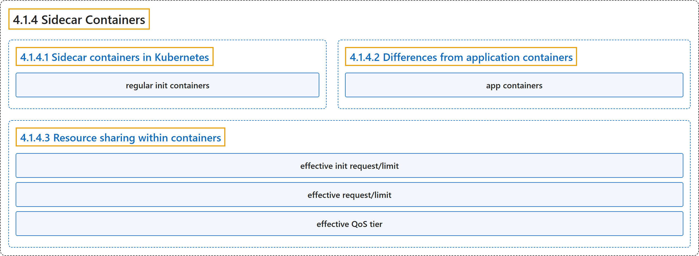

# 4.1.4 Sidecar Containers

## Classification

## Glossary

| Term | Definition | 中文翻译 | Source |
|---|---|---|---|
| **4.1.4 Sidecar Containers** 边车容器 | "Sidecar containers are **the secondary containers that run along with the main application container within the same [Pod](https://kubernetes.io/docs/concepts/workloads/pods/)**." | 边车容器是**在同一个 [Pod](https://kubernetes.io/docs/concepts/workloads/pods/) 中与主应用容器一起运行的辅助容器**。 | [The Kubernetes Authors, n.d., "Sidecar Containers", para. 2](https://kubernetes.io/docs/concepts/workloads/pods/sidecar-containers/#:~:text=Sidecar%20containers%20are%20the%20secondary%20containers%20that) |
| **4.1.4.1 Sidecar containers in Kubernetes** Kubernetes 中的边车容器 | "Kubernetes implements sidecar containers as **a special case of [init containers](https://kubernetes.io/docs/concepts/workloads/pods/init-containers/)**; sidecar containers remain running after Pod startup." | Kubernetes 把边车容器实现为 **[Init 容器](https://kubernetes.io/docs/concepts/workloads/pods/init-containers/)的一种特例**；边车容器在 Pod 启动后继续运行。 | [The Kubernetes Authors, n.d., "Sidecar containers in Kubernetes", para. 1](https://kubernetes.io/docs/concepts/workloads/pods/sidecar-containers/#:~:text=Kubernetes%20implements%20sidecar%20containers%20as%20a%20special) |
| **regular init containers** 常规 Init 容器 | "This document uses the term *regular init containers* to **clearly refer to containers that only run during Pod startup**." | 本文用*常规 Init 容器*这个术语**明确指代只在 Pod 启动期间运行的容器**。 | [The Kubernetes Authors, n.d., "Sidecar containers in Kubernetes", para. 1](https://kubernetes.io/docs/concepts/workloads/pods/sidecar-containers/#:~:text=This%20document%20uses%20the%20term%20%2Aregular%20init) |
| **4.1.4.2 Differences from application containers** 与应用容器的区别 | (No definition) | （无定义） | [The Kubernetes Authors, n.d., "Differences from application containers"](https://kubernetes.io/docs/concepts/workloads/pods/sidecar-containers/#differences-from-application-containers) |
| **app containers** 应用容器 | (context) "Sidecar containers **run alongside *app containers* in the same pod**." | （语境）边车容器**与*应用容器*在同一个 Pod 中并行运行**。 | [The Kubernetes Authors, n.d., "Differences from application containers", para. 1](https://kubernetes.io/docs/concepts/workloads/pods/sidecar-containers/#:~:text=Sidecar%20containers%20run%20alongside%20%2Aapp%20containers%2A%20in) |
| **4.1.4.3 Resource sharing within containers** 容器内的资源共享 | (No definition) | （无定义） | [The Kubernetes Authors, n.d., "Resource sharing within containers"](https://kubernetes.io/docs/concepts/workloads/pods/sidecar-containers/#resource-sharing-within-containers) |
| **effective init request/limit** 有效 Init 请求/限制 | "The highest of any particular resource request or limit defined on all init containers is **the *effective init request/limit***." | 所有 Init 容器上定义的某种资源请求或限制中的最高值，就是**有效 Init 请求/限制**。 | [The Kubernetes Authors, n.d., "Resource sharing within containers", para. 2](https://kubernetes.io/docs/concepts/workloads/pods/sidecar-containers/#:~:text=The%20highest%20of%20any%20particular%20resource%20request) |
| **effective request/limit** 有效请求/限制 | "The Pod's *effective request/limit* for a resource is **the sum of [pod overhead](https://kubernetes.io/docs/concepts/scheduling-eviction/pod-overhead/) and the higher of**:" | Pod 对某种资源的*有效请求/限制*是 **[Pod 开销](https://kubernetes.io/docs/concepts/scheduling-eviction/pod-overhead/)与以下两者较高者之和**： | [The Kubernetes Authors, n.d., "Resource sharing within containers", para. 3](https://kubernetes.io/docs/concepts/workloads/pods/sidecar-containers/#:~:text=The%20Pod%27s%20%2Aeffective%20request%2Flimit%2A%20for%20a%20resource) |
| **effective QoS tier** 有效 QoS 层级 | "The QoS (quality of service) tier of the Pod's *effective QoS tier* is **the QoS tier for all init, sidecar and app containers alike**." | Pod 的*有效 QoS 层级*，**对所有 Init 容器、边车容器和应用容器都同样适用**。 | [The Kubernetes Authors, n.d., "Resource sharing within containers", para. 5](https://kubernetes.io/docs/concepts/workloads/pods/sidecar-containers/#:~:text=The%20QoS%20%28quality%20of%20service%29%20tier%20of) |

## References

The Kubernetes Authors. (n.d.). *Sidecar Containers*. Kubernetes Documentation. Retrieved October 31, 2026, from <https://kubernetes.io/docs/concepts/workloads/pods/sidecar-containers/>
