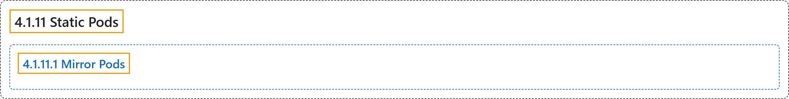

# 4.1.11 Static Pods

## Classification

## Glossary

| Term | Definition | 中文翻译 | Source |
|---|---|---|---|
| **4.1.11 Static Pods** 静态 Pod | "*Static Pods* are **managed directly by the kubelet daemon on a specific node**, **without the API server observing them**." | *静态 Pod* **由特定节点上的 kubelet 守护进程直接管理**，**API 服务器不会观察它们**。 | [The Kubernetes Authors, n.d., "Static Pods", para. 1](https://kubernetes.io/docs/concepts/workloads/pods/static-pods/#:~:text=%2AStatic%20Pods%2A%20are%20managed%20directly%20by%20the) |
| **4.1.11.1 Mirror Pods** 镜像 Pod | "The kubelet automatically tries to **create a mirror Pod on the Kubernetes API server** for **each static Pod**." | kubelet 会自动尝试**在 Kubernetes API 服务器上创建一个镜像 Pod**，对应**每个静态 Pod**。 | [The Kubernetes Authors, n.d., "Mirror Pods", para. 1](https://kubernetes.io/docs/concepts/workloads/pods/static-pods/#:~:text=The%20kubelet%20automatically%20tries%20to%20create%20a) |

## References

The Kubernetes Authors. (n.d.). *Static Pods*. Kubernetes Documentation. Retrieved October 31, 2026, from <https://kubernetes.io/docs/concepts/workloads/pods/static-pods/>
