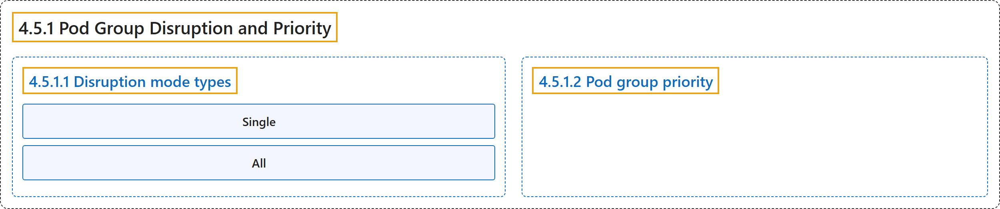

# 4.5.1 Pod Group Disruption and Priority

## Classification

## Glossary

| Term | Definition | 中文翻译 | Source |
|---|---|---|---|
| **4.5.1 Pod Group Disruption and Priority** Pod 组的干扰与优先级 | (No definition) | （无定义） | [The Kubernetes Authors, n.d., "Pod Group Disruption and Priority"](https://kubernetes.io/docs/concepts/workloads/workload-api/disruption-and-priority/#pod-group-disruption-and-priority) |
| **4.5.1.1 Disruption mode types** 干扰模式类型 | (No definition) | （无定义） | [The Kubernetes Authors, n.d., "Disruption mode types"](https://kubernetes.io/docs/concepts/workloads/workload-api/disruption-and-priority/#disruption-mode-types) |
| **Single** Single | "The `Single` mode **instructs the scheduler to treat all Pods in the group as separate entities**, allowing independent disruption of a single pod from a PodGroup." | `Single` 模式**让调度器把组内所有 Pod 视为相互独立的实体**，允许单独干扰 PodGroup 中的某一个 Pod。 | [The Kubernetes Authors, n.d., "Single", para. 1](https://kubernetes.io/docs/concepts/workloads/workload-api/disruption-and-priority/#:~:text=The%20%60Single%60%20mode%20instructs%20the%20scheduler%20to) |
| **All** All | "The `All` mode **emphasizes "all-or-nothing" semantics for disruption**." | `All` 模式**强调干扰的“全有或全无”语义**。 | [The Kubernetes Authors, n.d., "All", para. 1](https://kubernetes.io/docs/concepts/workloads/workload-api/disruption-and-priority/#:~:text=The%20%60All%60%20mode%20emphasizes%20%22all-or-nothing%22%20semantics%20for) |
| **4.5.1.2 Pod group priority** Pod 组优先级 | "PodGroup **uses the same concept of [PriorityClass](https://kubernetes.io/docs/concepts/scheduling-eviction/pod-priority-preemption/#priorityclass) as single Pods**." | PodGroup **使用与单个 Pod 相同的 [PriorityClass](https://kubernetes.io/docs/concepts/scheduling-eviction/pod-priority-preemption/#priorityclass) 概念**。 | [The Kubernetes Authors, n.d., "Pod group priority", para. 1](https://kubernetes.io/docs/concepts/workloads/workload-api/disruption-and-priority/#:~:text=PodGroup%20uses%20the%20same%20concept%20of%20%5BPriorityClass%5D%28https%3A%2F%2Fkubernetes.io%2Fdocs%2Fconcepts%2Fscheduling-eviction%2Fpod-priority-preemption%2F%23priorityclass%29) |

## References

The Kubernetes Authors. (n.d.). *Pod Group Disruption and Priority*. Kubernetes Documentation. Retrieved October 31, 2026, from <https://kubernetes.io/docs/concepts/workloads/workload-api/disruption-and-priority/>
