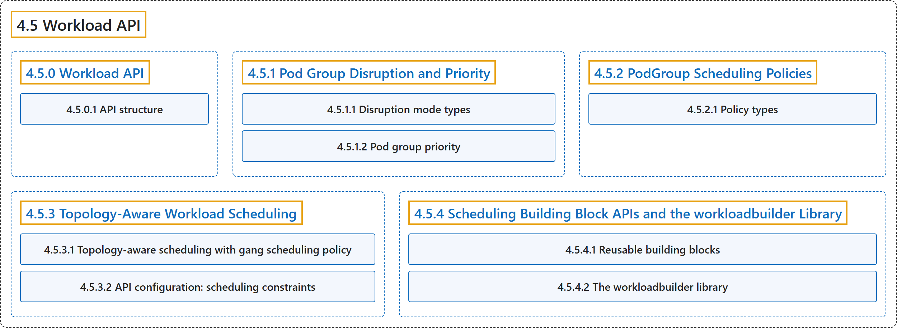

# 4.5 Workload API

## Classification

## Glossary

| Term | Definition | 中文翻译 | Source |
|---|---|---|---|
| **4.5 Workload API** Workload API | (context) "A `Workload` is **a static, long-lived policy template**." | （语境）`Workload` 是**一个静态、长期存在的策略模板**。 | [The Kubernetes Authors, n.d.-e, "What is a Workload?", para. 2](https://kubernetes.io/docs/concepts/workloads/workload-api/#:~:text=A%20%60Workload%60%20is%20a%20static%2C%20long-lived%20policy) |
| **[4.5.0 Workload API](workload-api.md)** Workload API | (context) "A `Workload` is **a static, long-lived policy template**." | （语境）`Workload` 是**一个静态、长期存在的策略模板**。 | [The Kubernetes Authors, n.d.-e, "What is a Workload?", para. 2](https://kubernetes.io/docs/concepts/workloads/workload-api/#:~:text=A%20%60Workload%60%20is%20a%20static%2C%20long-lived%20policy) |
| **[4.5.1 Pod Group Disruption and Priority](disruption-and-priority.md)** Pod 组的干扰与优先级 | (No definition) | （无定义） | [The Kubernetes Authors, n.d.-a, "Pod Group Disruption and Priority"](https://kubernetes.io/docs/concepts/workloads/workload-api/disruption-and-priority/#pod-group-disruption-and-priority) |
| **[4.5.2 PodGroup Scheduling Policies](policies.md)** PodGroup 调度策略 | (No definition) | （无定义） | [The Kubernetes Authors, n.d.-b, "PodGroup Scheduling Policies"](https://kubernetes.io/docs/concepts/workloads/workload-api/policies/#podgroup-scheduling-policies) |
| **[4.5.3 Topology-Aware Workload Scheduling](topology-aware-scheduling.md)** 拓扑感知工作负载调度 | "*Topology-Aware Scheduling* (TAS) is **a feature of the Workload API that optimizes the placement of pods within the cluster**." | *拓扑感知调度*（TAS）是 **Workload API 的一项功能，用于优化 Pod 在集群中的放置**。 | [The Kubernetes Authors, n.d.-d, "Topology-Aware Workload Scheduling", para. 3](https://kubernetes.io/docs/concepts/workloads/workload-api/topology-aware-scheduling/#:~:text=%2ATopology-Aware%20Scheduling%2A%20%28TAS%29%20is%20a%20feature%20of) |
| **[4.5.4 Scheduling Building Block APIs and the workloadbuilder Library](workloadbuilder.md)** 调度构建块 API 与 workloadbuilder 库 | "Workload-aware Scheduling defines **a set of reusable API *building blocks*** under the `scheduling.k8s.io` [API group](https://kubernetes.io/docs/concepts/overview/kubernetes-api/#api-groups-and-versioning)." | 工作负载感知调度在 `scheduling.k8s.io` [API 组](https://kubernetes.io/docs/concepts/overview/kubernetes-api/#api-groups-and-versioning)下定义了**一组可复用的 API *构建块***。 | [The Kubernetes Authors, n.d.-c, "Scheduling Building Block APIs and the workloadbuilder Library", para. 4](https://kubernetes.io/docs/concepts/workloads/workload-api/workloadbuilder/#:~:text=Workload-aware%20Scheduling%20defines%20a%20set%20of%20reusable) |

## References

The Kubernetes Authors. (n.d.-a). *Pod Group Disruption and Priority*. Kubernetes Documentation. Retrieved October 31, 2026, from <https://kubernetes.io/docs/concepts/workloads/workload-api/disruption-and-priority/>

The Kubernetes Authors. (n.d.-b). *PodGroup Scheduling Policies*. Kubernetes Documentation. Retrieved October 31, 2026, from <https://kubernetes.io/docs/concepts/workloads/workload-api/policies/>

The Kubernetes Authors. (n.d.-c). *Scheduling Building Block APIs and the workloadbuilder Library*. Kubernetes Documentation. Retrieved October 31, 2026, from <https://kubernetes.io/docs/concepts/workloads/workload-api/workloadbuilder/>

The Kubernetes Authors. (n.d.-d). *Topology-Aware Workload Scheduling*. Kubernetes Documentation. Retrieved October 31, 2026, from <https://kubernetes.io/docs/concepts/workloads/workload-api/topology-aware-scheduling/>

The Kubernetes Authors. (n.d.-e). *Workload API*. Kubernetes Documentation. Retrieved October 31, 2026, from <https://kubernetes.io/docs/concepts/workloads/workload-api/>
