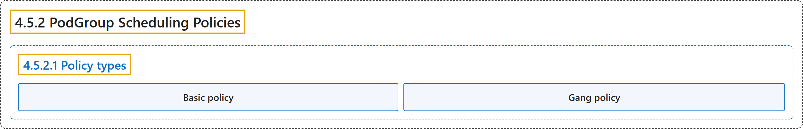

# 4.5.2 PodGroup Scheduling Policies

## Classification

## Glossary

| Term | Definition | 中文翻译 | Source |
|---|---|---|---|
| **4.5.2 PodGroup Scheduling Policies** PodGroup 调度策略 | (No definition) | （无定义） | [The Kubernetes Authors, n.d., "PodGroup Scheduling Policies"](https://kubernetes.io/docs/concepts/workloads/workload-api/policies/#podgroup-scheduling-policies) |
| **4.5.2.1 Policy types** 策略类型 | "The `schedulingPolicy` field **supports two policy types**:" | `schedulingPolicy` 字段**支持两种策略类型**： | [The Kubernetes Authors, n.d., "Policy types", para. 1](https://kubernetes.io/docs/concepts/workloads/workload-api/policies/#:~:text=The%20%60schedulingPolicy%60%20field%20supports%20two%20policy%20types%3A) |
| **Basic policy** basic 策略 | "The `basic` policy **instructs the scheduler to evaluate all Pods on a best-effort basis**." | `basic` 策略**让调度器以尽力而为的方式评估所有 Pod**。 | [The Kubernetes Authors, n.d., "Basic policy", para. 1](https://kubernetes.io/docs/concepts/workloads/workload-api/policies/#:~:text=The%20%60basic%60%20policy%20instructs%20the%20scheduler%20to) |
| **Gang policy** gang 策略 | "The `gang` policy **enforces "all-or-nothing" scheduling**." | `gang` 策略**强制执行“全有或全无”的调度**。 | [The Kubernetes Authors, n.d., "Gang policy", para. 1](https://kubernetes.io/docs/concepts/workloads/workload-api/policies/#:~:text=The%20%60gang%60%20policy%20enforces%20%22all-or-nothing%22%20scheduling.) |

## References

The Kubernetes Authors. (n.d.). *PodGroup Scheduling Policies*. Kubernetes Documentation. Retrieved October 31, 2026, from <https://kubernetes.io/docs/concepts/workloads/workload-api/policies/>
