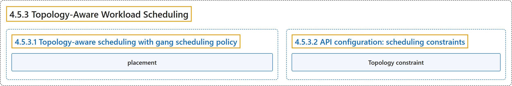

# 4.5.3 Topology-Aware Workload Scheduling

## Classification

## Glossary

| Term | Definition | 中文翻译 | Source |
|---|---|---|---|
| **4.5.3 Topology-Aware Workload Scheduling** 拓扑感知工作负载调度 | "*Topology-Aware Scheduling* (TAS) is **a feature of the Workload API that optimizes the placement of pods within the cluster**." | *拓扑感知调度*（TAS）是 **Workload API 的一项功能，用于优化 Pod 在集群中的放置**。 | [The Kubernetes Authors, n.d., "Topology-Aware Workload Scheduling", para. 3](https://kubernetes.io/docs/concepts/workloads/workload-api/topology-aware-scheduling/#:~:text=%2ATopology-Aware%20Scheduling%2A%20%28TAS%29%20is%20a%20feature%20of) |
| **4.5.3.1 Topology-aware scheduling with gang scheduling policy** 结合 gang 调度策略的拓扑感知调度 | (No definition) | （无定义） | [The Kubernetes Authors, n.d., "Topology-aware scheduling with gang scheduling policy"](https://kubernetes.io/docs/concepts/workloads/workload-api/topology-aware-scheduling/#topology-aware-scheduling-with-gang-scheduling-policy) |
| **placement** 放置 | "When applied to PodGroups with `gang` scheduling policy, **TAS simulates the potential assignment (*placement*) of the full group of pods at once**." | 应用于采用 `gang` 调度策略的 PodGroup 时，**TAS 一次性模拟整组 Pod 的潜在分配（*放置*）**。 | [The Kubernetes Authors, n.d., "Topology-aware scheduling with gang scheduling policy", para. 1](https://kubernetes.io/docs/concepts/workloads/workload-api/topology-aware-scheduling/#:~:text=When%20applied%20to%20PodGroups%20with%20%60gang%60%20scheduling) |
| **4.5.3.2 API configuration: scheduling constraints** API 配置：调度约束 | (No definition) | （无定义） | [The Kubernetes Authors, n.d., "API configuration: scheduling constraints"](https://kubernetes.io/docs/concepts/workloads/workload-api/topology-aware-scheduling/#api-configuration-scheduling-constraints) |
| **Topology constraint** 拓扑约束 | (context) "To define a topology constraint for a PodGroup you need to **set a `key`, which corresponds to a Kubernetes node label, representing the target topology domain** (for example, a rack or a zone)." | （语境）要为 PodGroup 定义拓扑约束，你需要**设置一个 `key`，它对应一个 Kubernetes 节点标签，代表目标拓扑域**（例如机架或可用区）。 | [The Kubernetes Authors, n.d., "Topology constraint", para. 1](https://kubernetes.io/docs/concepts/workloads/workload-api/topology-aware-scheduling/#:~:text=To%20define%20a%20topology%20constraint%20for%20a) |

## References

The Kubernetes Authors. (n.d.). *Topology-Aware Workload Scheduling*. Kubernetes Documentation. Retrieved October 31, 2026, from <https://kubernetes.io/docs/concepts/workloads/workload-api/topology-aware-scheduling/>
