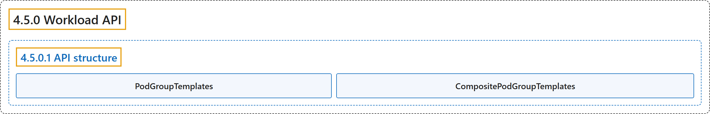

# 4.5.0 Workload API

## Classification

## Glossary

| Term | Definition | 中文翻译 | Source |
|---|---|---|---|
| **4.5.0 Workload API** Workload API | (context) "A `Workload` is **a static, long-lived policy template**." | （语境）`Workload` 是**一个静态、长期存在的策略模板**。 | [The Kubernetes Authors, n.d., "What is a Workload?", para. 2](https://kubernetes.io/docs/concepts/workloads/workload-api/#:~:text=A%20%60Workload%60%20is%20a%20static%2C%20long-lived%20policy) |
| **4.5.0.1 API structure** API 结构 | "A `Workload` consists of **two fields: a list of `PodGroupTemplates` and an optional controller reference**." | `Workload` 由**两个字段组成：一个 `PodGroupTemplates` 列表和一个可选的控制器引用**。 | [The Kubernetes Authors, n.d., "API structure", para. 1](https://kubernetes.io/docs/concepts/workloads/workload-api/#:~:text=A%20%60Workload%60%20consists%20of%20two%20fields%3A%20a) |
| **PodGroupTemplates** PodGroupTemplates | "The `spec.podGroupTemplates` list **defines the distinct components of your workload**." | `spec.podGroupTemplates` 列表**定义工作负载的各个组成部分**。 | [The Kubernetes Authors, n.d., "PodGroupTemplates", para. 1](https://kubernetes.io/docs/concepts/workloads/workload-api/#:~:text=The%20%60spec.podGroupTemplates%60%20list%20defines%20the%20distinct%20components) |
| **CompositePodGroupTemplates** CompositePodGroupTemplates | "The `spec.compositePodGroupTemplates` field **defines non-leaf templates in a group-template hierarchy tree**." | `spec.compositePodGroupTemplates` 字段**定义组模板层次树中的非叶模板**。 | [The Kubernetes Authors, n.d., "Structure and constraints", para. 1](https://kubernetes.io/docs/concepts/workloads/workload-api/#:~:text=The%20%60spec.compositePodGroupTemplates%60%20field%20defines%20non-leaf%20templates%20in) |

## References

The Kubernetes Authors. (n.d.). *Workload API*. Kubernetes Documentation. Retrieved October 31, 2026, from <https://kubernetes.io/docs/concepts/workloads/workload-api/>
