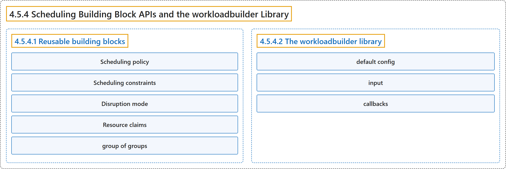

# 4.5.4 Scheduling Building Block APIs and the workloadbuilder Library

## Classification

## Glossary

| Term | Definition | 中文翻译 | Source |
|---|---|---|---|
| **4.5.4 Scheduling Building Block APIs and the workloadbuilder Library** 调度构建块 API 与 workloadbuilder 库 | "Workload-aware Scheduling defines **a set of reusable API *building blocks*** under the `scheduling.k8s.io` [API group](https://kubernetes.io/docs/concepts/overview/kubernetes-api/#api-groups-and-versioning)." | 工作负载感知调度在 `scheduling.k8s.io` [API 组](https://kubernetes.io/docs/concepts/overview/kubernetes-api/#api-groups-and-versioning)下定义了**一组可复用的 API *构建块***。 | [The Kubernetes Authors, n.d., "Scheduling Building Block APIs and the workloadbuilder Library", para. 4](https://kubernetes.io/docs/concepts/workloads/workload-api/workloadbuilder/#:~:text=Workload-aware%20Scheduling%20defines%20a%20set%20of%20reusable) |
| **4.5.4.1 Reusable building blocks** 可复用的构建块 | "The building blocks are **strongly-typed Go structs in the `scheduling.k8s.io/v1alpha3` API group**." | 这些构建块是 **`scheduling.k8s.io/v1alpha3` API 组中的强类型 Go 结构体**。 | [The Kubernetes Authors, n.d., "Reusable building blocks", para. 1](https://kubernetes.io/docs/concepts/workloads/workload-api/workloadbuilder/#:~:text=The%20building%20blocks%20are%20strongly-typed%20Go%20structs) |
| **Scheduling policy** 调度策略 | "The scheduling policy block **carries the same `basic` and `gang` policies as a PodGroup's `spec.schedulingPolicy`**." | 调度策略块**携带与 PodGroup 的 `spec.schedulingPolicy` 相同的 `basic` 和 `gang` 策略**。 | [The Kubernetes Authors, n.d., "Scheduling policy", para. 1](https://kubernetes.io/docs/concepts/workloads/workload-api/workloadbuilder/#:~:text=The%20scheduling%20policy%20block%20carries%20the%20same) |
| **Scheduling constraints** 调度约束 | "The scheduling constraints block **carries the topology constraints documented in [Topology-aware workload scheduling](https://kubernetes.io/docs/concepts/workloads/workload-api/topology-aware-scheduling/)**" | 调度约束块**携带[拓扑感知工作负载调度](https://kubernetes.io/docs/concepts/workloads/workload-api/topology-aware-scheduling/)中记载的拓扑约束** | [The Kubernetes Authors, n.d., "Scheduling constraints", para. 1](https://kubernetes.io/docs/concepts/workloads/workload-api/workloadbuilder/#:~:text=The%20scheduling%20constraints%20block%20carries%20the%20topology) |
| **Disruption mode** 干扰模式 | "The disruption mode block **selects whether the group's Pods may be disrupted individually (`single`) or only as a unit (`all`)**" | 干扰模式块**选择组内 Pod 是可以单独被干扰（`single`），还是只能作为整体被干扰（`all`）** | [The Kubernetes Authors, n.d., "Disruption mode", para. 1](https://kubernetes.io/docs/concepts/workloads/workload-api/workloadbuilder/#:~:text=The%20disruption%20mode%20block%20selects%20whether%20the) |
| **Resource claims** 资源申领 | "The resource claims block **expresses which [dynamic resource allocation](https://kubernetes.io/docs/concepts/scheduling-eviction/dynamic-resource-allocation/) claims are shared by every Pod in the group rather than allocated per Pod**." | 资源申领块**表示哪些[动态资源分配](https://kubernetes.io/docs/concepts/scheduling-eviction/dynamic-resource-allocation/)申领由组内每个 Pod 共享，而不是按 Pod 分别分配**。 | [The Kubernetes Authors, n.d., "Resource claims", para. 1](https://kubernetes.io/docs/concepts/workloads/workload-api/workloadbuilder/#:~:text=The%20resource%20claims%20block%20expresses%20which%20%5Bdynamic) |
| **group of groups** 组的组 | (context) "Multi-level controllers that orchestrate other controllers (for example, JobSet creating Jobs) **coordinate a *group of groups***." | （语境）编排其他控制器的多级控制器（例如创建 Job 的 JobSet）**协调一个*组的组***。 | [The Kubernetes Authors, n.d., "Composite building blocks", para. 1](https://kubernetes.io/docs/concepts/workloads/workload-api/workloadbuilder/#:~:text=Multi-level%20controllers%20that%20orchestrate%20other%20controllers%20%28for) |
| **4.5.4.2 The workloadbuilder library** workloadbuilder 库 | "`workloadbuilder` is **a shared Go library that turns a controller's scheduling intent into the scheduler-facing Workload and its runtime PodGroup/CompositePodGroup objects**" | `workloadbuilder` 是**一个共享的 Go 库，把控制器的调度意图转换为面向调度器的 Workload 及其运行时 PodGroup/CompositePodGroup 对象** | [The Kubernetes Authors, n.d., "The workloadbuilder library", para. 1](https://kubernetes.io/docs/concepts/workloads/workload-api/workloadbuilder/#:~:text=%60workloadbuilder%60%20is%20a%20shared%20Go%20library%20that) |
| **default config** 默认配置 | "a *default config*, **the controller's own defaults for anything the user leaves unset**." | *默认配置*：**控制器为用户未设置的任何内容提供的自身默认值**。 | [The Kubernetes Authors, n.d., "How a controller uses it", para. 2](https://kubernetes.io/docs/concepts/workloads/workload-api/workloadbuilder/#:~:text=a%20%2Adefault%20config%2A%2C%20the%20controller%27s%20own%20defaults) |
| **input** 输入 | "an *input*, **the user's intent taken from the controller's API**." | *输入*：**从控制器 API 中取得的用户意图**。 | [The Kubernetes Authors, n.d., "How a controller uses it", para. 3](https://kubernetes.io/docs/concepts/workloads/workload-api/workloadbuilder/#:~:text=an%20%2Ainput%2A%2C%20the%20user%27s%20intent%20taken%20from) |
| **callbacks** 回调 | "optional *callbacks*, **which adjust the merged configuration**." | 可选的*回调*：**用于调整合并后的配置**。 | [The Kubernetes Authors, n.d., "How a controller uses it", para. 4](https://kubernetes.io/docs/concepts/workloads/workload-api/workloadbuilder/#:~:text=optional%20%2Acallbacks%2A%2C%20which%20adjust%20the%20merged%20configuration.) |

## References

The Kubernetes Authors. (n.d.). *Scheduling Building Block APIs and the workloadbuilder Library*. Kubernetes Documentation. Retrieved October 31, 2026, from <https://kubernetes.io/docs/concepts/workloads/workload-api/workloadbuilder/>
