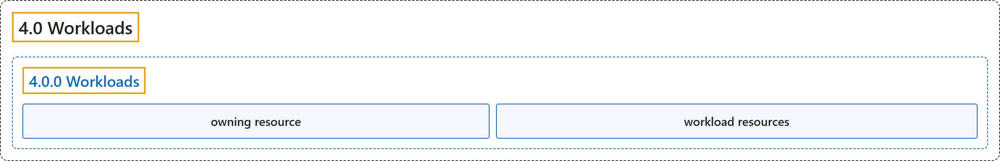

# 4.0 Workloads

## Classification

## Glossary

| Term | Definition | 中文翻译 | Source |
|---|---|---|---|
| **4.0 Workloads** 工作负载 | "**A workload** is **an application running on Kubernetes**." | **工作负载**是**运行在 Kubernetes 上的应用程序**。 | [The Kubernetes Authors, n.d., "Workloads", para. 2](https://kubernetes.io/docs/concepts/workloads/#:~:text=A%20workload%20is%20an%20application%20running%20on%20Kubernetes) |
| **4.0.0 Workloads** 工作负载 | (No definition) | （无定义） | [The Kubernetes Authors, n.d., "Workloads"](https://kubernetes.io/docs/concepts/workloads/#workloads) |
| **owning resource** 属主资源 | (context) "**tidies up objects from your cluster** after **their *owning resource* has been removed**." | （语境）**从集群中清理对象**，在**其*属主资源*被移除**后。 | [The Kubernetes Authors, n.d., "What's next", para. 7](https://kubernetes.io/docs/concepts/workloads/#:~:text=tidies%20up%20objects%20from%20your%20cluster%20after) |
| **workload resources** 工作负载资源 | (context) "Instead, you can use ***workload resources*** that **manage a set of pods on your behalf**." | （语境）你可以改用***工作负载资源***，由它们**代你管理一组 Pod**。 | [The Kubernetes Authors, n.d., "Workloads", para. 4](https://kubernetes.io/docs/concepts/workloads/#:~:text=Instead%2C%20you%20can%20use%20%2Aworkload%20resources%2A%20that) |

## References

The Kubernetes Authors. (n.d.). *Workloads*. Kubernetes Documentation. Retrieved October 31, 2026, from <https://kubernetes.io/docs/concepts/workloads/>
